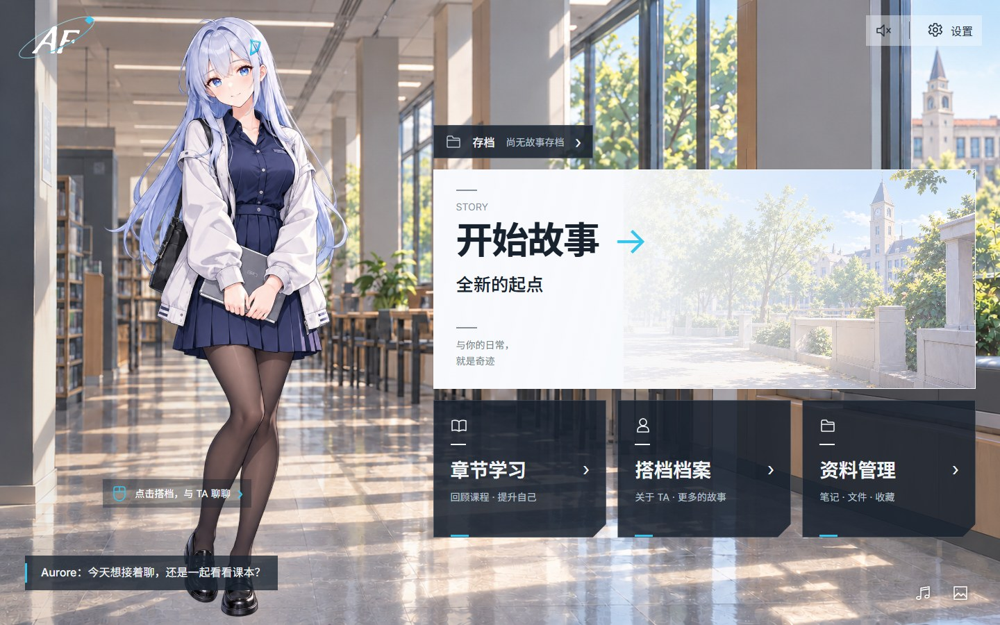
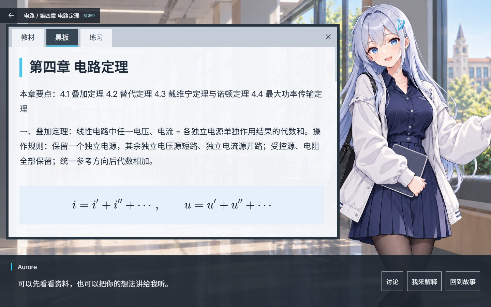
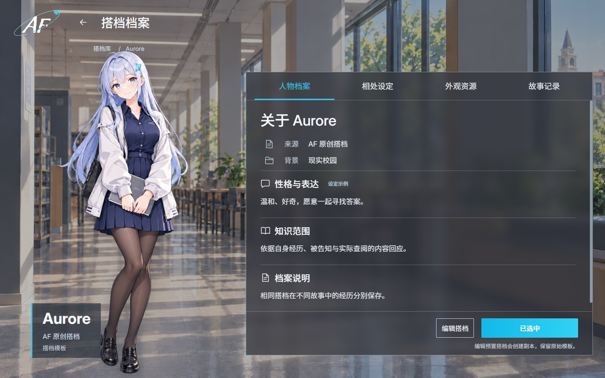
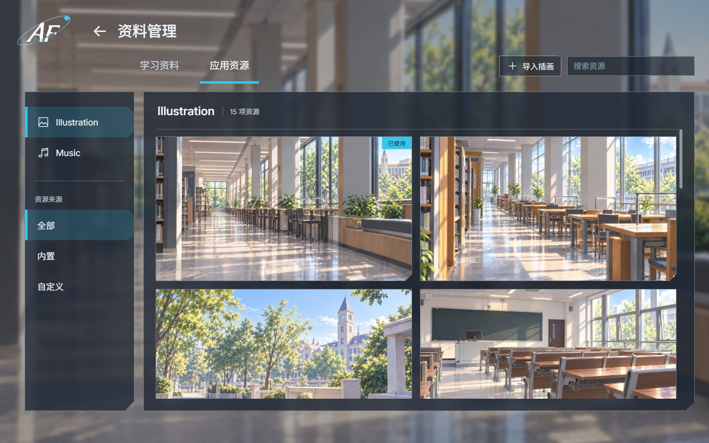

# Aurora Forge / AF

**在互动中自然学习。**

Aurora Forge 是一款将搭档互动、视觉小说和本地资料学习结合起来的桌面应用。你可以选择或创建搭档，在日常故事中相处，也可以带着自己的课件、教材与试题进入章节学习。

目前处于 **0.1.0 开发阶段**，已接通资料管理、首页聊天、主线演出与章节学习的核心流程，尚未发布可安装版本。



> 本页配图来自实际 Electron 界面。故事和课程使用演示材料，不包含真实个人资料；配图说明见 [截图记录](docs/assets/readme/README.md)。

[快速开始](#快速开始) · [功能展示](#功能展示) · [开发与验证](#开发与验证) · [当前边界](#当前边界) · [设计与协作规范](#设计与协作规范)

## 功能展示

### 日常主线：和搭档一起展开故事

选择搭档、世界背景、双方身份和关系起点后，创建一份独立存档。角色保持自己的性格与知识边界，以有限立绘、场景和对白呈现日常互动。


- 正常开始前准备当前一幕的完整确定路径，遇到选择时等待真实用户决定。
- 对白默认每秒四字，可调为三至五字；旁白、用户发言和公式完整呈现。
- 空格或点击先补全当前页，再次操作才推进；自动播放不会替用户选择。
- 可以随时插话、查看历史、保存进度或进入学习。插话后使旧未播尾部失效，按有效缓冲门槛恢复，并继续补齐新幕。
- 只将已接受输入和实际呈现的文字纳入经历，未播放草稿不提前成为共同记忆。

存档支持创建、激活、重命名、删除、持久保存和只读回看。不同存档保留独立角色快照，之后修改搭档模板不会改写已有故事。

### 章节学习：从自己的资料出发

导入文档后按科目与章节组织，搭档仍在场，教材、黑板与练习按需展开。可以查看原文、自由讨论，或将自己的理解讲出来。



即使只提供章节标题或目录，也可以结合通用学科知识生成概念、条件、推导、例题、易错点和总结。上传资料摘录与补充教学在后台分别标记，不给补充内容编造课件页码或出处；黑板正文展示知识，参考资料按需展开。

练习支持单选、多选、判断、文本、数值与单位，以及主观解释和推导。题目、参考答案与评分要点在展示前冻结，再由独立任务核验；提示、解析和作答复核分别留有记录。阅读进度、作答情况和掌握证据分开统计，显示过讲解不等于已经掌握。

学习面板、未提交答案、讨论草稿和返回主线的位置会保存。公式使用随应用提供的 KaTeX 与数学字体；程序区分排版成功、数值／单位核对与尚不能确定的数学结论。

### 搭档档案：创建属于自己的搭档



内置默认搭档 **Aurore**，也支持创建、复制、编辑、导入和管理自定义搭档。姓名、人格、身份、称谓、知识范围与外观资源分别配置。

立绘标签可以新增、改名和删除，不固定为六种表情；可指定默认立绘，用于首页及缺图回退。Aurore 自带六张已确认的透明全身立绘，演出按情境切换，不使用实时生成立绘或角色配音。

点击首页人物可展开左下聊天栏。**首页聊天有自己的历史与上下文**，只与主线共享人格、章节标题和少量场景摘记，不直接续演存档，也不将首页发言写进主线末句或剧情历史。

### 资料与资源管理：文件、插画和音乐各有所属



| 学习资料 | 应用资源 |
|---|---|
| DOC、DOCX、PPT、PPTX、PDF、Markdown、TXT | Illustration 场景插画与 Music 音乐 |
| 选择文件或文件夹、指纹去重、解析与原文预览 | 导入自定义背景与 BGM、实际媒体预览 |
| 按内容发现科目，再与已有类别做语义归并 | 设置首页背景、调整画面位置、选曲与试听 |
| 手动调整分类、教材与章节，保留明确的用户分类 | 内置素材保留，自定义资源可管理和移除 |

类别不依赖预设科目表。课件和教材可按课程归类，论文可按研究主题整理；同义名称可归并，手动分类不会被后台重扫覆盖。

默认每批整理 **20 份资料**，在“设置 → 资料与来源”可调整为 **1–100 份**。一次选择更多文件时，剩余资料自动分批排队；内部仍采用受限的小组发现与跨批归并，不把全部文件塞进一次模型请求。

PDF 使用本地 PDF.js 显示原页；DOCX／PPTX 提供实际内容和图片预览；DOC／PPT 通过 AF 管理的 Office 转换组件处理，扫描 PDF 使用本地中英文 OCR。Office 内容预览不承诺复原原始版式，公式转录仍需结合原页核对。

关联文件夹支持授权、增量检查、改版处理和解除关联。导入保存受管副本，不移动或覆盖原文件；单个文件失败不会撤销整批已完成内容。

## 快速开始

### 1. 准备开发环境

当前完整文档处理组件以 **Windows x64** 为开发验证基线，使用 **Node.js 24 或更高版本**与 npm。其他系统尚未完成完整功能及发行验证。

```powershell
git clone https://github.com/quarkes1/AF.git
cd AF
npm ci
npm run runtime:documents
npm run dev
```

`runtime:documents` 下载并校验固定版本的 Office 转换与中英文 OCR 组件，Office 下载约 356 MiB；首次准备需要联网。来源、版本及哈希见 [文档运行组件配置](config/document-runtime.json)。

编译后运行桌面预览：

```powershell
npm run build
npm run preview
```

`preview` 使用已有构建，修改源码后请重新构建。运行前完整退出旧 AF 窗口，避免单实例机制切回旧版本。

### 2. 配置模型

在“设置 → 模型与预算”填写服务地址、模型和 API key，并测试连接。默认使用 DeepSeek 的 `deepseek-flash`，也可配置其他兼容 OpenAI Chat Completions 协议的服务。

凭据由主进程通过系统加密保存在应用数据目录，不写进角色模板、前端偏好或故事内容。在线模型需要网络与相应服务的有效额度。

### 3. 开始使用

1. 在“搭档档案”选择 Aurore，或创建自己的搭档。
2. 在“存档”新建故事，确认身份与背景，点击“继续故事”进入主线。
3. 在“资料管理”导入文件，完成解析、分类并核对教材或选择跳过。
4. 从首页或主线进入“章节学习”，选择科目和章节，阅读、讨论或作答。
5. 返回主线继续互动，或在首页进行独立聊天。

没有资料时不会生成虚构课程；未配置模型时可以管理已有本地内容，但不会伪造新模型回复。

## 本地数据与模型边界

本地保存不等于离线推理。文档副本、解析结果、模板、存档、已呈现历史和学习记录存于 AF 用户数据目录，主进程通过 SQLite 管理；在线功能会向用户配置的模型服务发送完成当前任务所需的文本。

不同功能使用独立的原生 dsh 会话和受限工具：

| 功能 | 可用上下文 |
|---|---|
| 资料整理 | 本次授权资料片段、文件名及类别目录 |
| 首页聊天 | 冻结人格、首页自身历史和有限场景摘记 |
| 主线编写 | 本档角色、身份、已呈现主线／学习经历及有效草稿前缀 |
| 教学与核验 | 当前章节资料、问题及相应冻结题目／评分要点 |

资料不会直接成为角色已经知道的内容，专业解答也不冒充搭档原本就会。执行任务带有取消、超时、版本和预算校验，切档或旧结果迟到时不能覆盖新档。

资料工具不提供任意 shell、文件系统或外部消息发送能力。核心运行组件由 AF 管理，最终发行目标是用户只安装 AF；当前源码开发仍需上述工具准备，不能将源码预览视为自包含安装包已经验收。

## 开发与验证

技术栈：Electron、electron-vite、React、TypeScript、SQLite、dsh 原生 Agent／Session／Tool／Skill、PDF.js、KaTeX、LibreOffice 与 Tesseract。

```powershell
npm run typecheck
npm test
npm run check:assets
npm run check:boundaries
npm run build
npm run test:e2e
```

端到端测试需要先构建，使用隔离的测试数据目录。部分可重复模型场景在独立复制的测试应用中使用明确标记的离线工作器；真实模型联调另行执行，两者不能互相替代。测试记录见 [主线与学习接入](docs/decisions/2026-10-31-story-learning.md) 和 [本轮验收修复](docs/decisions/2026-10-31-review-fixes.md)。

<details>
<summary>界面演示与专项检查命令</summary>

| 命令 | 用途 |
|---|---|
| `npm run title:review -- day` | 固定白天标题栏；也支持 `dusk`、`night` |
| `npm run save:review` | 存档列表与保存点的显式演示数据 |
| `npm run learning:review` | 演示课程、目录、正文与练习，不记录真实学习证据 |
| `npm run companion:review` | 多搭档、编辑和横向滚动演示 |
| `npm run dev:browser` | 浏览器辅助界面预览，不提供完整桌面后端 |
| `npm run test:title-review` | 时段、动画分层及背景失败回退检查 |
| `npm run assets:icons` | 从已确认原图生成应用图标 |

演示模式不代表真实模型、存档或学习能力验收。会重建产物的命令应顺序运行，不与正在进行的桌面回归同时执行。

</details>

## 当前边界

当前已接通核心交互，仍在继续开发。以下功能尚未完成，不应从界面预留入口推定可用：

- 从旧保存点覆盖恢复、派生分支与完整故事包导出；现有保存点支持持久记录和只读回看。
- 长期记忆编辑、摘要压缩、自动成长、心情及完整主动行为调度。
- QQ、微信等平台连接、语音对话和通用 MCP 扩展管理。
- 一般符号代数证明、受控图表生成及任意复杂教材的可靠公式转录。
- 完整安装包、干净机器、跨平台发行及长期真人教学效果验证。

参考研究、页面展示和自动测试都不能代替对应功能的完整规格验收。

## 设计与协作规范

开发的唯一设计依据为 [设计规格书](docs/AF项目设计书.md)，同版本 [PDF](docs/AuroraForge-设计规格书-v1.3.pdf) 是发布快照；界面参考图、样式和交互规则集中在规格书第 23 章。协作要求见根目录 [Agent.md](Agent.md)。

参与开发请先 fork [quarkes1/AF](https://github.com/quarkes1/AF)，每次开发前获取上游并检查是否落后。功能必须按规格、参考图和验收条件验证后提出 PR，不能以“能运行”或“看起来差不多”标记完成。

```text
src/main/       应用服务、任务、存储与模型适配
src/preload/    最小权限 IPC 桥
src/renderer/   页面、演出、排版与音频
src/shared/     纯类型、schema 与公共契约
assets/         正式素材、清单与来源记录
docs/           规格、PDF、参考图与正式开发记录
tests/          单元、集成与桌面回归
config/         构建及运行组件配置
scripts/        长期维护的工程工具
build/、tmp/    忽略的构建产物、报告与临时文件
```

`localtest/`、`LOCALKEEP.md`、`scripts/docs/`、本地凭据、私人教材、调试记录和临时脚本不得进入提交。正式规格 PDF 放在 `docs/` 根目录；README 配图作为正式文档资源单独维护，不提交整个测试截图目录。

## 素材与许可

Aurore 立绘、场景插画、AF 字标和应用图标由正式资源清单登记。运行素材只有清单中可用的资源会进入构建，已否决音频不接入播放。第三方运行组件、字体和图标保留各自许可证及来源记录。

代码、人物插画、音乐、音色和第三方组件的授权范围分别核对。本仓库目前没有统一的根目录代码许可证，不应将公开可读推定为全部资源均可自由再分发；音频来源及具体范围见 [音频说明](assets/audio/README.md)，其他来源见各素材清单与 `assets/licenses/`。
