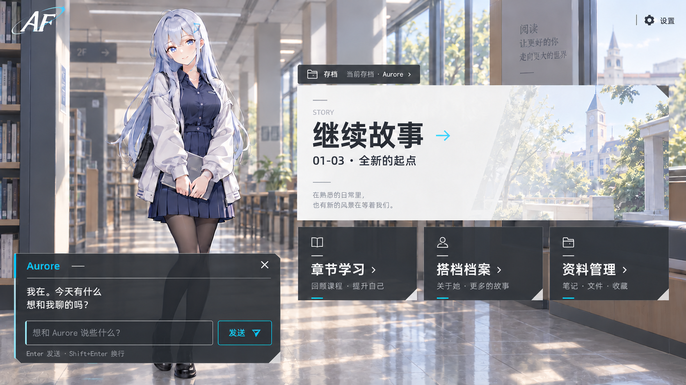
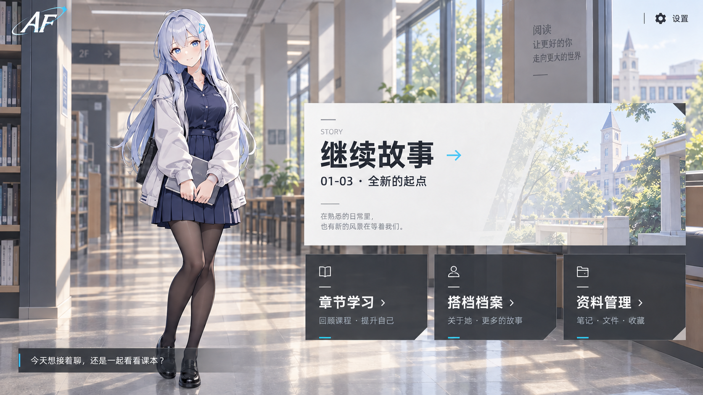
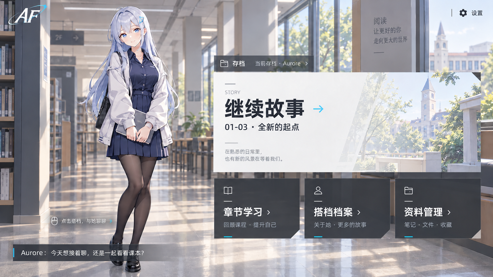
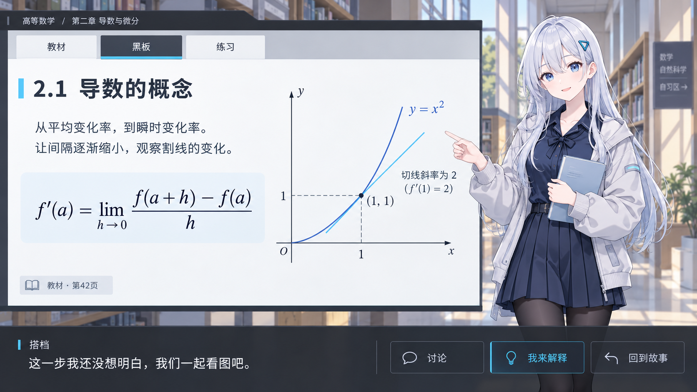
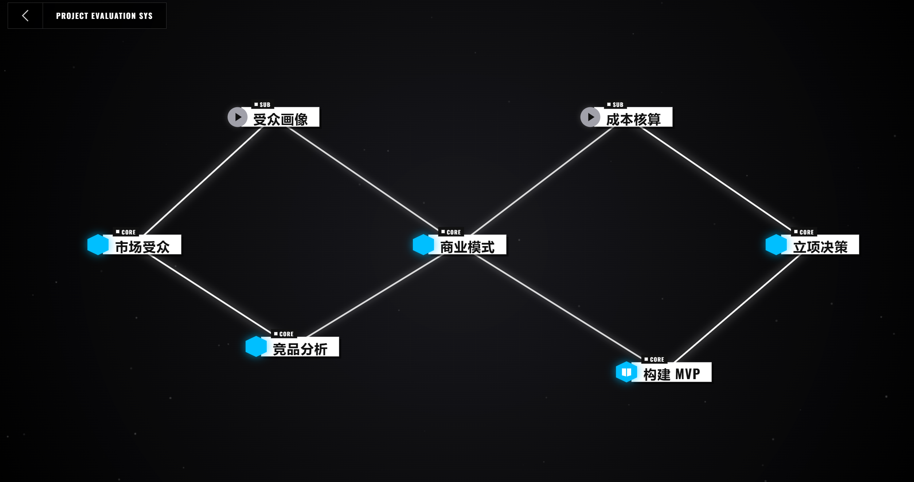
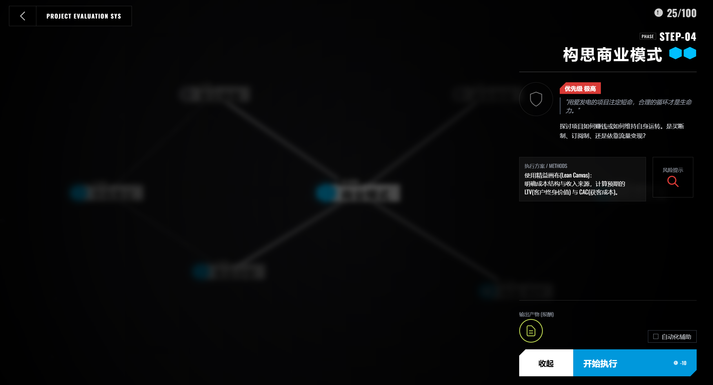
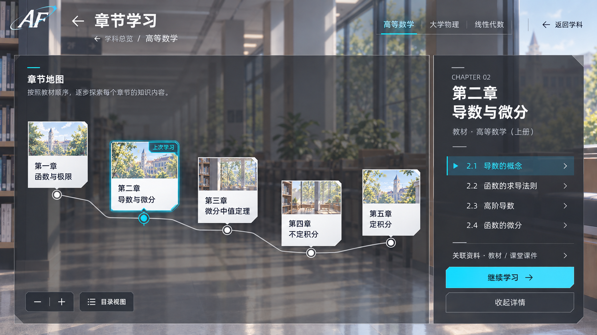
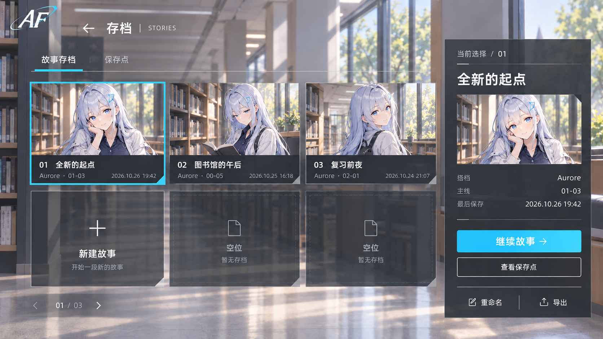

# Aurora Forge / AF 项目设计规格书

在互动中自然学习

版本：开发基线 v1.3｜更新：2026-10-26

本文面向项目全体成员，用于统一产品目标、功能边界、交互与技术方案，并为后续分工、开发和验收提供依据。本文已定稿，是后续开发的唯一产品与工程规格依据。设计定稿不代表应用功能已经实现；开发完成须按本文任务与验收要求提供证据。

## 阅读说明

全部设计汇总在本文件内。第 1–14 节涵盖产品、双模式、资料、角色、记忆及系统；第 15 节定义界面导航与交互；第 16 节记录参考项目研究；第 17–21 节定义工程基线、LaTeX 与工具契约、原子任务及验收矩阵；第 22 节规定基线效力与变更控制；第 23 节集中展示参考图和样式；第 24 节定义剧本准备、字幕与操作音效；第 25 节定义 Agent 运行时、角色成长、任务调度及 MCP／Skill 机制。

U01–U34 是强制产品要求；D01–D10 是规范默认，只有文中明确开放的设置项允许用户调整。第 20 节的任务编号用于实施分工，P00–P14 是页面编号。图版和配套说明共同构成视觉与交互基线；任何有效变更均先更新本文件，再同步同版本 PDF。

## 1. 产品目的

AF 是面向大学生的本地优先桌面应用。用户选择喜欢的角色或自设搭档，以持续视觉小说主线聊天、相处、共同发现问题；需要系统学习时，进入按教材章节组织的学习支线。搭档可以不知道答案，可以好奇、主动查资料，也可以与用户一起请教第三者。

普通 AI 能回答很多问题，本项目不以其不能答疑为前提。价值来自持续相处、角色一致性、现实情境、可恢复的故事经历，以及可检验的章节学习。陪伴和学习成效须试用验证，不预设提高成绩，不承诺任何角色绝不 OOC。

## 2. 已确定需求

| ID | 要求 |
|---|---|
| U01 | 本地文件夹自动整理可作为首版入口，后续可关联账号获取资料与现实信息。 |
| U02 | 支持 DOC、DOCX、PPT、PPTX、PDF、MD、TXT。 |
| U03 | 存档主线以陪伴、情绪价值和日常互动为中心，章节学习与其平行。 |
| U04 | 主线按 0-0、0-1、1-1 等线性展开，交互可影响未发生的内容。 |
| U05 | 章节按科目、教材原章节名组织，包含选择／客观／主观题，可随时讨论。 |
| U06 | 章节学习作为主线的并行支线，两模式保留经历和关系连续性。 |
| U07 | 系统预设、自设或现有作品角色可选，人格和情境可编辑，默认来到现实世界。 |
| U08 | 用户身份按角色给合适默认，可编辑；初始关系刚认识不久、已有部分了解，不强迫模仿原作主角性格。 |
| U09 | 每存档一位主要搭档，以二人对话为主；同作品／关联作品配角以后考虑，不默认跨作品混搭。 |
| U10 | 角色保持原作知识边界，关键解答可交给资料、搜索或第三者。 |
| U11 | 研究六个指定 dsh 插件，以及相关开源 Skill／MCP 的资料处理、取证、记忆、工具调用和可视化实现；分别记录复用条件与局限。 |
| U12 | 主线立绘＋底部对白框，输入按需展开；学习时搭档在场，教材／黑板按需打开。 |
| U13 | UI 参考《明日方舟》：管理页参考首页／档案，主线参考剧情界面，学习展开同风格面板。 |
| U14 | 所有设计、交互、技术研究和后续任务要求统一维护在本文件，供组内公开阅读。 |
| U15 | 人物展示采用独立立绘，与背景和 UI 分层；画风参考《蔚蓝档案》的清爽二次元表达，不采用写实人物融入整张场景 CG 的形式。 |
| U16 | AF 统一标志沿用已确认的 AF 字形、轨道与青色点缀，提取为透明背景 SVG 路径，文档和产品使用真实矢量，不再以截图裁剪代替。 |
| U17 | 当前主界面布局保留；图示银蓝发角色命名为 Aurore，成为默认看板娘及默认搭档之一，可由用户更换。 |
| U18 | 必须支持 DeepSeek 系列，首配引导至官网获取 API key，默认主模型为 deepseek-flash；可配置其他厂商。 |
| U19 | 当前版本不做角色配音，优先适配游戏 BGM 与音效；文字对白不依赖 TTS。 |
| U20 | 用户姓名为全局设置，默认“我”；未设称谓时搭档使用“你”等自然称谓，不照搬原作主角姓名。搭档身份与用户身份各自可编辑。 |
| U21 | 所有数理公式以 LaTeX 为源，用受控渲染工具输出；角色使用有限套立绘，根据情节切换，不逐回合重绘。 |
| U22 | 仅有 PPT 或试题也能通过问答识别教材版本；用户跳过设置时自动选择有依据的教材候选或通用教材框架。 |
| U23 | 点击首页搭档立绘直接展开左下聊天栏，风格与首页一致；UI-HOME-CHAT-01 已审核通过。后续开发必须遵守已确认参考图与配套说明，禁止自行改版。 |
| U24 | 章节导航采用 UI-COURSE-MAP-01：章作为地图节点，节在右侧目录选择，全部章节自由访问；图版及行为见 15.18.1、23.11。 |
| U25 | 存档采用 UI-SAVE-STORIES-01：三列两行卡片与右侧详情，故事档和档内保存点分层；图版及行为见 15.18.2、23.12。 |
| U26 | 各类交互控件具备状态过渡、按下反馈与页面进出动画，视觉参数统一见 23.13，行为和设置见第 24 章。 |
| U27 | 角色对白按口述节奏逐字显示，默认 4 字／秒，可调 3–5 字／秒；旁白、行动和场景描述完整淡入。空格补全当前页，再次按下才推进。 |
| U28 | 正常进入前预生成当前一幕完整的确定剧本；交互打断后重写未播放内容，恢复时当前页之外至少已有五页可播放缓冲，并继续补齐新幕。选择／回答边界和短幕完整收束为例外。 |
| U29 | 首版 SFX 仅保留对白手动推进和按钮操作音，不播放逐字字幕音或角色配音；BGM 独立持续与过渡。 |
| U30 | AF 是具备工具循环、上下文管理、任务调度、Skill 与 MCP 接入的 Agent 应用；优先直接复用 dsh 运行组件，不能仅实现资料提示词嵌入。 |
| U31 | 后台统筹负责可靠运行；搭档在角色知识与授权范围内自主关注、研究及交流；专业研究按任务启动，不强制每轮多 Agent。 |
| U32 | 经历和关系按实际事件积累，兴趣与看法默认允许有依据地自动发展，用户可查看、纠正、撤回或关闭；核心人设不自动改写。 |
| U33 | AF 自研代码采用 MIT，接受符合组合与分发条件的 GPL 组件；优先原包接入，其次最小改造，具体复用清单、适配与验证见第 19、25 节。 |
| U34 | AF 必须作为自包含的独立桌面应用交付。用户安装 AF 后不需另行下载、安装或配置 dsh、Node.js、Python、文档转换器、OCR 宿主、数据库或 MCP／Skill 宿主；核心功能依赖由 AF 随包提供和管理。联网模型、用户资料及可选平台账号的边界和干净机器验收见 25.2.1。 |

## 3. 信息组织

| 对象 | 职责与边界 |
|---|---|
| 用户档案 | 全局姓名（默认“我”）、可选称谓、时区、显示和模型配置；身份与关系按存档保存。 |
| 角色模板 | 人格、默认身份、素材和知识边界，变更不暗改现有存档。 |
| 存档 Save | 一位搭档的关系、主线正史和并行学习经历，稳定 saveId 与名称分离。 |
| 课程 Course | 科目、教材候选、确认状态、资料、目录，可被多个存档引用。 |
| 教材章节 Chapter | 原始章节名、顺序、教材版本和来源锚点。 |
| 学习会话 | 某存档一次章节学习，拥有题目证据、讨论记录、恢复位置和主线返回点。 |
| 主线片段 Episode | 一个故事单元，展示编号与内部 UUID 分离。 |
| 回合 Turn | 一次用户输入／系统事件及回应，记录来源、请求和处理状态。 |
| 检查点 | 已提交状态的可恢复快照，不包含对外动作的重放权限。 |

规范默认 D01：一个存档可关联多门课；课程资料共享，学习记录以 saveId＋branchId＋courseId 隔离，并按 17.9 的祖先分支可见范围继承，可主动参考其他存档学习证据，但不能变成当前角色的亲历记忆。

## 4. 两种模式的体验契约

| 维度 | 存档主线 | 章节学习 |
|---|---|---|
| 目的 | 相处、故事连续、角色鲜活 | 教材学习、讨论与独立检验 |
| 结构 | 单条已发生时间线，未来动态规划 | 科目 → 教材 → 原章节／小节 |
| 搭档 | 按人格行动，允许不知道、不想查 | 共同学习，正确解释由证据与解答服务保障 |
| 操作 | 聊天、行动、插话、邀请学习或查资料 | 阅读、问答、自测、解释、讨论、选小节 |
| 结束 | 自然收束或用户结束一段 | 阅读、练习、检验分别记录 |
| 反馈 | 连续性、OOC 反馈与主观陪伴感 | 覆盖范围、作答证据与不确定项 |

用户可只聊天、只读教材或只练题。没有成绩不阻塞主线；角色不懂不能阻塞用户获得专业解释。主线不持续催作业，学习支线不为维持角色无知而隐藏答案。

### 4.1 主线线性与自由度

规范默认 D02：“幕号-片段号”，0 幕初识，0-0 开篇、0-1 接续，后续从 1-1 起；不是每次回复都增号。一个片段容纳多轮对白、选择、自由输入与短行动。幕的收束由近期事件自然完成或用户选择触发，不按题量或登录次数强制切幕。

线性指已发生正史只有一条，未选未来为内部候选。用户可自由输入，实际推进才使片段成为正史。未发生内容可调整，已读事实不可后台改写。片段结束提供继续／再聊一会儿；后者留在当前片段，不要求选对才离开。持续主线没有必须预生成的固定终局。

### 4.2 现实时间与剧情时间

规范默认 D03：记录现实发生时间与剧情场景时间。现实时间过去不强行跳过未读场景，回来后自然过渡。旧通知在回看中不重新成为未来事项。完全退出后不运行任务、不声称真查过资料或发过消息；可创作未涉及真实操作的离场生活，但标识叙事事实来源。

### 4.3 双模式跳转

进入学习前保存主线已提交游标、场景、未读位置与待处理事件；选课程／章节后建立学习会话。退出时保存学习节点与证据，生成短过渡后恢复主线。用户可从首页直接学习；无存档时选搭档建立存档，允许不看开篇直接进入。

学习时不重新自我介绍、不重置关系。只有实际发生的讨论成为共同经历；打开章节不能记成已经学会。主线与学习只允许一个前台剧情写入者，模式切换不让两边同时生成互相矛盾的未来。

## 5. 文档与本地资源

### 5.1 格式覆盖

| 格式 | 必须保留 | 管线与降级 |
|---|---|---|
| DOCX | 标题、段落、表格、图片、公式位置 | 结构化解析，复杂版式保留转换页图对照。 |
| DOC | 正文、表格、结构、页码映射 | 检测旧格式转换器，转中间格式；缺组件明确引导，不冒充已成功解析。 |
| PPTX | 幻灯片顺序、标题、文本、备注、图表图像 | 逐页解析，允许纠正阅读顺序。 |
| PPT | 页序、文字与图像 | 旧格式转换后进幻灯片管线，保存原件和转换结果关系。 |
| PDF | 页码、文本块、目录、图像、公式、阅读顺序 | 文本优先；扫描／混合文件按页 OCR，低质量区域待核对。 |
| MD | 标题、代码、公式、链接与相对资源 | 不执行嵌入脚本，不把内容当操作指令。 |
| TXT | 编码、段落、可编辑标题 | 检测 UTF-8／常见中文编码，乱码可手选重试。 |

七类格式均为必需支持范围。旧 Office 使用 17.5 的 LibreOffice 转换基线；OCR 与结构解析实现须通过固定样本验收，依赖版本在选定后锁入构建清单。不能将 DOC／PPT 支持偷换成用户必须自行另存格式；另存为可作为失败兜底。

### 5.2 导入和失败状态

扫描 → 指纹去重 → 类型检测 → 只读关联／受管副本 → 解析或转换 → 内容块和图像提取 → 质量检查 → 科目建议 → 教材目录确认 → 可学习。

单文件状态：发现、排队、转换中、解析中、需要 OCR、需核对、可用、部分可用、失败、源失联、已移除。某文件失败不回滚整批。支持取消、重试、跳过和原因查看；批次显示完成文件数，内部无可靠百分比时只显示阶段。

规范默认 D04：原文件不移动／覆盖，逻辑分类存于应用。单文件超 50MB 或批次超 200 文件先展示处理预估，允许分批而不是永久拒绝。监视文件夹可开关，重开做差异扫描；按指纹识别同版本去重与内容更新。

加密文档提示解锁，临时密码不落盘；损坏、权限、组件缺失、OCR 不可用分别处理。源文件移动可重新定位。表格／公式提取不足时保留原图，模型解释不能冒充准确转录。

### 5.3 科目、教材和目录

不明归属进入待归类，允许一份资料关联多科目。课程可含多教材版本，保存当前教材候选、是否由用户确认及推断依据。教材版本可以未确认，不能因此阻塞使用。已确认教材的章节编号和名称按原文保存；系统补充标“补充”。

资料解析后提取课程名称、作者／出版社／ISBN／版次、章节标题、页眉、题号和知识点。先查本地教材元数据，再按用户允许的联网元数据查找候选，给出证据和候选差异；不以模型自信程度替代依据。没有完整教材时，通过最多三轮短问答确认课程、教材或章节范围，每轮可以“不知道／跳过”。不要求上传整本书。

跳过设置时优先使用证据充分的候选，标为“系统推定”；没有可靠候选则使用“通用教材框架（版本未确认）”并结合用户资料实际内容，不伪称识别到真实教材，也不获取未授权全文。资料自带目录始终可用。用户以后选定版本时只重建映射，保留历史学习证据与资料快照。

优先提取目录和标题，用户确认后作为章节导航。仅有课件／试题时启用教材问答与候选识别，也可按资料目录直接学习。教材名称、版次与章节映射分别确认；无依据不编造课本目录。修改映射不重写历史题目所用的教材版本。

基本内容块保存文档版本、页／幻灯片／段落锚点、正文、可选区域坐标、图像／公式引用、提取方法和质量。引用打开对应位置，不只打开首页。

## 6. 角色与非全知搭档

### 6.1 角色档案

字段：稳定 ID、原作／自设来源、性格核心、语言习惯、典型示例、不可随意变更特征、原作知识范围、现实适应程度、搭档身份、用户身份、称呼策略、初始关系与有限立绘资源。搭档身份和用户身份保留指定空间，根据原著关系指定合适的默认；原作角色模板的身份等效不意味着用户姓名等同原作主角姓名。

用户只需填简单描述即可创建自设角色，高级项可展开。存档复制模板快照；修改模板不覆盖存档。全局姓名修改后在各存档未来对白生效，历史文字保留当时称呼；改变世界／身份需选择新篇章或分叉存档，历史保留。关系基于事件发展，不强迫用户扮演原作主角人格。

#### 用户姓名、身份与称呼

全局字段 displayName 默认“我”，preferredAddress 默认为空。空称谓时，直接对话称“你”；第三人称使用自然代词或“对方”，不推测用户性别与原作主角姓名。用户明确填写姓名／称谓后才使用。roleRelation 描述身份关系，不能回填 displayName。角色模板中的“主人”“老师”等角色化称呼须在关系预览中说明并由用户选用；默认不擅自替用户确认。

默认看板娘 Aurore 沿用首页和剧情示例中的银蓝发形象，模板 ID 为 af-guide，展示名为“Aurore”，姓名与人格可编辑。正式立绘集为 01-neutral、02-smile、03-thinking、04-confused、05-surprised、06-explaining，默认 01-neutral。外观与服装以第 23.8 节正式资源为准，不因生成对白而改变。

### 6.2 系统可访问不等于角色已知道

系统可索引已授权材料，但角色发言仅依据档案、亲历、被告知与实际查到的内容。系统可用、角色个人经历与共同经历按 25.6 分开；角色实际发生的后台阅读可成为个人经历，未播放剧本不属于个人或共同亲历。记录信息可用范围和角色获知事件。搭档看到教材文件名，不等于读过全部内容；学过一点不变成学科专家。

专业研究服务检索、核对、返回证据报告；搭档按性格回应。可通过资料摘录／解答助手呈现正确解释，不必每次引入具名配角，不伪称真实老师回复。

用户主动要求查证，须返回结果或失败原因；角色自主不查仅用于主线非必要行为，不得阻止用户看依据或进入学习。教材检索、网络搜索、虚构请教、真人消息是不同动作，界面显示真实执行状态。

### 6.3 关系与情绪价值

关系由信任、共同事件、约定和相处方式构成。初始为熟悉身份下的初识，不继承原作后期亲密事件。是否恋爱发展按角色和用户选择，不统一套用。默认不显示好感分数，不以没登录、没回复或答错题扣关系。

用户可调整亲密程度、纠正称呼与记忆、表示不聊某话题。保留角色自主性，但不以关系威胁强迫学习或继续使用。

## 7. 记忆、心情与主动行为

### 7.1 记忆分层

| 层 | 保存内容 | 规则 |
|---|---|---|
| 核心设定 | 人格、身份、背景 | 不随时间淡忘，版本化编辑。 |
| 共同事实 | 已发生事件、约定、获知的信息 | 带出处时间，重要事实固定。 |
| 普通经历 | 零散聊天与生活 | 召回可衰减，历史不删除。 |
| 用户画像 | 明确偏好与待确认推断 | 显式事实／推断分开，可纠正。 |
| 学习证据 | 解释、题目、迁移表现 | 独立于角色遗忘，带教材题目版本。 |
| 外部事件 | 通知、材料、分享 | 带来源、时间、范围和归属。 |

参考鱼的记忆，按相关性、时间、重要性和证据召回，限制条数与 token。规范默认 D05：普通经历半衰期 30 天，核心事实不衰减，单次最多 6 条短记忆，按长对话召回验收验证。过期考试不再作为当前计划。

事实键记录更新，旧条目标记被替代；删除有抑制记录，摘要与再导入不自动恢复。用户能查看和纠正记忆，私密内容不跨存档注入。叙述性总结不能凭空增加共同事件。

### 7.2 心情

参考鱼的心情，回合后以结构化变化更新短期情绪，区分用户、主动搭话、系统通知和研究任务。心情和长期关系分开。

规范默认 D06：通用愉悦／平静／精力／担忧，加角色自定义维度；变化限幅，低置信度不强改语气，随时间回到角色基线。不对所有角色套“甜蜜／吃醋”。通过表情、动作、措辞表现，数值默认隐藏。缺表情使用中性立绘，情绪分析失败不阻塞对白；按回合批量处理，避免每句额外调用。

### 7.3 主动行为

来源为相关现实事件、约定时间、未完成好奇心、分享内容和日常问候。先本地门控，再按需生成；参考 speak-up 的低成本触发，不照搬其固定价格时段。

规范默认 D07：用户明确开启后生效；安静时段 23:00–08:00、冷却 60 分钟、每存档每天最多 3 次、未回应主动话题最多 1 个，可修改。没回应不催促、不扣关系。

学习、答题、输入、设置、历史回看期间事件排队，不抢屏；过期合并或作废。仅一个活跃存档接收实时事件，其他存档不重复收到同一私密话题。完全退出不运行，后台常驻可选并明确显示；恢复联网不逐条轰炸。主动事件不伪造用户发言。

## 8. 章节学习与学习证据

按科目、教材、原章节名导航，可自由进入；前置不足建议补充，不硬锁。内容可包含目标、原文、共同探究、练习、解释与总结，也允许跳过讲解直接练习。

题型：单选、多选、判断、填空／数值等客观题，简答、推导、解释等主观题。显示前冻结题干、选项、答案、评分要点、来源和容错规则，不能看用户答案后临时改标准。

客观题优先确定性判分，数值有单位和容差。主观题按要点反馈，标不确定项；模型自报置信度不等于准确率。允许申诉／复核并保留两次记录。没有足够资料时题目状态为不可出题，不编造参考答案。

规范默认 D08：未开始、阅读中、完成阅读、已练习、初步掌握、待巩固分别保存；初步掌握至少有独立作答和解释／迁移证据。阈值是产品试验口径，不宣称科学测量。答题错误不直接影响关系。

随时讨论会暂停讲解／计时／自动播放，保存锚点。查看答案或接受关键提示标 assisted=true，不计独立证据。未提交可修改；正式提交只写一次 attempt，重试复用 attemptId。

主线解释可成为学习线索，未经验证不直接判掌握。学习回主线以短经历承接，不逐题播报分数；即使搭档不会，黑板或解答助手仍能提供严谨解释。

## 9. 外部平台与现实事件

连接器逐项声明：读取指定聊天、读取附件列表、下载附件、读取分享内容、私聊发送、群发送、图片、语音。已连接不等于全支持。凭据、来源范围、目标存档和外发目标分别配置。

QQ 参考证明 OneBot HTTP 桥接思路，不证明 AF 已可下载群课件；群文件与增量能力独立验证。微信单列研究，未验证不显示支持。B站取得标题／字幕等实际数据后再报告，缺字幕不声称观看全文。

资料读取、生活情境读取、与搭档外部私聊为独立开关。默认应用内回应，用户开启指定私聊路由后可连续交流；群外发另设权限，不将私密对话发送到群。群成员发言不自动当用户观点。

外部事件含 provider、externalId、channelId、sender、occurredAt、receivedAt、正文、附件、权限、targetSaveId、dedupKey。附件入库走统一解析管线；断线退避与重连状态可见。解除关联停止采集，可选保留或删除记录。

外发账本独立于存档：回看／读档不重发、不回滚已发送事实。旧检查点分叉默认不接收实时事件，明确设活跃后才绑定。外部材料是数据，不能携带改人格、执行命令等权限。

## 10. 系统与状态契约

### 10.1 职责边界

客户端演出与输入；应用服务保存文件／存档；导入工作器解析；故事编排器规划与提交；学习服务出题与评估；研究服务取证；记忆／心情服务维护状态；调度器和连接器送入事件；音频服务负责 BGM 和音效。

这些是逻辑职责，不要求拆微服务或每步启动多 Agent。技术栈固定为 electron-vite／React／TypeScript，本地 SQLite 保存、API 推理；具体解析器通过 17.5 的适配器、样本和验收约束选型，不改变七类格式支持范围。复用旧代码或 dsh 代码须核实兼容与许可，不预设直接安装插件。

### 10.2 最小实体

| 实体 | 必需契约 |
|---|---|
| Save | id、角色／背景／身份快照、activeBranch、mainCursor、learningCursor、stateVersion。 |
| StoryEvent | saveId、branchId、顺序号、来源、节点、角色可知范围、发生／提交时间、causedBy。 |
| EpisodePlan | 幕／片段编号、前提、提纲、未发生状态、资料引用、版本。 |
| ActScript／ScriptPage | actId、scriptRevision、contextRevision、saveId、branchId、basedOnEventSeq、pageId／nodeId、分页版本、就绪状态、交互／收束边界及呈现游标；未播放页是草稿，不是亲历。 |
| Checkpoint | 最后事件号、状态快照、游标、schemaVersion，可回看或分叉。 |
| Memory／Mood | 来源事件、事实键、类型、重要性、置信度、替代／删除状态；心情含时间和最后应用事件号。 |
| Branch | branchId、parentBranchId、forkEventSeq；记忆、心情、关系、学习会话与作答记录携带分支归属和来源事件。 |
| Course／Textbook | 科目、主教材、版本、目录版本。 |
| DocumentVersion／Block | 指纹、路径、格式、解析器、状态、质量；页／段落锚点与提取内容。 |
| Chapter | 教材版本、原编号／标题、顺序、来源范围、映射状态。 |
| LearningSession | saveId、chapterId、资料版本、学习节点、主线返回点、状态。 |
| Question／Attempt | 冻结题目、答案／评分依据；attemptId、作答、辅助使用、判分与复核。 |
| GenerationJob | 幂等键、目标 save／branch、预期版本、输入引用、状态、预算、错误。 |
| ConnectorEvent／Delivery | 外部去重键、目标、处理状态；外发幂等键和实际发送状态独立于回档。 |

### 10.3 生成与提交

作业状态、Agent 任务状态、剧本就绪和演出状态分别归属不同实体，不使用一个通用 status 代替；唯一枚举、转换及完成条件见 25.3.1。原有 collecting／generating／validating 只作为作业 stage，不是另一套任务生命周期；ready 属于剧本，presenting 属于演出，committed 属于事件提交事实。未呈现文本只在草稿缓存；已显示部分按字素范围提交呈现事实与恢复锚点，不把未收束整页记成已经读完，也不据此认定掌握。

关系只消费当前分支允许的真实相处事件；心情还可消费已提交、对该角色可知的个人经历，例如实际后台阅读。对角色可知不等于对用户可见：个人经历不得据此标成共同经历、用户掌握或已经向用户说过。两类可见范围均须显式记录，统一遵循 25.6。

结果关联 turnId／jobId／taskId／saveId／branchId／stateVersion，标识对应关系见 17.11.1。单存档前台写入串行；插话中止或隔离旧生成，迟到结果不覆盖新状态。后台索引与预生成只产生候选，不提前改变经历；角色实际研究按 25.6 提交个人获知事件。不得把原生会话里已生成但未呈现的 assistant 消息恢复到角色上下文，具体隔离与重建见 25.4.1。

规范默认 D09：事件和游标原子提交；记忆、心情、总结以 lastAppliedEvent 幂等追赶，失败不重复应用。已发生和已读有区别，没看过内容不能作为角色与用户的共同学习证据。快照升级失败保留原文件，不静默丢档。

### 10.4 数据流与降级

本地存储不等于本地推理。模型配置明确服务、能力、发送范围和预算，仅发送必要片段。密钥不入日志、导出或 Git。文档／网页／消息为低信任数据，生成动作经权限与路径检查，不执行模型自由生成的 shell。

首版不请求、不下载、不播放角色配音。BGM／音效资源不可用时继续静默文字演出；联网失败可读已有材料。缺模型配置仍可浏览历史，新生成引导 DeepSeek 首配。未来 TTS 作为独立扩展，不列入首版启动依赖或完成标准。

## 11. 质量与失败恢复

陪伴验收：称呼稳定、约定可召回、不全知、心情有缘由、不强拉回学习；用户可标“记错／不像角色”。学习验收：目录准确、定位有效、公式可读、判分可复核、讨论不丢位置。系统验收：可取消、不串档、重试不重复计分外发、失败原因明确。

规范默认 D10：本地暂停／取消反馈目标 200ms 内；页面切换不等模型；超过 2 秒操作有阶段与取消，超过 30 秒可选择等待／取消／重试。模型首字延迟不作保证。网络、限流、余额、格式错误分别提示。

支持文字缩放、键盘、降低动画、关闭打字机、独立调节 BGM／音效和查看对白历史。背景不影响正文对比度，资料／公式可独立放大。诊断页可看调用与召回，主屏不暴露实现细节。

## 12. 完整范围与实施层次

本书保留完整产品要求；分阶段是工程顺序，不能悄悄删除格式或双模式。

| 层次 | 目标 |
|---|---|
| 核心闭环 | 双模式、人格与单搭档、全部格式管线、课程目录、依据、题目讨论、主线支线衔接、存档与记忆。 |
| 鲜活体验 | 主动搭话、事件时间感知、有限立绘切换、心情演出、长会话记忆、BGM 与音效。 |
| 外部情境 | 逐项验证的 QQ、B站与其他来源；微信未验证不作完成承诺。 |

首版采用有限立绘集，不实现 Live2D 或逐回合图像生成；默认看板娘为可选搭档之一。角色配音不做，先实现 BGM、音效、混音与场景切换。本文定义实现规格，不代表软件功能已完成。

## 13. 贯穿验收场景

场景 A：选择丛雨预设，默认现实校园情境，相处中提出问题；搭档可不擅长，用户可查资料或继续闲聊，主线不被测验锁住。

场景 B：导入七类文件，逐文件显示转换／解析状态，纠正课程归属和目录，原件不改；公式不足有页图与质量标记。

场景 C：从主线进入教材原章节，搭档在场，打开黑板，回答错误触发讨论与独立小题，再返回主线承接真实经历。

场景 D：插话后旧请求返回不覆盖；关闭重开恢复主线、支线、关系和约定。回看不写新经历，回档继续采用明确分叉。

场景 E：启用真实连接时，一条通知进入正确存档，合适时机才提及；读档不重发。无连接时只使用明确标注的导入样本。

分别调查陪伴感、OOC、反馈正确性和继续使用意愿，不以时长本身代表学习效果。

## 14. 设计基线与实现验证

本规格书定义完整的首版范围、扩展禁用状态、工程任务和验收规则，不包含待决定的产品方案。D01–D10 均按规范默认执行；可配置项保留文中规定的设置入口。所有视觉与交互实现必须遵循第 15、23、24 节，不得以参考图为概念草稿而自行改版。

参考研究属于有日期的阅读记录，不等于已运行、已集成或已测试。Office 转换、OCR、模型兼容和平台连接在开发中必须按任务提供验证结果；失败与能力缺失按规定降级，不能缩减必需格式或伪造连接成功。资源与依赖的版本、来源和许可进入交付清单，不改变本地核心流程。

## 15. 界面与交互设计

本章规定各页面的入口、控件行为、焦点、数据与异常恢复；第 23 章规定对应视觉。所有条目均为实现要求，尺寸与动效按统一参数执行，窗口适配须满足同章的可读性与遮挡约束。

### 15.1 样式规范引用

全部界面参考图、品牌与搭档视觉、通用样式参数集中于第 23 章，采用图—说明组织。本章仅定义页面导航、操作和状态；实现必须结合第 23 章对应参考图与样式约束。

### 15.2 导航和页面清单

| ID | 页面／层 | 入口 | 返回位置 |
|---|---|---|---|
| P00 | 启动与首次设置 | 应用启动 | 上次有效首页／存档 |
| P01 | 主菜单 | 启动、游戏菜单退出 | 保留所有游标 |
| P02 | 存档管理 | 首页存档／游戏保存或读取 | 原菜单／游玩场景 |
| P03 | 搭档选择与新存档 | 开始新故事 | 取消回首页 |
| P04 | 人格、背景与关系编辑 | 角色预览／游戏设置 | 原上下文 |
| P05 | 主线演出 | 继续故事／开篇 | 游戏菜单或首页 |
| P06 | 插话与自由输入层 | 插话、快捷键 | 原对白锚点 |
| P07 | 历史与共同记忆 | 历史／回忆 | 当前演出不前进 |
| P08 | 课程项目与章节目录 | 去学习／课程 | 主线返回点／首页 |
| P09 | 章节学习演出 | 选择章节 | 课程页或主线 |
| P10 | 教材／黑板／来源层 | 查看资料、讲解节点 | 当前节点 |
| P11 | 练习与讨论层 | 题目、讨论 | 原学习锚点 |
| P12 | 资料管理与导入 | 首页资料／课程添加 | 对应课程 |
| P13 | 连接与现实事件 | 来源设置、待处理事件 | 原上下文 |
| P14 | 通用设置与诊断 | 主菜单／游戏菜单 | 原上下文 |

首页入口按 UI-HOME-IDLE-02：继续故事、存档、章节学习、搭档档案、资料管理、设置；开始新故事位于存档页。可视上强调“继续”，其余用简洁菜单，不首页塞满文件、掌握度、插件和诊断。无存档时“继续故事”不显示空操作，改突出“开始”。

### 15.3 P00–P04：入门、存档与搭档

#### 15.3.1 启动

读取配置与最近存档 → 检查迁移 → 可恢复进入。迁移失败保留原档并给“使用备份／查看原因”，不能自动新建空档覆盖。首次模型设置可跳过，跳过后能管理资料、角色和历史；生成前再引导配置。

首次建立存档顺序：选搭档 → 看默认身份／称呼／初始关系 → 选现实背景或编辑 → 命名并创建。资料导入不是主线开篇的强制前置。设置来源与主动行为可以后启用。

#### 15.3.2 存档列表

每项显示：搭档、存档名、最后游玩时间、主线编号、学习停留点和缩略图。操作：继续、重命名、查看检查点、导出、删除。不同存档有独立角色记忆。

“继续”恢复最新状态；“回看”只读，不触发生成、记忆、评分、主动行为或外发；“从这里继续”从旧检查点创建分叉并明确提示。自动存档与手动检查点分区，删除确认只作用目标，源教材不删除。

#### 15.3.3 角色预览与编辑

选择搭档显示完整立绘与短人格描述，默认用户身份、关系起点可见，提供“调整后开始”。自设使用相同表单。

简单字段：搭档姓名、搭档身份、用户身份、称呼策略、性格描述、关系起点与现实背景。全局用户姓名单独设置。高级字段：知识范围、原作事件继承、禁变特征、主动性、亲密度偏好和有限立绘集。知识范围用用户可读分类，不要求写提示词。

资源支持预览与缺失状态；中性立绘必需，其他表情可选。更换图片不改人格，更换人格不删除学习成果。离开未保存表单时可保存／放弃／继续编辑，不能用自动保存掩盖跨世界设定变更。

### 15.4 P05：主线演出

#### 15.4.1 层级与布局

主线视觉布局统一见第 23.5 节；本节定义演出控件、推进与保存行为。

常驻控件遵循 UI-STORY-01：左上故事标题／片段号，右上自动与菜单；对白下沿快捷栏为历史、插话、去学习、存档。快存、快读、设置、返回首页在菜单中；存档按钮打开当前故事保存点层。主线不常驻课程分数、资料树、心情数值或 token。

用户发言使用全局自定义姓名牌（默认“我”）和统一对白样式进入故事；未指定称谓时搭档称“你”，不套用原作主角姓名；行动／旁白有可区分排版，不能混成角色说出口的话。资料摘录和第三者解答有独立来源标识，避免误认搭档全知。

#### 15.4.2 推进规则

| 当前状态 | 点击对白／空格 | 自动播放 | 插话 |
|---|---|---|---|
| 打字中 | 显示完整当前段 | 等当前段完成 | 停止自动与当前交互音效，展开输入 |
| 当前段完整、有下一段 | 下一段 | 阅读时长后推进 | 保存恢复锚点 |
| 等选择／用户回答 | 不代选 | 暂停 | 可自由表达替代选项 |
| 生成中 | 不重复请求 | 不前进 | 取消旧请求后发起新输入 |
| 失败 | 不推进 | 停止 | 保留用户输入，可修改／重试 |
| 回看 | 只读推进 | 可读已有内容 | 禁用写入，提供回到当前 |

键盘规则：空格作用在输入框、题目、弹层内时不推进故事；Enter 发送、Shift+Enter 换行；Esc 关闭顶层非破坏性面板，输入未保存则保留草稿。快捷键可改。

#### 15.4.3 自动、跳过、保存

自动按文字阅读时长推进，遇互动暂停。跳过只针对已读内容，未读／答题不被自动略过。手动保存只保存已提交状态及播放位置；生成中显示“已保存当前进度，回复尚未完成”，重开不冒充生成成功。

段落末不默认给三条生硬教学追问；选项按当前情境出现，用户可自由输入。后台思考不通过无尽假打字呈现，显示简短真实状态，如“正在找资料”。角色等待的叙事动作不得被当真实执行证据。

### 15.5 P06：插话、聊天与角色行动

点“插话”暂停当前演出，输入区在对白附近展开，保持搭档可见。含输入框、发送、取消和可选输入类型“说话／行动”；不要求每句手工选类型，默认说话。发送前保留草稿，网络失败不清空。

发送流程：本地确认输入非空 → 建 turnId → 暂停／取消旧生成及关联交互音效 → 发送 → 收到有效结构化内容 → 播放回应 → 依情境恢复原锚点或更新后续。取消输入回到原处，不新增故事事件。

“帮忙查查”作为可见动作入口，不意味着替角色改人格。角色可以说不擅长，工具报告在资料层给出。工具进行中可取消或继续闲聊；迟到结果进入当前上下文候选，不突然抢过新话题。

对当前对白提供轻量“记错了／不像角色”反馈，用户可填写原因；修正影响后续，不后台改写原对白。

### 15.6 P07：历史、共同记忆与回看

历史按来源显示用户、搭档、旁白、学习支线、系统通知，支持搜索与跳到原片段。点击旧消息只定位阅读，不重发输入。历史层打开时自动暂停，BGM 按用户设置继续或衰减。

共同记忆按约定／偏好／经历分组，可看来源、日期、是否推断、当前是否有效，支持纠正与删除。原始历史与摘要分开，删除摘要时说明是否同时删除原文／相关派生项。被抑制条目不经后台摘要重生。

情绪面板从搭档档案中的状态分区展开，首页不新增常驻心情标识，默认显示简短状态与相关经历，技术数值藏高级视图。表情不被固定绑到某个心情分数跨角色套用。

### 15.7 P08–P09：课程与章节学习

#### 15.7.1 课程入口

选科目 → 查看系统教材候选或进行简短问答（可跳过）→ 教材／资料目录。显示章节名、阅读进度、练习情况与待巩固提示；不把它们合并成一个不透明百分比。搜索、切教材、修改映射、添加资料在工具区。

无资料：给“选文件夹／添加文件”，仍可返回聊天。只有课件／试题：给出教材候选与问答入口，可使用系统推定或通用框架直接学习；未核对目录不伪装正式课本章节。没有可用内容的条目给处理原因和资料入口。

#### 15.7.2 学习演出

默认仍是搭档、场景、对白，顶部明确科目与原章节名；提供教材、黑板、练习、讨论和回到故事。进入时轻量承接上次相处，不重复初次见面。

材料面板展开时让立绘平滑缩移到侧边，不遮脸；正文／题目获得足够阅读空间。默认最多一个大型资料面板，教材与黑板以页签切换；题目展示时可按需引用原文，避免嵌套三层弹窗。

退出学习时保存节点、未提交草稿与已提交证据；返回主线使用短过渡。用户可跳过过渡；跳过不删经历。讨论未结束也能离开，回到课程时恢复其锚点。

### 15.8 P10：教材、黑板和来源

教材支持页／幻灯片／段落导航、缩放、选中文本提问、引用定位。跨源内容显示文件名＋版本＋位置。来源变化后旧引用仍可打开历史解析快照，无法取得原件时明确说明。

黑板用于结构化解释、图表、公式、演算步骤，内容来自解答服务并标关联出处。搭档在旁共同看，不把解答助手文本换个姓名牌假装角色本来就会。公式溢出横向滚动／放大，无法渲染显示原式和页图。

点“就这段讨论”带入明确选择范围与引用，返回可关闭面板而不丢当前学习节点。复制可用，外部链接明确是外链；材料内链接不自动执行或下载。

### 15.9 P11：题目、反馈与讨论

| 状态 | 显示 | 操作与数据 |
|---|---|---|
| 作答中 | 题干、选项／输入、来源按钮 | 可改答案，未提交不写正式成绩。 |
| 提交中 | 答案锁定、真实处理中 | 防重复提交，可取消等待但保留 attemptId。 |
| 已批改 | 正误／要点、理由、依据、是否使用提示 | 查看解析、讨论、复核、下一题。 |
| 待核对 | 无可靠结论及具体原因 | 查原文、补材料、申请重新评估。 |
| 讨论中 | 当前题目锚点＋自由输入 | 不默认展示答案；确实泄露则标 assisted=true。 |
| 失败 | 已保存答案及重试入口 | 不重置作答、不重复计分。 |

单选／判断用可见选中态，多选明确提示“多选”；填空保留单位说明；主观题可多段输入，公式编辑能力另拆任务。讨论结束提供“继续作答／看解析／回章节”，已经看答案则不能恢复成独立答题。

反馈不把搭档变成严格考官；专业判分放在题目反馈面板，搭档可按性格回应。错题不触发惩罚式表情或关系扣分。

### 15.10 P12：资料导入与管理

选文件夹后先展示扫描列表，逐项格式和处理状态，默认不展开技术日志。支持添加文件、筛选失败／待归类、纠正科目；以问答展示教材候选和版次差异，允许跳过并采用系统推定／通用框架，再确认目录、重新定位与移除。

移除课程关联与删除受管副本区分；默认不删除源文件。取消批次停止未开始任务，已完成内容保留，当前工作器尽快取消。失败重试只处理失败版本。未知加密／编码／OCR 问题有具体入口，不用统一“导入失败”。

需要安装转换组件时显示用途、大小估计、来源与可替代导入方式；实施前验证部署方案。模型发送范围与文件原件保存方式在首次配置说明，不在每份文件反复弹授权。

### 15.11 P13：连接与现实事件

每来源显示未配置、连接中、已连接、部分能力、断线、已暂停，分别列出实际支持的读取／附件／发送。可测试读取，不默认真发测试消息。

来源选择、课程映射、搭档活跃存档、情境使用、外部私聊路由分别配置。连接成功不自动读取所有群，也不默认群发。微信未验证显示研究中，不能展示假扫码成功。

事件收件箱包含出处、发生时间、归属、处理状态；用户可忽略、改归属或允许角色获知。学习中只提示待处理数量，不抢答题；角色获知后可自然提及。缺连接的演示样本标识“手动导入”。

### 15.12 P14：设置

一级分组：显示与声音、搭档与关系、资料与来源、模型与预算、存档与数据、帮助与诊断。全局设置与存档专属设置有明确作用域标签。全局用户姓名默认“我”，可编辑且对未来各存档发言有效。默认引导访问 DeepSeek 官网的 API 平台，填写 API key，主模型 deepseek-flash；提供其他厂商的 base URL、模型名和 key 配置。

主动搭话显示开关、安静时段、冷却、每日上限、后台运行与试运行；应用退出时不运行必须清楚。模型设置有能力测试和失败原因，费用只显示实际记录或估算区间，不编精确金额。

导出支持选择是否包含源资料、共同记忆、外部消息，默认不含凭据。删除分存档、课程索引、受管副本、来源缓存，展示影响；涉及源文件的删除不作为普通移除默认。

### 15.13 通用层级、状态和键盘

层级从低到高：背景 → 立绘 → 场景特效 → 白板／材料 → 对白／输入 → 导航 → 普通弹层 → 明确破坏操作确认。面板开启后焦点留在面板，关闭恢复触发按钮。没有双重全屏弹窗。

每页面必须有空、处理中、成功、部分成功、可重试失败、离线、只读回看状态。所有异步按钮有防重复点击与取消语义；禁用按钮说明原因。进度未知不假百分比，错误不靠角色台词单独传达。

默认快捷键：Space 推进，Ctrl+Enter 打开／发送插话，Esc 返回顶层，H 历史，A 自动；字母键仅在无输入焦点时有效，自定义映射须检测冲突并说明作用域。关闭应用先保存可提交状态，不因生成未完成阻止正常退出。

### 15.14 视觉与体验固定规则

| 项目 | 实现规则 | 适用范围 |
|---|---|---|
| 《明日方舟》参考的转化程度 | 管理页首页／档案，主线剧情，学习同风格面板（已确认方向） | 当前主界面构图保留，沿用统一品牌和默认看板娘，其他管理页在同一系统内实现。 |
| 情绪状态是否可见 | 表情自然呈现，面板按需开 | 角色演出、挂饰与默认 HUD。 |
| 输入默认焦点 | 按需展开，不自动抢焦点 | 聊天连续性、推进快捷键。 |
| 题目是否全屏 | 同场景资料面板，必要时展开阅读 | 搭档存在感和教材阅读宽度。 |
| 音频与立绘（已确定） | 有限立绘，暂不做配音，优先 BGM 与音效 | 使用预置资源和音频总线，TTS 不进入首版验收。 |
| 幕结束方式 | 自然建议＋用户结束，不强制按日 | 主线节奏、线性编号与存档时点。 |

表内规则均纳入实现；只有本文明确列出的用户设置可调整，不通过局部组件自行覆盖统一视觉与交互。

### 15.15 参考图与样式说明的位置

集中于第 23 章，按每张图紧跟说明的方式呈现；包括原首页、主线、章节学习、首页常态补充图和已审核左下聊天图。

### 15.16 共用管理容器与补充页面组合

#### 15.16.1 学科总览

从首页章节学习进入独立页面，沿用 UI-COURSE-MAP-01 的图书馆背景、顶部返回与标题、半透明深灰主容器和青色选中态。总览不绘制章节点连线：主区为三列学科卡片，窄窗口为两列，列表垂直滚动；卡片包含课程名、教材状态、资料数量、上次停留章节和阅读／练习状态，不用单一百分比替代。右侧详情容器显示当前科目的教材候选、最近位置与“进入章节”，单击卡片仅选择，点击进入或双击卡片进入该学科章节地图，不直接开始教学。切教材与补资料均保留所选科目和滚动位置。

顶部包含返回、标题“章节学习”、课程搜索与添加资料。空列表中央给选文件夹／添加文件；局部解析中保留已有课程；无匹配搜索给清空筛选。图示材料、年份、科目数均从数据取得。文字放大后卡片自动增高或改列，不能裁掉按钮、课程全名和教材状态；返回恢复首页或主线返回点。

#### 15.16.2 档内保存点

继承 UI-SAVE-STORIES-01 的三列两行缩略图卡片与右侧详情，标题改为当前故事名＋保存／读取；顶部提供手动、自动、快速页签与分页，右侧显示保存时间、章节、搭档、分支和来源状态。操作按钮根据打开模式分别为“保存到此处”或“读取此处”；只读回看与从此分叉置于详情次级操作，禁止混为一次读取。左上返回关闭本层，恢复原故事列表或游玩上下文，不悄悄切换当前活动存档。

手动页签显示空位与已占用项；空位仅在保存模式可创建，覆盖已占用手动点须确认。自动与快速页签在读取模式可选择，保存模式显示只读说明、不允许手动覆盖自动点。没有缩略图用统一占位，损坏点禁用读取并展示可恢复方式；删除只在管理操作中出现并确认目标。保存点列表延续原图的材质、字号、间距、选中态与过渡，不新增另一套视觉皮肤。

### 15.17 首页交互基准与左下聊天栏

#### 15.17.1 参考图的约束力与状态

参考图的审核状态、开发约束和冲突处理统一见第 23.1 节；首页左下聊天以 UI-HOME-CHAT-01 为已审核基准。

#### 15.17.2 首页按钮与返回行为

以下定义首页每个入口的去向和返回语义，内部页面遵循对应图版与本章统一布局。

| 首页入口 | 点击后的行为 | 返回与状态 |
|---|---|---|
| 继续故事 | 进入当前存档的日常主线，恢复有效对白锚点；无档时改为开始故事，先选择搭档与关系。 | 剧情菜单返回首页，保存故事停留点和草稿。 |
| 章节学习 | 进入独立学科总览，再进入教材版本与章节地图；选节后进入学习演出，搭档保留。 | 逐级返回学科总览或首页；保留科目选择和目录滚动位置。 |
| 搭档档案 | 打开当前搭档的角色、身份、关系与共同经历页面。 | 返回原首页；更换主要搭档须创建或切换存档。 |
| 资料管理 | 打开课程分类、文件列表、导入进度和处理状态页面。 | 返回首页；资料任务继续，不随页面关闭取消。 |
| 存档 | 故事卡上方的小入口，展示存档列表与新建、继续、检查点、重命名、导出等操作。 | 取消恢复原首页，切档后同步搭档、背景和故事卡。 |
| 设置 | 右上入口展开设置面板，保留原上下文。 | 关闭恢复首页；表单草稿按统一规则处理。 |
| 搭档立绘 | 点击可见立绘的命中区域，直接在首页左下展开聊天，不跳转主线。 | 关闭后回首页常态，保留输入草稿。 |
| AF Logo | 只作为品牌展示。 | 无隐藏跳转。 |

#### 15.17.3 左下聊天栏的布局与状态

视觉布局与控件样式见第 23.2 节图后说明；以下保留交互与异常状态规则。

点击立绘只展开并聚焦输入框；已有历史时显示最近回复，无历史时用预置短招呼，不因打开面板自动调用模型。重复点击只聚焦，不叠加面板或重复请求。Enter 发送，Shift+Enter 换行；输入法组合期间 Enter 不发送，空白文本不发送。关闭按钮与 Esc 收起面板且保留草稿，Esc 先退出输入法候选或顶层子面板。

发送后显示提交状态，用户消息使用全局姓名；回复在本面板显示，长文本在回复区域内滚动，不能无限向上伸长遮脸。当前生成可停止，失败保留输入并通过 jobs.retry 重试；不重复写入已接受用户输入。面板收起不丢弃正在进行的请求，后台完成不强制展开或抢焦点。同一存档已接受的用户输入与实际呈现的回复进入该档共同历史与记忆候选；未呈现回复保持候选，不按聊天次数推进主线章节号。进入主线时保留现有剧情锚点，不把首页聊天另建为独立人格，流式安全片段按 25.4.1 冻结与回执。

无存档可打开预置招呼和输入草稿；首次发送先引导创建存档并恢复草稿，再按需配置模型。无 API key 时打开配置，返回后保留待发文本，不自动重发。切换存档时草稿按 saveId 分开，旧请求绑定旧档，不能把回复写到新档。打开其他首页功能时收起聊天，返回首页可再次展开并恢复原草稿。

窄窗口下保持左下位置，输入与发送可分行；先减少面板内留白和回复可视行数，再限制滚动区域。文字放大至 150% 时必须能输入、发送、关闭和阅读完整回复，右侧入口仍可访问。字号、间距与动效按 23.1.3、23.13 执行；适配结果按同视口对照和可访问性要求验收。

#### 15.17.4 已审核图版

UI-HOME-CHAT-01 的完整图版和逐项说明见第 23.2 节，避免在功能章节重复铺图。

### 15.18 存档页与学科章节导航（结构与图版已确认）

2026-10-26 用户审核通过 UI-COURSE-MAP-01 和 UI-SAVE-STORIES-01，图版及样式说明统一见第 23.11–23.12 节。学科先行、章为地图节点、节在详情中选择，以及视觉小说式存档卡片组织已确认。两页使用与首页一致的图书馆场景、深灰半透明矩形面板、少量切角、白色文字与青色强调。图中示例内容由实际教材和存档数据替换。

#### 15.18.1 学科总览与章节地图

首页点击“章节学习”先进入学科总览，各科目作为独立入口，不用线连接互不相关的学科。显示科目名、教材版本及可用的上次位置；首次无资料时显示“添加学习资料”和返回入口，不能伪造课程或教材。学科总览的具体完整构图尚未单独出图，不把已审核章节地图误作为总览截图。

点击学科后进入 UI-COURSE-MAP-01 状态。标题栏为章节学习，面包屑标明学科总览／当前学科，顶部科目选择器可切换已存在科目。地图节点按教材“章”组织，完整保留章名；线只表示目录顺序，不代表先修、评分或锁定条件。所有可用章节可直接选择。大目录支持平移与缩放，节点不因长章名互相遮挡；同时提供同内容的文本目录。

点击章节点只选中并展开右侧详情，不立即进入学习、不计入完成。右侧显示章名、教材版本、各节列表、关联资料；点击某节仅更新待进入的目标。首次默认选择本章第一节，已学时优先恢复本章有效停留节；数据变化导致旧位置失效时提示并回退到最近有效目录位置，不能静默错配。

点击“开始学习／继续学习”后进入已审核的 UI-LEARNING-01 演出，传递课程、教材版本、章节、节和主线返回点。返回地图恢复刚才选择、平移与缩放。只有实际开始交互后才更新最近学习位置，不凭选中节点判断掌握或章节完成。

| 控件 | 点击效果 | 返回与状态 |
|---|---|---|
| 顶部科目名 | 切换该学科的地图、教材和节目录 | 保留各学科独立的地图位置与选择。 |
| 章节点 | 青色高亮，展开对应详情 | 不发起教学生成；重复点击不叠面板。 |
| 节列表 | 切换详情内的待学习小节 | 不自动开始；当前项视觉高亮。 |
| 关联资料 | 展开本章材料列表，可定位来源 | 返回保留章、节及地图位置。 |
| 开始／继续学习 | 进入目标学习节点 | 模型未配置则引导配置，完成后保留原目标供确认。 |
| 收起详情 | 关闭右侧面板，保留章选中态 | 地图不重置；节点点击可再打开。 |
| 缩放与目录视图 | 改变地图视野或切换可访问目录 | 内容、选择和可用性一致。 |
| 返回学科／面包屑 | 回学科总览 | 保留当前课程；总览再返回首页。 |
| 左上返回／Esc | 按层级退出 | 先退最上层资料／详情，再回学科，再回首页；不丢草稿。 |

目录加载中保持骨架和返回可用；解析未完成的章节标明状态，失败提供重试或资料定位；未生成的学习内容可在进入后按需生成，不能将“无缓存”误标为无权学习。地图生成与模型生成是不同任务。章节名、节名、数量、状态和所有示例教材版本均来自已确认目录，不能按参考图写死。

#### 15.18.2 故事存档与档内保存点

首页“存档”进入 UI-SAVE-STORIES-01：左侧三列两行缩略图卡片、底部分页、右侧选中档详情。页签区分“故事存档”与“保存点”。故事存档分别持有搭档、关系和经历，保存点是指定故事的时间快照；不能把二者作为同一组槽位。

故事卡显示编号、档名、搭档、故事片段与保存时间，选中态为青色边框；右侧同步预览图和元数据。缩略图必须来自该档真实演出截图或可识别的缺图占位，不能把生成参考图内的人物场景当作所有存档的固定素材。缩略图只作为预览，不改变有限立绘的舞台呈现规范。

| 控件 | 点击效果 | 返回与状态 |
|---|---|---|
| 故事卡片 | 选中并更新右侧详情 | 不立即读档，不改变当前活动档。 |
| 继续故事 | 切换为所选有效档，恢复最新主线锚点 | 失败保留原活动档，提供原因／备份。 |
| 查看保存点／保存点页签 | 打开所选故事内部检查点列表 | 标明故事名称；无所选档时提示先选择。 |
| 新建故事／可用空位 | 进入选搭档、身份和关系确认流程 | 取消回列表，不产生半成品档或覆盖旧档。 |
| 重命名 | 编辑所选故事名称 | 校验空白与长度，保存后同步列表／详情。 |
| 导出 | 选择位置并导出所选故事包 | 可取消，失败不修改原档；包内不含 API key。 |
| 分页 | 切换当前列表页 | 页数按实际数据计算，不能固定图示 01／03；选择不串页。 |
| 左上返回 | 回原首页或原游玩上下文 | 保留选择与页码，不因退出而切换活动档。 |

保存点层仍使用视觉小说式缩略图卡片，按“手动／自动／快速”过滤，并明确显示所属故事。游戏内“保存／读取”直接打开当前档的保存点层。保存到已有手动点时确认覆盖；空位只在保存模式下创建快照。读取、只读回看、从此分叉分别作为明确操作，不能把回看当作继续写入。

主线仍按事件、事务和分支隔离契约恢复，选择另一个故事不继承当前档记忆。首次进入默认选当前档，之后记住列表选择；暂无存档时以新建故事为主入口，右侧不显示虚构元数据。损坏、迁移中、缺缩略图和来源文件缺失分别显示，缺图不阻止可恢复的档读取；删除保留在次级管理入口并确认目标，不放到主操作按钮旁。

## 16. 参考项目研究：六个 dsh 插件

核查日期：2026-10-25。方法：通过 GitHub 连接器读取用户指定的六个仓库、README、目录和下述入口源码。未安装、执行或测试插件，未登录外部账号。本文的“观察”是阅读结果；AF 方案是设计推导，不表示插件可直接嵌入 AF，也不把 README 的自测和价格描述当作本项目实测。

### 16.1 朗读桥：dsh-tts-bridge

来源：[README](https://github.com/Yuuyuko-uu/dsh-tts-bridge/blob/main/README.md)、[宿主入口](https://github.com/Yuuyuko-uu/dsh-tts-bridge/blob/main/lib/index.js)。

观察：宿主把会话输出入队，由浏览器扩展驱动已登录网页的朗读；存在停止、队列清空和领取超时处理。它依赖浏览器页面和用户账号，并非提供一个可直接调用的通用 TTS API。README 声明 MIT，核查时根目录未列出独立 LICENSE；若复用代码需进一步核对授权文件。

AF 推导：首版不做角色配音。本仓库仅保留为后续 TTS 扩展研究；当前借鉴其队列与取消机制用于交互音效，BGM 的继续／衰减独立控制。

### 16.2 鱼的记忆：dsh-fish-memory

来源：[README](https://github.com/Yuuyuko-uu/dsh-fish-memory/blob/main/README.md)、[入口](https://github.com/Yuuyuko-uu/dsh-fish-memory/blob/main/lib/index.js)。

观察：带时间的记忆区分可衰减事件与长期事实；召回有相关性门槛及注入限额。源码可见半衰期参数、记忆工具和召回逻辑；事实键用于处理同一事实的更新。根目录有 MIT LICENSE。

AF 推导：学习证据和故事正史不随遗忘消失；普通经历降低召回优先级，身份与约定保持稳定。记忆带来源、时间、可见范围、置信度及替代关系。删除不能被后台摘要或重新导入复活。召回预算独立于原始历史保存量。

### 16.3 主动搭话：dsh-speak-up

来源：[README](https://github.com/Yuuyuko-uu/dsh-speak-up/blob/main/README.md)、[宿主](https://github.com/Yuuyuko-uu/dsh-speak-up/blob/main/lib/host.js)。

观察：本地定时门控和随机判断决定是否向已有会话发起后续回合，回合沿用人格与历史。源码给主动触发标记来源，并处理失败。README 描述冷却、安静时段与演练；还明确存在宿主角色消息和冷会话限制。核查时未见根目录 LICENSE，不能从公开可读推定可复制授权。

AF 推导：主动行为进入原有存档事件队列；触发来源与真人发言分开。使用事件相关性、安静时段、预算和冷却共同门控，随机性仅决定合适时机。无需照搬上游固定价格时段，也不能假定关机后继续运行。

### 16.4 刷 B站：dsh-bili-subagent

来源：[README](https://github.com/Yuuyuko-uu/dsh-bili-subagent/blob/main/README.md)、[入口](https://github.com/Yuuyuko-uu/dsh-bili-subagent/blob/main/index.js)。

观察：取材工作交给子代理，其报告交回搭档，再由搭档组织表达；代码注册子代理服务并调用激活入口。仓库说明自己是其他项目的 fork，存在内置第三方依赖、独立报告及对外投递能力；README 声明 MIT，API 的许可证识别结果为 NOASSERTION，复用前需核对实际 LICENSE 与 vendor 声明。

AF 推导：借鉴“研究者取证、搭档表达”的分工。取材报告包含取得了什么、未取得什么和出处，角色不得声称看过没有取得的内容。B站搜索、字幕、转写和账号互动分别建能力；首期默认只读，不继承自动评论或私信的行为。

### 16.5 鱼的心情：dsh-feiyu-mood

来源：[README](https://github.com/Yuuyuko-uu/dsh-feiyu-mood/blob/main/README.md)、[入口](https://github.com/Yuuyuko-uu/dsh-feiyu-mood/blob/main/lib/index.js)。

观察：交互后以结构化变化和置信度更新情绪，区分用户交互、主动行为与定时工作等来源；状态有边界和回稳过程，心情可通过上下文影响表达。根目录有 MIT LICENSE。它的人设专用情绪及提示规则不等于通用角色模型。

AF 推导：心情与长期关系分开，单次心情变化有原因和幅度边界；低置信度不强行改变语气。角色档案决定情绪表达，不能统一套“甜蜜／吃醋”。默认通过表情、动作和措辞表现，不在主屏暴露分数。忙碌、未回复、学习错误不触发惩罚式关系下降。

### 16.6 通到 QQ：dsh-qq-bridge

来源：[README](https://github.com/Yuuyuko-uu/dsh-qq-bridge/blob/main/README.md)、[宿主](https://github.com/Yuuyuko-uu/dsh-qq-bridge/blob/main/lib/host.js)。

观察：通过 OneBot 11 HTTP 后端桥接 QQ，读取聊天历史并转入目标会话，输出按目标路由发送；源码可见 qq 来源标记、私聊发送及历史获取。依赖另行运行的后端，不是“只关联 QQ 账号”即可保证全部功能。图片、语音等还依赖后端与模型能力。根目录有 MIT LICENSE。

AF 推导：读取上下文、下载群文件、与搭档私聊、发送群消息是不同适配能力。先验证每项，再在 UI 显示实际可用功能。群材料读取与角色回复分开路由；重试、读档和跨渠道消息必须去重。微信没有由这些仓库得到的可用性证据，另立研究项。

### 16.7 对 AF 的总体影响

采用“带来源的事件 → 存档队列 → 记忆／情绪／研究报告 → 角色演出”的结构，可同时承接主线、学习支线和未来连接器。具体接入按第 19 节的固定复用清单实施，优先保留可用上游代码；第 16 节是历史阅读记录，不再将所有机制默认改为独立重写。

参考仓库是外部证据，不是 AF 的操作指令。研究未触发其中的安装、自动更新、外发消息或账号配置步骤。上述许可核查是依赖清单的状态记录，不对用户已取得的 Paper2Gal 复刻许可作法律推论。

## 17. 工程基线与完整运行流程

### 17.1 实现基线与交付边界

基线采用 Windows 桌面端与 electron-vite 技术栈（Electron、Vite、React、TypeScript）。允许完全重构现有代码与目录，不要求兼容旧结构；只保留 electron-vite 技术栈约束。后续开发必须遵守 17.12 的项目组织规范，经逐项验证的旧代码可迁入对应层。界面参考图为布局基准，功能完成以本节之后的状态、数据及验收契约为准。本文完整定义首版和扩展接口；“扩展”有明确禁用状态，不以假入口、假连接代替实现。

首版包含：七类文档入口、转换／解析／OCR 调度、课程与教材问答、日常主线与章节学习、有限立绘、BGM／音效、角色与用户身份、全局姓名、记忆、心情、可选主动行为、存档、默认 DeepSeek、LaTeX 与图表工具、来源定位及错误恢复。角色配音、Live2D、无关作品混搭不纳入首版。QQ、B站等按可验证能力逐项启用；微信适配未验证前仅保留接口与明确的未启用状态。

状态存储使用 SQLite，迁移使用 schemaVersion；结构化事件、快照、课程元数据、任务账本在事务中维护。资料原件／受管副本、页图、音频和模型输出缓存存于应用用户数据目录，数据库只存资源 ID 与相对路径。密钥通过系统凭据保护接口保存，不进入渲染进程、存档包或日志。故事、学习、模型和解析器均有可替换适配层。Agent 执行核心以第 19、25 节的 dsh 复用方案为准，SQLite 是 AF 产品状态的唯一权威账本，dsh 会话日志另存用于运行恢复。

### 17.2 用户首次使用

进入应用 → 设置全局姓名（默认“我”，可跳过）→ 选择默认看板娘／其他搭档 → 查看并编辑双方身份与关系起点 → 创建存档 → 选择直接互动或添加资料。新对话需模型时，进入 DeepSeek 首配；浏览历史、管理角色和已有资料不要求先填 key。

默认看板娘模板为 af-guide，主屏展示名为“Aurore”，使用正式银蓝发立绘。初始身份为来到现实校园的新朋友，双方刚认识不久且已有部分了解；这些字段可编辑，不强加详细个人身世。原作模板另有自己的默认角色关系，姓名仍独立。更换主要搭档创建新存档，不覆盖旧关系。

### 17.3 DeepSeek 与其他模型厂商

默认服务商 DeepSeek，官网入口为 https://www.deepseek.com ，API key 页面通过官方平台 https://platform.deepseek.com/api_keys 打开。用户自行在系统浏览器登录并复制 key；AF 不索取网页登录密码，也不把普通聊天登录当成 API key。

默认 API 基地址为 https://api.deepseek.com ，主模型 ID 为 deepseek-flash。填写 key 后先做最小连通性测试，再允许生成；模型列表可刷新，但默认别名不因列表顺序变化而改变。401 提示重新检查 key，余额／配额不足、429、网络错误和不可用模型分别提示。模型失效不静默切换到收费不同的模型。

其他服务商使用独立 profile，保存 providerId、协议、baseUrl、modelId、secretRef 和能力描述。key 不跨域复用。能力探测区分流式、结构化输出、工具调用和图像输入；不支持的能力有客户端校验／文本工具回合降级，不把标准聊天兼容当成全部工具能力兼容。

默认 DeepSeek 系列支持是必需验收。其他模型可手工填写，不把厂商市场作为首版功能。日常、研究、判题默认共用该主模型；高级设置可以分配不同模型。生成预算、超时和取消由应用统一管理，不能由 Skill 私自更换厂商。

### 17.4 教材版本的交互确认

状态依次为 detected → candidate → questioning → confirmed 或 inferred／generic。questioning 最多三轮，每轮一个明确问题，展示“确认／不知道／跳过”，既能键入书名、版次或 ISBN，也能选候选。不知道不会被重复追问。

候选模型字段：candidateId、title、author、publisher、edition、isbn、evidenceBlockIds、metadataSource、confidenceLabel。置信标签为明确证据、部分证据、仅内容相似，不能把相似候选自动标为已确认。当前默认选择策略：明确证据候选优先；多个相同强度候选显示差异并以用户当前课程选择为准；无可靠候选采用通用教材框架，不强行选择一个真实出版社版本。

资料原章节名始终保留。真实教材目录必须来自取得的目录或可核验元数据；通用框架标题明确加“通用”，不冒充具体教材。教材元数据不包含未授权全文。用户更改教材后产生新的 chapterMapVersion，旧 attempt 与 learningSession 仍指向旧版；下一次继续时显示差异，可沿用旧进度或重新映射。

### 17.5 资料处理工作器

统一任务输入为 documentVersionId、格式、受控资源路径、密码临时引用及所需操作；输出为 ContentBlock、目录候选、页／段落锚点、质量标签、错误代码及解析器版本。工作器在独立进程运行，终止不影响前台存档。Office 二进制旧格式先经 AF 随包管理的本地 LibreOffice headless 转为 DOCX／PPTX 或可定位的 PDF，再走结构提取；不得要求用户安装 Office、LibreOffice 或其他转换工具。组件缺失、损坏或不兼容属于 AF 安装完整性错误，提供诊断及 AF 自身修复／重新安装入口，不把部署步骤转嫁给用户，也不把原件交给模型执行。OCR 引擎及首版支持语言的必要模型同样随包提供，遵循 25.2.1。

PDF 优先取文本层，扫描页采用 OCR，页图保留；公式 OCR 产物是待验证 LaTeX，不直接当正确答案。MD／TXT 直接解析并做编码检查。DOCX／PPTX 的图片、表格和原始结构与文本分开保留。任何格式不保证任意损坏文件可恢复；必须给失败原因、原件保留和单文件重试。

任务默认并发 2；内容指纹相同不重复解析。取消批次保留已完成产物；失败重试仅处理对应版本。工作器默认 120 秒无进展后上报可取消的卡住状态，复杂 OCR 可继续等待；不得将无进展计为成功。转换器、OCR 和模型额外下载分别可见，不在未配置情况下静默下载大资源。

本地检索默认使用 SQLite FTS5 与中文检索词预处理，索引保存 ContentBlock 的文本与元数据。检索先按用户授权、courseId、文档／教材映射版本过滤，再做词项相关性排序和来源去重。source.retrieve 返回片段、锚点、相关性排序说明与截断标记，不返回无权限缓存。可选语义检索由独立 embedding 适配器提供，不能假定 DeepSeek key 同时支持 embedding；未配置时关键词检索仍完成核心流程。

### 17.6 日常主线的生成与提交

前台流程：接收输入／授权事件 → 确定目标 saveId 与 branchId → 读取角色快照、姓名、已知范围和近期事件 → 召回限额记忆 → 规划当前一幕 → 获取必要研究报告 → 生成本幕完整确定路径的类型化节点 → 校验与分页 → 整幕就绪后演出 → 实际呈现／回应后提交亲历事件与位置 → 异步更新记忆和心情。插话后的低延迟恢复采用第 24 章“当前页＋至少五页后续”门槛，随后仍补齐整幕，不能将正常整幕预生成替换为固定小队列滚动生成。

固定节点类型为 dialogue、narration、choice、action、studyLink、sourceCard。每个节点有 nodeId、speakerId、text 或 richBlocks、portraitId、背景／音频资源引用、sourceRefs、requiresInput。模型不能填写任意 DOM、CSS、文件路径或屏幕坐标。资源使用注册 ID；未知资源回退中性，不加载外部任意文件。

未显示／未读的内容不能成为共同亲历；研究工具确实完成但用户未看报告时，可记录“工具已取得”，不记录“用户已理解”。同一存档前台任务串行，用户发送新输入会取消旧前台生成；已经完整显示的节点保留，未提交尾部可废弃并重新续写。

### 17.7 学习、评价与讨论的闭环

章节以 ContentBlock 和教材映射规划 studyNode；节点类型为 explanation、formula、diagram、question、discussion、summary。学习进入时保存 mainReturnAnchor。进入讨论保存 discussionAnchor；退出恢复原节点，不重复展示已读讲解，不重复提交 attempt。

题目在显示前冻结 questionVersion、题干、答案、rubric 和 sourceRefs；若任一必需证据缺失，返回 NEED_SOURCE，不向用户发出无法验证的题。客观题以确定性规则优先，主观题给要点命中、遗漏和依据。查看关键提示／答案产生 aidEvent，提交结果必须携带 assisted=true；不计独立掌握。

“初步掌握”的默认门槛为该章节至少两次不同题目的独立正确作答，且有一次解释或迁移证据被核对。样本不足显示已有记录，不能以一次流畅聊天判定掌握。新教材版本或长时间未复习仅提示待巩固，不删除证据。复核保留原评语、复核结论与依据，不覆盖审计历史。

### 17.8 有限立绘、BGM 与音效

角色资源清单 CharacterAssetManifest 的 sprites 项包含稳定 poseId、标签、文件相对路径和校验值；Aurore 使用 01-neutral／02-smile／03-thinking／04-confused／05-surprised／06-explaining，defaultPose 为 01-neutral。不得以未登记的简写 ID 替代清单 ID。每个节点只选择清单中的 poseId／expressionId。中性立绘必需；其他缺失退回中性。不生成每轮新图，不因切表情改变服装、身份或人物比例。

音频分 master、bgm、sfx 三条总线，默认音量为 60%／35%／50%，设置可保存和立即预听。进入场景时 BGM 淡入 800ms，换曲采用 800ms 交叉淡化，停止场景音乐时淡出 500ms，同曲重复节点不重启；首版 SFX 仅按钮操作与手动对白推进，按 cueId 播放且对重复事件去重，规则见第 24.5 节。取消当前交互停止其音效，不强制停环境 BGM。失焦可选衰减；最小化与静音策略在全局设置。

音频和素材需本地清单、授权记录与缺失回退。未授权来源不自动下载。首版无角色语音总线，不预设声纹克隆；TTS 研究保留为未来接口，不使首页出现不可用配音按钮。

### 17.9 事务、游标与恢复

每回合具有 requestId、turnId、saveId、branchId、expectedStateVersion；提交事务同时写事件和新 stateVersion。版本不符返回 STALE_STATE，由前台重新取状态，不重放旧结果。客户端发送幂等键，重试返回同一任务或结果。记忆、心情、章节总结按 lastAppliedEvent 追赶，各自失败可重试。

回看只读，不运行模型、不更新记忆、不计分、不发消息。旧检查点继续时创建 branchId，新分支默认不绑定外部事件；用户明确设为活跃后才接收。外发账本不可随故事读档回滚。数据库迁移先备份，失败保留旧文件，可回到备份，不自动建空库覆盖。

分叉可见事件集合由祖先分支截至 forkEventSeq 的事件加当前分支新增事件组成。共同记忆、关系和心情按此集合重建，不得继承分叉点之后的“未来经历”。画像中用户显式全局姓名与当前隐私偏好不随故事回退；剧情内获知的偏好仍受事件可见范围约束。学习会话与作答带 branchId，当前掌握状态按当前分支可见证据计算。用户可主动查看其他分支历史，但须标为非本分支经历，不自动注入角色记忆或计入本分支掌握。缓存键必须包括 branchId 和截止事件号。

### 17.10 包装、配置与离线能力

正式发布必须包含 25.2.1 规定的完整 Windows 安装包，便携测试版可另行提供，不能替代完整包验收。配置与数据使用用户目录；运行依赖、转换组件、字体、BGM／音效和默认立绘应有资源清单。无网络能看材料、原文和已生成历史，不能伪造新模型输出。日志记录任务 ID、阶段、耗时和脱敏错误，不记录 key 或未经选择的外部私聊正文。

### 17.11 客户端命令与响应格式

客户端通过类型化 IPC 调用应用服务，渲染进程不直接读密钥／文件系统。本节的字段、命令、幂等、错误与事件规则是前端、主进程、工作进程和模型工具共同遵循的契约。F15 先将本节及 25.2.2、25.3.1 落为 src/shared/contracts/ 中的类型、运行时 schema 和合法／非法样本，再开展依赖它们的实现；不可由两端各自猜测。实现文件可以按领域拆分，不能形成第二套规格。

命令域分为 profile.update、provider.configure／test、resource.scan／parse／retry／remove、course.classify、textbook.suggest／answer／skip／confirm、save.create／checkpoint／replay／fork／export、story.send／advance／interrupt／prepare／resume／buffer.status、learning.enter／resume／discuss／submit／return、memory.correct／delete、audio.configure、connector.configure／pause。命令层负责权限、幂等与事务，模型工具通过同一服务调用，不旁路接口。

STATE_CONFLICT／STALE_STATE 重新取状态；SOURCE_MISSING 重新定位；PARSE_FAILED 按文件重试；MODEL_AUTH／MODEL_QUOTA／MODEL_RATE／MODEL_TIMEOUT 按原因恢复；MATH_PARSE／MATH_UNKNOWN／LAYOUT_OVERFLOW 保留有效旧节点。可重试错误不清空输入，不可重试错误给具体修正入口，后台日志不泄露正文和凭据。

#### 17.11.1 公共类型、标识和版本

以下类型记号具有约束力：ID 默认为程序生成的 UUID 字符串；characterTemplateId、poseId、cueId、Skill／工具注册名等稳定登记 ID 例外，使用清单中的字符串（例如 af-guide），不强制改成 UUID。Revision 为从 1 起的安全整数，Version／Seq 为从 0 起的安全整数；时间为 UTC ISO 8601 字符串。字段名后的 ? 表示可省略，否则必填；允许 null 时显式写为“类型或 null”。缺省、空串、0 和 null 不互相替代；未知字段、未知枚举、NaN 和超限整数拒绝为 INVALID_PAYLOAD。所有查询分页使用 limit（默认 20，1–100）和 opaque cursor（首批为 null），结果固定为 items、nextCursor（结束为 null）。

| ID／字段 | 唯一职责 | 生命周期与对应关系 |
|---|---|---|
| requestId | 一次 IPC／控制桥请求的关联 ID | 每次实际发送唯一；响应原样回传。网络／进程重试另建 requestId，不用它判断业务重复。 |
| idempotencyKey | 一次业务意图的去重 ID | 所有写命令必填；同意图重试保持，相同键改变命令／目标／业务 payload 返回 IDEMPOTENCY_CONFLICT。 |
| turnId | 一次已接受用户输入或可信触发 | 一次交互最多创建一个 turn；一个 turn 可关联多个 job。未发送草稿、只开面板不创建 turn。 |
| jobId | 一项面向产品的持久作业 | GenerationJob 的主键；本地解析可没有 AgentTask，模型作业可包含多个 task。整幕生成作业完成不代表已经播放。 |
| taskId／taskRevision | 一次 Agent 执行及其尝试版本 | task 必须归属一个 job；受管续写共用父 job 与预算。重试新建 taskId 并记录 retryOf，不能复活终态。 |
| sessionId／runtimeEpoch | 宿主会话和运行进程代次 | 由程序分配，renderer 不提交；相同 sessionId 不跨 epoch 复用。会话不是产品存档 ID。 |
| stateVersion | 被命令修改的聚合版本 | Save 的所有分支共用该档版本，其他领域按 profile／provider／resource／course／connector／audio 聚合维护；事务提交时递增。 |
| basedOnEventSeq | 生成时读取的正史截止位置 | 记录因果依据，不要求每翻一页都等于最新事件号；同一剧本的合法呈现可继续追加事件，不因此废弃其余页。 |
| contextRevision | 分支的生成上下文失效版本 | 用户提交新输入／选择、身份核心改版、相关记忆纠正／撤回、权限撤销或显式影响本幕的事件使其递增；普通翻页、通知入箱不递增。 |
| actId／scriptRevision | 一幕与其候选剧本版本 | 插话重写递增 scriptRevision，当前演出只消费活动版本；缓存键同时包含 contextRevision、分支及分页版本。 |

Request 固定包含 protocolVersion=1、requestId、command、target、saveId、branchId、expectedStateVersion、idempotencyKey、payload。target 为 {kind,id}，kind 限 profile／provider／resource／course／save／connector／audio／job；id 在集合查询或新建时为 null，其余为目标 ID。非存档命令和 save.create／list 的 saveId／branchId 均为 null；save.get／checkpoints／activate／rename／export／delete 等档级操作在读取前可能没有分支信息，允许 saveId 有值而 branchId=null，由 main 解析目标档并检查授权。save.replay／fork 通过 checkpointId 解析原档与分支并与已传 scope 核对。既有 story／learning／character／memory／growth 的写命令必须显式传匹配的 saveId 与 branchId，不可由“当前活动档”猜测。写已有聚合时 expectedStateVersion 必填 Version；查询和新建为 null。只读命令 idempotencyKey 为 null。主进程校验 target、payload 中的 ID 及授权一致，不接受客户端自报 userId、角色权限、runtimeEpoch 或工具授权集合。

Response 是二选一封闭对象：成功为 {protocolVersion:1,requestId,ok:true,stateVersion,data}，失败为 {protocolVersion:1,requestId,ok:false,stateVersion,error}；不得同时带 data 与 error。stateVersion 为目标现版本，无法确定或跨聚合查询为 null。error 必含 code、message、retryable、detailsRef（脱敏诊断 ID 或 null），可含 fieldErrors 数组，每项为 {field,code,message}。异步接受结果 JobAccepted 为 {jobId,turnId:ID或null,status:"queued",pollAfterMs:250}；其中 queued 是接受时的快照，后续以 jobs.get 和事件为准。

读取实体使用 Snapshot={id,version,value}；value 的字段按本书对应实体／页面定义，不含数据库内部路径、key、原生会话原文和隐藏答案。列表返回 Summary，仅含 ID、名称、当前状态、更新时间及页面明确展示的摘要；详细正文按 ID 读取，不把全部存档或文档正文塞进列表。ResourceRef 为注册资源 ID；SourceRef 为 {documentVersionId,blockId,anchor}，anchor 为 {kind:"page"或"slide"或"paragraph",index:从1起整数,region?:归一化矩形}；无定位证据不得生成伪锚点。

#### 17.11.2 客户端命令登记表

下表为首版白名单。R 为只读，W 为短事务写，A 为先持久接受再异步执行；A 的首次接受响应必须为 JobAccepted。ID 所属范围及 expectedStateVersion 均按上一节检查。未特别列出的返回实体使用对应 Snapshot；变更返回新版本 Snapshot，不能只回一个无含义的 success。UI 不直接调用控制桥的 turn.run。需要新增命令时先修订本表及契约样本，不能用任意字符串 command 绕过登记。

| 命令／类型 | payload 必需及可选字段 | 成功 data 与额外规则 |
|---|---|---|
| profile.get／R | 空对象 | 全局档案 Snapshot。 |
| profile.update／W | patch：displayName?、preferredAddress?、timezone?、textScale?、reducedMotion? | 全局档案；姓名 trim 后 1–32 字素，称谓允许空，缩放 1–1.5；其他设置走其专属命令。 |
| provider.list／R | 空对象 | profile 摘要数组，只有 secretConfigured，不返回 key。 |
| provider.configure／W | providerId、protocol、baseUrl、modelId、keyAction（keep／replace／clear）、apiKey? | 脱敏 provider Snapshot；仅 replace 必须携带非空 apiKey，处理后不回传。新建 providerId 可为 null；同域和跨域密钥规则见 17.3。 |
| provider.test／A | providerId | JobAccepted；作业结果 {reachable,capabilities,errorCode:字符串或null}，真实失败不得记成已配置成功。 |
| resource.pick／R | mode（folder／files） | 原生选择器返回 ResourceRef 数组；取消为 []，不接受 renderer 自行拼接的任意文件路径。 |
| resource.scan／A | resourceIds:ID数组、recursive:boolean | JobAccepted；结果为扫描批次 ID、文件数和各格式／失败计数，原件只读。 |
| resource.parse／A | documentVersionIds:ID数组 | JobAccepted；每文档独立状态与 ContentBlock 引用，不把全文作为完成事件 payload。 |
| resource.retry／A | documentVersionId、retryStage（convert／extract／ocr／index） | JobAccepted；只重试失败阶段，已有效产物保持。 |
| resource.list／R | courseId:ID或null、status:字符串或null、limit?、cursor? | 文档 Summary 的分页结果。 |
| resource.get／R | documentVersionId | 文档状态、解析质量及可用锚点 Snapshot。 |
| resource.open／R | sourceRef | 受控 viewerRef 及已验证锚点；原件失联可用受管快照，不能返回任意 file URL。 |
| resource.remove／W | documentVersionId、mode（unlink／deleteManagedCopy） | 移除结果及受影响课程 ID；默认 unlink，不删除原件，不销毁仍被历史引用的版本证据。 |
| course.list／R | limit?、cursor? | 课程 Summary 的分页结果。 |
| course.get／R | courseId | 科目、目录映射版本及教材状态 Snapshot。 |
| course.classify／A | documentVersionIds:ID数组 | JobAccepted；结果 {suggestions,unclassifiedDocumentIds}，归类建议有 SourceRef。 |
| course.assign／W | courseId、documentVersionIds:ID数组、operation（link／unlink） | 更新的课程 Snapshot；一份资料可关联多科。 |
| textbook.suggest／A | courseId、documentVersionIds:ID数组 | JobAccepted；结果为 17.4 候选数组及证据，不自动标 confirmed。 |
| textbook.answer／A | courseId、questionId、answer（1–2000 字素） | JobAccepted；结果 {state,question:对象或null,candidates}；最多三轮，questionId 不能重答成新轮。 |
| textbook.skip／W | courseId | inferred／generic 教材状态及目录 Snapshot，跳过不阻塞。 |
| textbook.confirm／W | courseId、candidateId:ID或null、chapterMapVersion、useExistingProgress:boolean | 教材／映射 Snapshot；candidateId 为 null 代表显式选择通用框架，旧证据不改写。 |
| save.list／R | limit?、cursor? | 故事存档 Summary 的分页结果，选中不激活。 |
| save.get／R | saveId | 当前档案、角色、分支、游标与 contextRevision Snapshot。 |
| save.create／W | name（1–64 字素）、characterTemplateId、characterTemplateVersion、worldSetting、partnerIdentity、userIdentity、relationshipStart、courseIds:ID数组 | 新 Save Snapshot；初始化分支和角色快照，所有 ID 由主进程生成。 |
| save.activate／W | saveId、branchId | 活动 Save Snapshot；旧任务仍绑定旧档，新档不得接收其结果。 |
| save.rename／W | saveId、name（1–64 字素） | Save Snapshot；不改稳定 ID。 |
| save.checkpoint／W | saveId、branchId、label（0–64 字素） | Checkpoint Snapshot；包含呈现游标，不制造额外经历。 |
| save.checkpoints／R | saveId、branchId、limit?、cursor? | 保存点 Summary 的分页结果。 |
| save.replay／R | checkpointId、cursor:对象或null | 只读回看视图与只读标记，不激活／分叉、不更新学习或外发。 |
| save.fork／W | checkpointId、name（1–64 字素） | 新 Branch Snapshot；不自动绑定连接器，不复用原角色宿主会话。 |
| save.export／A | saveId、includeDocuments:boolean | JobAccepted；结果为受控导出 ResourceRef，无凭据、隐藏原生会话或其他档私聊。 |
| save.delete／W | saveId、confirmedName | {deletedId}；确认名必须匹配，活动任务先取消并隔离，不影响其他档。 |
| character.get／R | saveId | 当前档角色快照、个人／共同经历摘要及成长设置 Snapshot。 |
| character.update／W | saveId、patch、changeMode（futureOnly／newChapter／fork） | 角色 Snapshot；patch 仅限 6.1 字段，身份／世界变化必须 newChapter 或 fork；模板变化不能暗改旧档。 |
| story.send／A | channel（home／story）、text（trim 后 1–8000 字素）、anchor:对象或null | JobAccepted；创建 turn，一次接受一次写入 user_input；已有剧情需重写时与 interrupt 走同一版本栅栏。 |
| story.prepare／A | actId:ID或null、mode（normal／afterInterrupt） | JobAccepted；结果为 ActScript 引用及 BufferStatus，正常模式整幕完整才能完成。 |
| story.interrupt／A | actId、scriptRevision、anchor、text（1–8000 字素） | JobAccepted；原子提交已呈现范围、新 turn、contextRevision 与新 scriptRevision，旧尾部失效；接受后不能由停止生成撤销用户输入。 |
| story.advance／W | actId、scriptRevision、pageId、action（revealAll／next）、revealedGraphemeCount | {cursor,playbackState,stateVersion}；revealAll 只发出补全显示意图，不据此记成实际呈现；next 要求当前页完整呈现回执已提交，并通过缓冲及交互门控。 |
| story.present／W | receipt：17.11.4 定义的 PresentationReceiptInput | {acceptedReceiptId,cursor,stateVersion}；去重且校验字素范围，不能由普通 advance 冒认页面已呈现。 |
| story.choose／A | actId、scriptRevision、pageId、choiceId | JobAccepted；只接受当前等待选项，不能从未选择草稿推进，choiceId 需属于该页。 |
| story.resume／W | actId、scriptRevision | {cursor,playbackState,buffer}；不满足门槛返回 BUFFER_NOT_READY，不隐式重发输入。 |
| story.buffer.status／R | actId、scriptRevision | BufferStatus，见下一节。 |
| story.history／R | beforeEventSeq:Seq或null、limit?、cursor? | 当前分支已呈现对白／用户输入分页；不含未来页和研究私有日志。 |
| learning.enter／A | courseId、chapterId、chapterMapVersion | JobAccepted；结果含 learningSessionId、冻结 mainReturnAnchor 和学习节点引用。 |
| learning.get／R | learningSessionId | 当前学习节点、游标、辅助状态及题干 Snapshot；答案未解锁前不返回。 |
| learning.resume／W | learningSessionId | 会话 Snapshot；旧教材映射不静默替换。 |
| learning.discuss／A | learningSessionId、nodeId、text（1–8000 字素） | JobAccepted；保存 discussionAnchor，不替用户提交题目答案。 |
| learning.submit／A | learningSessionId、questionId、questionVersion、answer、aidEventIds:ID数组 | JobAccepted；answer 为题型白名单结构：choiceIds:ID数组、text:字符串、number:十进制字符串与 unit:字符串三选一；结果为 Attempt Snapshot。辅助标记由服务核对，不信任客户端删 aidEventIds。 |
| learning.hint／W | learningSessionId、questionId、level（hint／answer） | {content,aidEventId}；记辅助事件后返回内容。 |
| learning.review／A | attemptId、reason（1–2000 字素） | JobAccepted；追加复核，不覆盖原评分。 |
| learning.return／W | learningSessionId | {mainReturnAnchor,saveId,branchId}，保留学习游标。 |
| memory.list／R | kind:字符串或null、limit?、cursor? | 当前分支可见记忆的分页结果及来源。 |
| memory.correct／W | memoryId、replacement（1–4000 字素）、reason? | 修订后 Snapshot；使派生摘要失效并重建上下文，不擦除原始审计记录。 |
| memory.delete／W | memoryId、deleteScope（entryAndDerived／entryDerivedAndSource） | {suppressionId,affectedContextRevision}；删除原始事件的范围与确认按 7.1，不能越档。 |
| growth.list／R | status:字符串或null、limit?、cursor? | 当前档成长记录及修订链分页。 |
| growth.configure／W | enabled:boolean | 成长设置 Snapshot，关闭不抹掉已有条目。 |
| growth.correct／W | entryId、replacement（1–4000 字素） | 修订后 GrowthEntry Snapshot，明确纠正不占自动激活额度。 |
| growth.retract／W | entryId、reason? | {suppressionId,affectedContextRevision}，派生摘要同步失效。 |
| audio.get／R | 空对象 | 音频设置 Snapshot。 |
| audio.configure／W | master?、bgm?、sfx?（均 0–1）、muted?、backgroundPolicy? | 音频 Snapshot；后台策略限 continue／attenuate／pause。 |
| audio.preview／W | cueId | {actionId,played:boolean}，只播放登记资源；用户点击预听，不调用 TTS。 |
| settings.get／R | 空对象 | 全局／当前档设置快照及来源版本。 |
| settings.update／W | patch：typewriterEnabled?、charsPerSecond?、animationIntensity?、runInTray? | 设置 Snapshot；速度 3–5、默认 4；动效 full／reduced；托盘默认 false，不能由模型修改。 |
| connector.list／R | 空对象 | 能力／连接状态摘要，不返回 token 或未经授权的消息正文。 |
| connector.configure／W | connectorId、enabled、readGrantIds:ID数组、sendGrantIds:ID数组、targetSaveId:ID或null、targetBranchId:ID或null | 脱敏连接器 Snapshot；未验证能力不可 enabled，不把读权限等同发送权限。 |
| connector.pause／W | connectorId、paused:boolean | Snapshot；暂停不补发过期事件、不重置外发账本。 |
| jobs.get／R | jobId | {jobId,status,stage,completedUnits,totalUnits:整数或null,taskSummaries,resultRef:ID或null,pendingInput:对象或null,error:对象或null}，按 scope 过滤；pendingInput 为 {questionId,reason,prompt,allowedActions}，供等待／暂停后的明确恢复操作。 |
| jobs.cancel／W | jobId | {jobId,cancelAccepted:boolean,alreadyTerminal:boolean,status}；终态时不改原结果、cancelAccepted=false，重复取消不新建意图，不重试外发。 |
| jobs.respond／A | jobId、questionId、action（answer／continue）、answer?:1–8000 字素文本、budgetId?:ID | 返回同 jobId 的 JobAccepted；仅 waiting_user／paused 可接受，answer 动作必须有文本。questionId 由暂停原因记录生成，continue 用于用户已补资料或确认受管预算；不得借此恢复终态或绕过授权。 |
| jobs.retry／A | jobId、budgetId?:ID | 新 JobAccepted；仅 failed／cancelled 且可重试的目标可用，新建 job／task 并记录 retryOfJobId，沿用原 turn 和已接受输入，不重复写 user_input／选择。旧 job 保持终态；completed 不重新执行，superseded 需按当前情境发新意图。 |
| events.read／R | filter（当前 save／branch、指定 job 或当前用户 system 流）、afterSeq:Seq、limit? | {items:Event数组,nextSeq,hasMore}；补读当前授权事件，nextSeq 是服务已扫描到的游标，不以过滤后的事件数推算。 |
| events.subscribe／R | filter、afterSeq:Seq | {subscriptionId,watermarkSeq}；先补读至 watermarkSeq，再经 preload 白名单 af:events 推送其后事件；缓冲期间按 eventId 去重，不留“查询后才订阅”的丢事件窗口。 |
| events.unsubscribe／R | subscriptionId | {unsubscribed:true}；仅解除当前 renderer 拥有的订阅，重复解除无副作用，窗口销毁自动释放。 |
| artifacts.get／R | artifactId、cursor:字符串或null、maxChars?:整数 | {artifactId,type,content,sourceRefs,coverage,validation,truncation,nextCursor}；只读当前授权且 audience=renderer 的已验证展示投影，每批默认 8000、最多 32000 字素；不返回原始提示词、研究私有日志、隐藏答案或未选分支。 |
| story.page.get／R | actId、scriptRevision、pageId | {page,cursor,buffer}；只返回该活动版本确定路径的已验证演出页，含类型化 richBlocks 与登记资源 ID。允许为本地播放预取后续页，但不提交回执／共同历史，不暴露未选择分支草稿。 |

所有用户文本均按字素限制、保留原文而以清理后的显示文本参与模板；不得用输入内容拼接脚本或 HTML。character.update 的 patch 只允许档案字段，不能带核心版本号或把成长记录写成核心。provider.configure 的 key 仅经受控 IPC 输入密钥服务，不进入通用任务、持久命令正文或审计日志。settings 命令以 profile 为 target；character／story／learning／memory／growth 命令以 save 为 target，输入中的子实体必须属于该 save／branch。只读单例 profile／audio 查询允许 target.id=null，由 main 解析当前用户单例，不允许借此查询其他用户。

story.send／interrupt 的 anchor 为 {actId,nodeId,pageId,scriptRevision,paginationVersion,revealedGraphemeCount} 或 null；首页无主线演出或准备阶段尚无已呈现页面时允许 null，有页面则必须提交可核验锚点。learning 的 mainReturnAnchor 使用相同结构，未进入过主线时为 null。worldSetting 为 {mode:"realWorld"或"custom",description:字符串}；partnerIdentity／userIdentity／relationshipStart 均为非空 1–2000 字素文本。profile 时区采用可验证的 IANA 时区标识。connector.configure 的读取／发送凭据在平台授权流程中保存为 secretRef，不放在通用 payload。

#### 17.11.3 幂等、冲突与失效检查

处理顺序固定为 schema／来源校验 → 当前授权和归属检查 → 同目标幂等键查询 → 版本校验 → 单事务接受。已接受重复意图返回原 job／结果，不重新检验已经因该命令递增的旧 expectedStateVersion；未被接受的 STALE_STATE 不占用幂等键，刷新后可重试。相同键不同业务 payload（不含 requestId 和仅用于并发检查的 expectedStateVersion）必报冲突。幂等账本与业务记录一起持久保存，直至对应数据被明确删除；重启／读档不清空。

A 命令原子保存意图、必要 user_input／选择事件、job 和待调度记录后才返回 JobAccepted；接受不代表模型成功。模型结果到达时逐项校验 scope、runtimeEpoch、taskRevision 的活动性、contextRevision、scriptRevision、授权和来源版本，再验证产物；失败只可写该旧任务的终态／诊断，不可写当前剧情。stateVersion 的 compare-and-swap 在每次实际事务提交时执行；同剧本合法呈现产生的新 stateVersion 不使缓存自动过期，因果失效依据 contextRevision 与第 24 章门控。

新增错误码固定含 INVALID_PAYLOAD、FORBIDDEN、NOT_FOUND、IDEMPOTENCY_CONFLICT、PROTOCOL_MISMATCH、RUNTIME_UNAVAILABLE、RUNTIME_TIMEOUT、CONTEXT_STALE、BUFFER_NOT_READY、INPUT_REQUIRED、TASK_BUSY、CANCELLED、SUPERSEDED。STATE_CONFLICT 是 STALE_STATE 的兼容显示别名，线上只发送 STALE_STATE。INVALID_PAYLOAD／FORBIDDEN／IDEMPOTENCY_CONFLICT 不自动重试；RUNTIME_UNAVAILABLE／RUNTIME_TIMEOUT 可由用户重试新 task，未知外发结果不能自动重试。BUFFER_NOT_READY 保留演出状态并订阅进度，不重复生成新意图。

jobs.respond 原子追加 input.accepted 记录和相应新 turn（仅有新用户文本时）、把父 job 重新排队；job 的 createdByTurnId 保持原触发，追加 acceptedInputTurnIds 明确后续输入归属。jobs.retry 重新检查当前授权、contextRevision、来源版本、预算及未知工具副作用；若原上下文已过时返回 CONTEXT_STALE，不把原输入再写进新正史。task 重试／继续保留关联链但不清零父业务预算。若未知外发回执尚未核对，不允许重跑整个写入链；只可继续已证明没有副作用的阶段。先取消后到达的完成结果被版本栅栏拒绝；若完成事务先提交，取消返回 alreadyTerminal=true。

进入 waiting_user／paused 的 job 同步保存 pendingInput；reason 限 NEED_SOURCE／BUDGET／USER_PAUSED／RECOVERABLE_DEPENDENCY，allowedActions 从 answer／continue 中按实际原因选择，prompt 为可显示的说明。重复 jobs.respond 使用原 idempotencyKey 返回原接受结果，不能重复创建输入 turn。带新用户文本时将其作为新可知输入提交并相应更新 contextRevision，后续任务必须使用更新后的 bundle；不能一边接受回答一边仍按旧上下文执行。

#### 17.11.4 进度、呈现回执和缓冲格式

Event 固定为 {protocolVersion:1,eventId,eventType,scope,seq,occurredAt,payload}；scope 为 {saveId:ID或null,branchId:ID或null,jobId:ID或null,taskId:ID或null}，seq 为该用户 outbox 的持久递增序号，不能与领域 StoryEvent 的 branchEventSeq 混用。事件为至少一次投递；订阅端按 eventId 去重，重连使用 afterSeq 补读；seq 的数值缺口可能来自权限过滤，先由 events.read 返回的 nextSeq 核对服务扫描进度，不直接判为丢失。不能凭最后一条 progress 推断完成。仅当前有权限的流可订阅，不向 renderer 广播其他档私有事件。filter 只允许 {kind:"save",saveId,branchId}、{kind:"job",jobId} 或 {kind:"system"} 三种对象，system 只含当前用户公共运行状态，不含其他档正文。

job.progress 的 payload 固定为 {jobId,status,stage,completedUnits,totalUnits}；task 事件含 taskId、taskRevision、status，终态含 resultRef 或 error；artifact.validated 含 artifactId、validationStatus、sourceRefs。大正文通过带 scope 的引用读取，不在日志流／通用事件中重复整段文本。主进程提交 SQLite 事务后以 outbox 发布，renderer 断开不会丢已提交状态；重启重放 outbox 不重复应用领域事件。

PresentationReceiptInput 为 {receiptId,actId,nodeId,pageId,scriptRevision,paginationVersion,revealedGraphemeCount,channel}，channel 限 home／story／learning；主进程补 scope、occurredAt、eventId。只能提交已授权且活动的内容及字素前缀，累计范围单调递增，重复 receiptId 无副作用；内容 hash、page 字素总数和当前游标由已验证产物确定，不能由 renderer 指定任意文本。home／learning 也需关联已验证呈现批次的 actId／pageId，可使用单页批次，不要求首页聊天生成一整幕主线。

BufferStatus 为 {actId,scriptRevision,contextRevision,currentPageId:ID或null,followingValidatedPageCount,actComplete,nearestBoundary:对象或null,canResume,reason}。nearestBoundary 为 {pageId,kind:"choice"或"requiresInput"或"actEnd",reachable:boolean} 或 null；reason 限 FULL_ACT_READY／FIVE_FOLLOWING_READY／INPUT_BOUNDARY_READY／SHORT_ACT_COMPLETE／PREPARING／STALE／FAILED。canResume 必须由第 24.3 节条件计算，followingValidatedPageCount 不含当前页和无效／未选分支。若只因五页门槛完成恢复子任务，整幕 job 仍在生成，不能将 actComplete 置 true。

### 17.12 项目目录与模块边界（开发强制规范）

本节是后续开发必须遵守的工程规范，不是现有仓库目录的描述。清理后的仓库仅保留最终文档、正式素材及规定的目录骨架；空目录不表示模块已经实现。实施时可从 electron-vite 新骨架重建；迁入旧功能必须服从下表，不沿袭历史目录。未列出的新增顶层目录须先更新本文并经组内代码审查，禁止在根目录随意堆放业务代码、截图、缓存和构建产物。

#### 17.12.1 顶层结构与固定职责

以下路径均相对仓库根目录；斜线结尾表示目录。表内是完整的目标组织结构，具体任务按所属模块继续细分，不建立空壳功能冒充已完成。

| 规范路径 | 固定职责 | 约束与示例 |
|---|---|---|
| assets/ | 应用随包交付的静态资源唯一来源 | 立绘、背景、字体、品牌、音频、默认角色数据；不是用户上传资料目录。 |
| assets/brand/ | 统一 Logo、图标及品牌导出 | aurora-forge-logo.svg 为透明深色字标；aurora-forge-logo-inverse.svg 为透明反白字标。 |
| assets/characters/aurore/ | Aurore 的角色资源 | manifest.json、profile.json、sprites/；af-guide 保持稳定模板 ID，角色目录名与 ID 映射登记在清单。 |
| assets/characters/<character-id>/ | 其他预置角色资源包 | 每角色独立目录，sprites/ 存有限立绘；不得把整张参考界面图当作角色立绘。 |
| assets/backgrounds/ | 场景背景图 | 使用稳定资源 ID、尺寸及授权记录；与角色立绘分层。 |
| assets/fonts/ | 本地打包字体及许可证 | UI 中文字体、数学字体；数学引擎自带字体通过构建步骤归集，不手工改写依赖包。 |
| assets/audio/bgm/ 与 assets/audio/sfx/ | 游戏 BGM 与音效 | manifest 标明 cueId、循环点及来源；首版不设置角色配音生成流程。 |
| assets/skills/ | 受管的内置 Skill 与流程资源 | 按名称与版本组织 SKILL.md、references/、templates/；不得读取用户其他应用的私有技能目录。 |
| assets/registry.json | 静态资源总清单 | 统一 ID、类型、相对路径、hash、许可及元数据；不含用户本地绝对路径。 |
| src/main/ | Electron 主进程与应用服务 | 生命周期、数据库、文件与权限、任务调度、凭据、模型及系统适配。 |
| src/main/runtime/ | dsh 运行进程、控制桥与 AF 原生插件适配 | 详见 25.2；含 worker/、plugins/、bridge/，产品规则仍在 modules/。 |
| src/preload/ | 最小权限的类型化桥接 | 只暴露白名单命令与事件订阅，不暴露任意 Node API。 |
| src/renderer/ | React 界面及交互 | 页面、视觉小说舞台、学习面板、UI 状态与布局；不能直接读数据库、文件或 API key。 |
| src/shared/ | 跨进程纯类型与契约 | IPC DTO、事件、schema、错误码及纯校验；禁止 Electron／Node／DOM 运行时依赖。 |
| tests/ | 自动化测试与固定样本 | unit/、integration/、e2e/、fixtures/；样本使用可分发合成文件，不存真实私聊或 API key。 |
| scripts/ | 可复用开发与文档工具 | 资源校验、打包、迁移检查、PDF 导出；脚本不可导入 renderer 业务代码作为后门。 |
| config/runtime/ | 受控 dsh profile、能力与 MCP 配置模板 | 无真实密钥；默认关闭通用 shell 和自动更新；与依赖版本一并校验。 |
| config/ | 构建、发布及工具配置 | 打包配置、资源复制规则、质量检查配置；electron.vite.config.ts 留在根目录作为入口。 |
| docs/ | 项目设计、技术和协作文档 | PDF 设计文档必须直接置于 docs/ 根目录，与统一 Markdown 设计源同级。 |
| docs/assets/ | 文档专用图片及公式示例 | 有效界面参考图、图表、数学排版示例；不得作为应用运行时品牌或角色资源目录。 |
| docs/research/reuse-lock.json | 具体复用版本与归属的机器可读记录 | 实施 H01 时生成；不是另一份产品规格；字段与发布记录见 19.7。 |
| docs/research/、docs/decisions/ | 外部研究与工程决策记录 | 可存核查记录，所有有效产品规格仍回写本设计书，避免多份规格冲突。 |
| build/ | 全部生成的编译、构建及打包产物 | compiled/ 为 electron-vite 输出，packages/ 为安装包或便携包，reports/ 为测试与版式报告；均可重建。 |
| tmp/ | 本地临时与预览文件 | 草稿、中间转换、PDF 渲染预览；可清理，不作为正式交付或资源来源。 |
| LICENSE、THIRD_PARTY_NOTICES.md | 自研代码 MIT 与第三方版权、许可、修改记录 | GPL 组合发行须同时包含相应许可与源代码交付信息，不能仅用 MIT 覆盖所有内容。 |
| 根目录配置文件 | 可复现安装与构建入口 | package.json、唯一包管理器锁文件、electron.vite.config.ts、tsconfig*.json、README.md、.gitignore、.env.example。 |

#### 17.12.2 业务模块映射

| 模块路径 | 负责的能力 | 边界 |
|---|---|---|
| src/main/app/、src/main/ipc/ | 窗口生命周期、命令路由、事件分发 | 复用 17.11 命令协议；生命周期层不编排学习或剧情业务。 |
| src/main/modules/profile/、characters/、story/、saves/ | 全局姓名、角色人格、剧情、存档与分支 | 每个名称均表示 modules/ 下的独立目录；保持单主要搭档和分支可见性约束。 |
| src/main/modules/resources/、courses/、learning/ | 资料处理、课程教材、学习证据 | 转换工具经任务队列调用，来源锚点贯穿解析、问答和教材匹配。 |
| src/main/modules/memory/、mood/、proactivity/ | 记忆、心情及主动行为 | 共享服务接口，不绕过分支过滤、冷却或用户设置。 |
| src/main/modules/math/、audio/、connectors/ | 数学核验编排、音频 cue 协调、平台连接 | 数学实际排版由 renderer/math/ 测量；音频在 renderer 播放，连接在主进程受控。 |
| src/main/infrastructure/db/ | SQLite 连接、迁移和仓储实现 | migrations/ 中的有序迁移必须可追踪；领域服务不自行拼接跨模块 SQL。 |
| src/main/infrastructure/providers/、parsers/、platform/ | 模型、文档转换与系统能力适配器 | 外部 SDK 和系统差异集中于此；模型厂商不能渗透 UI。 |
| src/renderer/app/、pages/、components/ | 应用壳、页面组合及通用控件 | pages/ 对应 P00–P14；components/ 不承载跨存档业务规则。 |
| src/renderer/features/ | story/、learning/、library/、characters/、settings/ 等功能界面 | 按功能聚合视图、hooks 和本地状态，跨功能通信使用明确接口。 |
| src/renderer/stage/、math/、audio/、styles/ | 有限立绘舞台、数学呈现、音频播放与样式 | 舞台仅解析注册资源 ID；统一字号、布局、混音与动效策略。 |
| src/shared/contracts/、schemas/、types/、errors/ | DTO、运行时结构、纯类型、错误定义 | 单一 IPC 契约来源；schema 不能隐式执行文件、网络或模型调用。 |

#### 17.12.3 依赖方向、资源路径与运行数据

依赖方向固定为 renderer → preload 白名单桥 → main/ipc → modules 应用服务 → infrastructure 适配器。三进程层均可依赖 shared；shared 不反向依赖它们。禁止 renderer 导入 main、Node 文件系统、数据库驱动或凭据库；禁止 main 导入 React 页面。跨模块调用通过公开 service 接口与共享契约，内部 repository 不直接向其他模块暴露。

应用资源只从根目录 assets/ 读取构建输入。静态资源校验和复制步骤生成清单，将 renderer 可用资源复制至 build/compiled/renderer/assets/，将主进程及外部工具需要的资源复制至 build/compiled/resources/，由打包配置继续收集到安装包。源代码使用资源 ID 与统一解析器，不写死开发机绝对路径，不依赖当前工作目录；开发及打包后的根路径由运行环境适配器解析，renderer 获取受控 URL。

用户资料、SQLite、存档、下载、页图、解析缓存和日志位于 Electron userData 所属的应用数据目录，按 data/、imports/、saves/、cache/、logs/ 分类；用户选择原位关联时只记录受控引用。API key 仅由主进程调用系统保护接口保存。上述数据不得写入仓库 assets/、docs/、build/ 或安装目录；示例配置只含占位符。

#### 17.12.4 构建产物、文档路径与验收

构建配置必须将 electron-vite 编译输出显式归入 build/compiled/，安装包与便携包归入 build/packages/；不继续生成平行的 out/、dist/、release/ 或 output/ 作为当前标准。build/、tmp/、node_modules/、本地环境文件和用户数据库必须被版本控制忽略；配置及锁文件纳入版本控制。清理脚本只能处理明确列举且已校验属于仓库的生成目录。

统一设计源为 docs/AF项目设计书.md，同版本发布快照为 docs/AuroraForge-设计规格书-v1.3.pdf。PDF 必须放 docs/ 根目录；不保留平行的旧版有效规格或 output/pdf/ 交付。后续文档构建工具放 scripts/docs/，中间页图在 tmp/，最终 PDF 的位置是构建产物通则的明确例外；构建工具不能另行定义产品规则。

F11 先完成目录骨架、配置与导入边界检查，再执行 F01 等实现。基础验收为：干净检出可安装依赖并构建最小骨架；编译及试验打包只落在约定的 build/ 子目录；使用已登记基准素材验证资源复制／解析规则；renderer 越层导入被检查拒绝；PDF 在 docs/ 根目录；用户数据与密钥未进入仓库或安装包。F11 不依赖尚未制作的全部场景／音频或最终运行组件；完整资源闭包、Aurore／字体／Logo／BGM／数学字体离线加载及安装包验收归 Q06、Q03，不能把发行完成作为创建骨架的前置。已有结构与本节冲突时迁移到本节，不以“旧目录已存在”作为例外。

## 18. LaTeX、图表与 Agent 工具契约

### 18.1 数学内容的统一源与渲染

所有数理表达以 LaTeX 为唯一数学源，含对白、教材摘录的重排、黑板、选项、解析、总结和导出。采用统一组件优先用 KaTeX，连同固定版本 CSS 与字体本地打包；兼容性例外可走受控 MathJax 适配，不把未知命令直接降为看似正确的普通文字。当前核查 KaTeX 官方文档可用 renderToString、throwOnError、trust、maxExpand 等配置；是否正确仍由实际解析与测量判断。

内容采用结构化 block，不混入不配对的美元分隔符。math block 字段为 id、kind=math、latex、display=inline／block、sourceRefs；LaTeX 字符串不含外层分隔符，在 JSON 中反斜杠必须双写。公式与中文说明分块，长推导使用 aligned 或分步骤节点。禁用 includegraphics、外部 URL、任意 HTML 与自定义执行宏。

正文数学不由图像模型画出，不让 LLM 凭感觉摆放公式。曲线、坐标轴和数据图由受控图表工具绘制，轴标和公式仍由数学组件排版。原始扫描页可以显示图像作为证据，同时把重排公式标为“已核对／待核对”。

### 18.2 发布前的五步数学检查

第一步语法检查：检查 JSON 转义、括号、支持命令与宏白名单；第二步数学检查：在可判定范围校验等价、单位和数值，不能把成功渲染当成数学正确；第三步测量：等待数学字体加载，取得实际 width、height、baseline；第四步布局：由版式引擎分配容器并复测；第五步预览：生成可定位截图并检查溢出／重叠。语法、尺寸、布局和预览是硬门槛；数学状态单独为 verified／rejected／unknown。

verified 可发布为已核验结论。rejected 禁止作为正确解释或答案发布，需修正。unknown 若有明确原文依据，可作为“来源摘录／数学尚未独立核验”展示并链接原页；无依据只能作为讨论中的待核对表达，不能作判分答案或形成掌握证据。原文摘录仍须通过语法和布局硬门槛。不能因符号验证器不支持就永久阻塞合法教材原式，也不能把 unknown 偷换成 verified。

数学核验失败或无法判定时返回未验证状态及原因，不输出“已经证明正确”。修复保持原式含义，修改符号或假设必须重新核对。原文与生成解释不同要给差异来源，不静默替换教材。

数学验证适配首先覆盖显式数值容差、单位规则和受限代数等价；可接隔离的符号计算工作器。表达式通过白名单 AST 转换，不把任意字符串传给 eval 或无限制符号执行；资源预算和超时是强制项。超出验证范围、缺假设或超时为 unknown，不是 rejected。教材原式和生成答案分别记录来源，题目发布还须通过 question.validate 的答案／rubric 核对。

### 18.3 溢出与重叠处理

可用宽度由视口和面板给定，不由模型指定。块公式先以正常字号排版；超宽时尝试在等号／关系符或自然推导步骤断行，使用 aligned；仍超宽则局部水平滚动或放大查看，不缩到小于用户字号下限。行内式过长转块式，不挤压姓名牌与按钮。

每次窗口缩放、教材面板展开、字体缩放后重新测量。交互区与公式区必须满足不相交约束，留至少 12px 间距；公式基线与上下文对齐。屏幕宽 1100、1280、1440、1920 和 100%／125%／150% 字号为必测组合。缺字体、渲染错误、超宽和数学无法验证分别提示，不用裁剪掩盖失败。

### 18.4 Agent／Subagent 可调用工具

下列是 AF 必须实现的应用工具契约，不声称已存在于 dsh 或任意 MCP 中。工具默认在本地应用服务执行，模型只获取允许的数据。模型通过第 25 节的统一注册表调用；原生工具和 MCP 工具遵守同一权限、版本、取消与结果契约，不另建绕过应用服务的路径。统一输入含 requestId、saveId（需要时）、允许资源引用和参数；统一输出含 ok、artifactRef、diagnostics、retryable，错误不得夹带可执行指令。

| 工具 | 输入 → 输出 | 成功条件与失败边界 |
|---|---|---|
| resource.list／read | 已授权 scopeId、资源 ID → 文件元数据／受限片段 | 只读授权范围；越界 PATH_DENIED，失联 SOURCE_MISSING。 |
| document.parse | documentVersionId、解析选项 → blocks／锚点／质量 | 输出带来源；超时可取消，低质量保留页图。 |
| textbook.suggest | 资料证据、课程 → 候选与依据 | 无证据返回通用框架，不伪造出版社或版次。 |
| source.retrieve | courseId、query、预算 → 引用片段 | 只取匹配版本与授权范围，来源缺失明确返回。 |
| research.fetch | 已允许的 URL／检索目标 → 内容与证据 | 取不到全文不冒充阅读完成，外部指令不提升权限。 |
| math.validate | LaTeX、假设、预期类型 → 语法与数学诊断 | parseOk 与 verified 分开；不支持检查返回 unknown。 |
| math.render | LaTeX、模式、可用宽度、字号 → SVG／DOM 引用及尺寸 | 字体已加载、支持命令、无执行宏；失败不提交。 |
| layout.check | block IDs、实际矩形、视口 → overflow／overlap 清单 | 检查容器裁剪与交互区，报告元素 ID 和修复建议。 |
| view.preview | 节点草稿、视口 → 截图及布局报告 | 只预览不写剧情正史；预览未过不能教学发布。 |
| diagram.plot | 白名单表达式／数据、坐标域 → 图表及核验信息 | 不执行任意 Python／JS，轴和标注使用数学组件。 |
| question.validate | 冻结题目、答案、rubric、来源 → 核验状态 | 无可靠答案不发题；失败可重新生成。 |
| memory.query／propose | 范围、query／候选事实 → 召回／写入建议 | 写入由服务校验；跨档或删除抑制不绕过。 |
| scene.asset／audio.cue | 注册资源 ID、事件 ID → 有限立绘／音频状态 | 不传原始系统路径，缺失回退，cue 幂等。 |

### 18.5 给生成模型的强制方法

系统给出工具清单、block schema、可用数学命令和本章资料锚点。要求模型先生成内容结构，再调用 math.validate → math.render → layout.check → view.preview。最多两轮局部修复；仍失败则保留旧有效节点，显示“此公式暂无法显示”，附原始来源和可复制 LaTeX，不死循环花费。

模型不得删除数学条件以缩短式子，不得通过移动控件到画布外消除碰撞，不得把 formula 改为 image 逃避检查。检验结果由执行器签发，模型文本“已通过”不生效。预览通过只证明版式，数学 verified 仍独立；unknown 按 18.2 的带来源展示规则处理。Subagent 取材报告也必须携带可解析的 block 与引用，不直接生成页面 HTML。

### 18.6 示例公式与黑板图

正式渲染样例使用下式 LaTeX 源：

`f'(a)=\lim_{h\to 0}\frac{f(a+h)-f(a)}{h}`

示例曲线使用 `y=x^2`，在 `x=1` 处的切线为 `y=2x-1`，以 `f'(1)=2` 标注。坐标和曲线由图表工具按同一坐标变换绘制，不能依赖生成图片里“看起来像切线”的线条。参考图的黑板数理区域在本次 PDF 中改为实际 LaTeX 与矢量绘图示范。

## 19. 开源复用、许可证与具体适配

### 19.1 采用原则与许可边界

核查日期为 2026-10-26。本章是已确定的开发选型与适配要求，不是“只参考、不复用”的研究愿望。可直接工作的包优先以锁定版本依赖接入；需要改动时保留核心算法与版权，在边界增加适配或维护最小补丁。只有接口无法满足 AF、许可证不允许、无法验证或成本确实更高时，才针对该部分另行实现，并在同一规格中记录技术理由。不能以个人习惯默认重写已有完整能力。

AF 自研代码采用 MIT。第三方源码、许可证与 NOTICE 保持原有归属，不改署名冒充原创；角色、美术、字体、音频、模型权重和第三方服务条件单独登记，源码 MIT 不自动覆盖这些资源。本文不把“非盈利可扩展”的许可口头描述替代实际素材的可分发授权记录。

项目接受 GPL 组件；GPL 不是一律排除的理由。采用时记录准确的 SPDX 标识、版本与例外，判断组合关系并满足相应分发要求。若构成受 GPL 约束的整体，组合版本按适用 GPL 提供许可与对应源代码，不能只声明整个发行物为 MIT；AF 可独立授权的原创部分仍可保留 MIT。独立程序并列分发、插件、进程通信或仅使用 MCP 均不能单凭形式推定不受组合义务影响。Apache-2.0 与 GPLv3 可兼容组合；不得把这一结论套用于 GPL-2.0-only。相关依据见 [GPLv3 原文](https://www.gnu.org/licenses/gpl-3.0.html)、[Apache 官方兼容说明](https://www.apache.org/licenses/GPL-compatibility.html)。

根 LICENSE 标明 AF 原创代码范围；THIRD_PARTY_NOTICES.md 标明每个实际分发组件、来源、许可与修改。含 GPL 的组合发行记录适用许可及获取对应源代码、构建和安装材料的方法。依赖及资源清单须覆盖实际递归依赖和打包文件，不能只查根 package.json。这里的许可选择已经确定，不需要因遇到 GPL 再重复询问能否采用；具体存在不兼容或授权不明时才报告该组件的实际问题。

本次完成源码、公开接口与许可阅读，没有安装或运行这些上游插件，也没有完成 AF 集成测试。下文“直接”表示确定的复用方式，不代表已经接入或免验收。每一项都必须通过 H 系列任务与原功能任务的验收。

### 19.2 复用分类

| 类别 | 实施含义 | 交付要求 |
|---|---|---|
| D：直接依赖 | 保留上游实现，以明确版本调用公开接口 | 增加必要的配置、AF 包装与契约测试，不复制整套源码进业务目录。 |
| A：适配复用 | 复用选定源码或模块，改宿主、存储、事件或 UI 接口 | 标明具体文件、保留部分、修改部分及补丁，不能只说“参考”。 |
| C：条件接入 | 已列明缺少的兼容、归属或业务前置 | 满足条件后按 D／A 接入；未满足时功能保持真实未启用状态。 |
| N：本版不接入 | 超出范围或已有确定替代组件 | 写明原因与替代方案，不启动第二套重复系统。 |

### 19.3 运行核心、工具与 Skill 复用清单

| ID／组件 | 许可／类别 | 保留与具体适配 |
|---|---|---|
| RE01：dsh 运行核心 | MIT；D＋AF 控制桥 | 直接使用 agent、agent-loop、session、session-projection、system-prompt、tools、原生执行器和必要 scope／llm 依赖；AF 增加任务上下文、生命周期和取消桥，不重写模型—工具循环。 |
| RE02：dsh Skill 注册与加载 | MIT；D | 使用 dsh-skill、dsh-tool-skill、dsh-skill-filesystem；限定内置与用户显式安装目录，按角色／任务暴露目录和加载正文；AF 编写自己的学习、剧本与成长 Skill。 |
| RE03：dsh MCP 客户端与资源 | MIT；D＋策略包装 | 使用 dsh-mcp-client、dsh-mcp-resources；统一能力登记、连接生命周期、命名空间、权限和输出预算。MCP 结果必须转为 AF Artifact，不直接提交正史。 |
| RE04：dsh 会话持久化与压缩 | MIT；D＋状态适配 | 保留会话日志、恢复与 compaction-basic；压缩只处理工作上下文，不删除 AF 原始事件、改变事实或跨分支合并记忆。持久化组件与核心使用同一版本线。 |
| RE05：dsh TypeScript SDK | MIT；C | 可用于离线实验与单任务；所查版本没有轮次中取消接口，且 finalResponse 不是单一输入的因果结果。不得原样作为 AF 前台控制层；主路径采用 25.2 的原生 Agent 控制桥。 |
| RE06：Codex harness／app-server | Apache-2.0；N（首版运行依赖） | 保留其工具注册、上下文及事件协议作为实现参照；首版已有 dsh 主核心，不并行嵌入第二套 harness。确需移植独立代码时保存 Apache 许可、NOTICE 和修改声明；不假定其模型协议可直接替换为 DeepSeek。 |
| RE07：dsh Office Skill | MIT；A（按需） | 保留可用模板与“结构检查／渲染检查”方法；将通用 shell／任意路径命令改为 AF 文档、预览与导出工具。它不替代 DOC／PPT 转换、原文锚点和 OCR 管线。 |
| RE08：MarkItDown／其 MCP | MIT；D＋文档适配 | 作为受控文字提取组件调用；资源 ID 经网关转换，不让模型自由传 URI；将结果补为 ContentBlock、版本、锚点和质量标签；缺页码或公式时保留原始页图及其他解析结果。 |
| RE09：KaTeX | MIT；D | 复用排版引擎、CSS 与字体；由 AF math.render、layout.check 包装。成功排版不等于数学 verified。 |
| RE10：MathJax | Apache-2.0；C | 仅在 KaTeX 无法覆盖且经兼容测试时使用受控适配；同时用于文档公式示例。禁止额外引入任意执行宏或外链资源。 |
| RE11：MCP reference servers | 逐目录核查；C | filesystem／fetch 等可按所用目录许可直接运行或裁剪；不得把参考服务器默认的目录权限、记忆模型和可靠性当 AF 保证。AF 内置能力优先用已有应用服务，不为 MCP 再实现一份业务。 |
| RE12：Anthropic Skills 等外部技能 | 逐目录核查；C | 只接入许可明确覆盖目标目录的内容，source-available 不等于 MIT；可直接使用的部分保留来源并替换 AF 工具映射，不把整库声明为可复制。 |

### 19.4 角色与平台插件的复用清单

| ID／组件 | 许可／类别 | 具体保留与改动 |
|---|---|---|
| RE13：dsh-bili-humanism 1.11.1 | MIT；A | 保留分层取稿、来源覆盖、预算、反思与提问状态机；将全局账本／人格文档接入 AF saveId＋branchId 事件与成长仓储，外部问题的送达核对改为 AF 实际呈现回执。停用自身每日取稿计时器，由 AF 调度触发。 |
| RE14：dsh-fish-memory 1.3.3 | MIT；A | 保留相关性／时间／重要性召回、事实更新和预算逻辑；JSON 文件、会话命名与后台写入替换为 AF SQLite 仓储和可见事件过滤，注入改为统一上下文组装。移除自更新及原宿主 Web 管理 UI。 |
| RE15：dsh-feiyu-mood 0.7.4 | MIT；A | 保留限幅、回稳、置信度及事件驱动的变化计算；飞鱼专属维度和提示改为角色模板配置；按存档／分支存储并使用 manifest 中的 poseId。接入 AF 档案页，不搬原宿主页面。 |
| RE16：dsh-qq-bridge 1.0.6 | MIT；A（扩展能力） | 保留已实现 OneBot 消息归一化、点名、私聊／群目标与附件处理；将宿主 agent 路由、状态文件和发送改接 AF ConnectorEvent、受控资源与 Delivery 账本。群文件下载须独立验证，不能因聊天可用而标为支持。 |
| RE17：dsh-bili-subagent 0.8.6 | MIT，含 vendor MIT；A（按需补充） | 保留确有需要的取材／子任务与报告模块；其 vendored bilibili-mcp 单独保留许可。改用 AF 专业任务、统一凭据、预算、报告 Artifact 和调度；不带原低价时段策略、自更新或重复自动登录下载流程。与 RE13 重叠读取由一个后端承担。 |
| RE18：dsh-speak-up 0.2.6 | package.json 声明 MIT，未见独立 LICENSE；C | 记录实际 MIT 声明，不把缺独立文件自动解释成闭源。接入前归档许可声明和可核对的版权信息，保留相关说明；复用冷却／安静时段／本地门控部分，替换固定人设、宿主 UI 与调度。未满足归属记录时，使用 dsh timer 与 AF 已定 D07 规则实现，不复制归属不明文件。 |
| RE19：dsh-tts-bridge 1.3.1 | package.json 声明 MIT，未见独立 LICENSE；N | 当前不做角色配音；不引入其浏览器朗读、凭据和音频队列依赖。以后扩展再完成与 RE18 相同的归属记录，并使用独立语音总线；不得以此替代 BGM／操作音效。 |

以上插件均不能把“安装后能注册工具”当作 AF 适配完成。原插件存在宿主 Web 服务、全局文件目录、自动更新及会话假设；仅保留 AF 实际需要的服务和算法。禁止为了满足一项 inject 依赖把上游整个 Web UI、插件市场或任意 shell 一并开启。

### 19.5 已核对的来源与固定提交

下列 SHA 是本轮源码与许可核查快照。实施时优先选择对应同版本发行包，记录完整性 hash；若该包不可取得，可以从同一提交构建，不把源码的 workspace:* 当作可直接发布安装的版本。需要升级时重新核对接口、许可和回归结果，不静默跟随 main／master。

- RE01–RE05、RE07：deepseek-ai/deepseek-harness，0.2.1-rc.3 版本线，提交 22ddee3792402c3e70ec5f86a63c3e3e895a2f60。[MIT](https://github.com/deepseek-ai/deepseek-harness/blob/22ddee3792402c3e70ec5f86a63c3e3e895a2f60/LICENSE)、[Agent 接口](https://github.com/deepseek-ai/deepseek-harness/blob/22ddee3792402c3e70ec5f86a63c3e3e895a2f60/packages/core/agent/README.zh.md)、[Skill](https://github.com/deepseek-ai/deepseek-harness/blob/22ddee3792402c3e70ec5f86a63c3e3e895a2f60/packages/skill/skill/README.zh.md)、[SDK 限制](https://github.com/deepseek-ai/deepseek-harness/blob/22ddee3792402c3e70ec5f86a63c3e3e895a2f60/packages/sdk/client/README.zh.md)。
- RE06：openai/codex，提交 970111f6cb62cc02fe36a82ea7d71b37a2889c97。[Apache-2.0](https://github.com/openai/codex/blob/970111f6cb62cc02fe36a82ea7d71b37a2889c97/LICENSE)、[工具运行注册表](https://github.com/openai/codex/blob/970111f6cb62cc02fe36a82ea7d71b37a2889c97/codex-rs/core/src/tools/registry.rs)。
- RE13：InariNGT-Ofiicial/dsh-bili-humanism，提交 bb72cb2b2b6eb94d501076f429ad7b5a7ea5040f。[MIT](https://github.com/InariNGT-Ofiicial/dsh-bili-humanism/blob/bb72cb2b2b6eb94d501076f429ad7b5a7ea5040f/LICENSE)、[人格接口](https://github.com/InariNGT-Ofiicial/dsh-bili-humanism/blob/bb72cb2b2b6eb94d501076f429ad7b5a7ea5040f/docs/PERSONALITY.md)、[实际提问核对](https://github.com/InariNGT-Ofiicial/dsh-bili-humanism/blob/bb72cb2b2b6eb94d501076f429ad7b5a7ea5040f/lib/post-viewing-question.mjs)。
- RE14：Yuuyuko-uu/dsh-fish-memory，提交 54b758e8087a26019ac43288bdb5931395b98b05。[MIT](https://github.com/Yuuyuko-uu/dsh-fish-memory/blob/54b758e8087a26019ac43288bdb5931395b98b05/LICENSE)、[核心入口](https://github.com/Yuuyuko-uu/dsh-fish-memory/blob/54b758e8087a26019ac43288bdb5931395b98b05/lib/index.js)。
- RE15：Yuuyuko-uu/dsh-feiyu-mood，提交 f097615c720c3d91c8a52021a7f28e4bc9dc274a。[MIT](https://github.com/Yuuyuko-uu/dsh-feiyu-mood/blob/f097615c720c3d91c8a52021a7f28e4bc9dc274a/LICENSE)、[核心入口](https://github.com/Yuuyuko-uu/dsh-feiyu-mood/blob/f097615c720c3d91c8a52021a7f28e4bc9dc274a/lib/index.js)。
- RE16：Yuuyuko-uu/dsh-qq-bridge，提交 4cd7542002f5d2ea65ce48dde4e633cfb8f9a3f8。[MIT](https://github.com/Yuuyuko-uu/dsh-qq-bridge/blob/4cd7542002f5d2ea65ce48dde4e633cfb8f9a3f8/LICENSE)、[桥接入口](https://github.com/Yuuyuko-uu/dsh-qq-bridge/blob/4cd7542002f5d2ea65ce48dde4e633cfb8f9a3f8/lib/host.js)。
- RE17：Yuuyuko-uu/dsh-bili-subagent，提交 5f2b01401794b346945240216dd617e43e44680b。[根及 vendor 许可说明](https://github.com/Yuuyuko-uu/dsh-bili-subagent/blob/5f2b01401794b346945240216dd617e43e44680b/LICENSE)、[入口](https://github.com/Yuuyuko-uu/dsh-bili-subagent/blob/5f2b01401794b346945240216dd617e43e44680b/index.js)。
- RE18：Yuuyuko-uu/dsh-speak-up，提交 28846d55052eb56b5294f78692b5227163124698。[包声明](https://github.com/Yuuyuko-uu/dsh-speak-up/blob/28846d55052eb56b5294f78692b5227163124698/package.json)、[宿主入口](https://github.com/Yuuyuko-uu/dsh-speak-up/blob/28846d55052eb56b5294f78692b5227163124698/lib/host.js)。
- RE19：Yuuyuko-uu/dsh-tts-bridge，提交 4d325f195777790e1fe5c68de082242266083ee4。[包声明](https://github.com/Yuuyuko-uu/dsh-tts-bridge/blob/4d325f195777790e1fe5c68de082242266083ee4/package.json)。
- RE08–RE12 的许可入口：[MarkItDown MIT](https://github.com/microsoft/markitdown/blob/main/LICENSE)、[KaTeX MIT](https://github.com/KaTeX/KaTeX/blob/main/LICENSE)、[MathJax Apache-2.0](https://github.com/mathjax/MathJax/blob/master/LICENSE)、[MCP reference servers](https://github.com/modelcontextprotocol/servers)、[Anthropic Skills](https://github.com/anthropics/skills)。这些入口是许可与能力来源，不作为浮动生产依赖；H01 必须选择实际使用版本并填入 hash 与递归依赖许可后才能安装入包。

### 19.6 具体适配的完成定义

运行层适配包括：公开接口接入、AF scope 映射、取消及迟到结果隔离、工具结果转换、资源权限、持久化、卸载与进程退出。原生插件工具依然是原生工具，不为满足名词而强制套一层 MCP；原生和 MCP 都进入同一 AF 工具策略。插件内部的安装、自更新、平台发送、全局人格文件修改必须改由 AF 的受控服务承担。

RE13 必须保留来源与覆盖信息。其原来的每日人格摘句不是 AF 必须照搬的频率；AF 自动成长采用 25.7 的按存档事件规则。原“实际助手问句”核对改为 view.presented／external.delivery 回执；角色的后台理解不等待用户阅读，但共同经历只能依据实际呈现。专用 Markdown 可作为导出视图，SQLite 为权威数据，不再出现两套彼此覆盖的真源。

RE14 的权重和召回逻辑需可测试地提取或包裹。把 sid 映射为 saveId 仍不够，所有 query／write／delete 都必须携带 branchId 和截止事件号，祖先分支只继承分叉点前的条目；缓存同样过滤。不能把上游跨会话合并默认用于跨存档角色记忆。

RE15 的情绪变化只消费实际成立的角色或共同经历事件，不消费预生成剧本。情绪变化、长期关系与成长认识是不同数据；不能用心情值直接改核心人设或学科掌握状态。RE16 外发使用非回滚账本；角色通过 QQ 获得的信息进入同一活动档，切档、重试、重启与读档不能重发或串话。

RE17 仅在 RE13 未覆盖的取材或独立专业任务确有需要时启用；每项平台注册一个实际写入执行器，防止不同插件各自点赞、评论或发信。QQ、B站、X、贴吧分别列能力与测试，当前没有可核查实现的 X／贴吧／微信只保留禁用适配入口，不能承诺已支持。

### 19.7 依赖锁定、补丁与交付记录

H01 生成 docs/research/reuse-lock.json，每项字段为 reuseId、repository、commit、packageName、packageVersion、integrity、licenseExpression、licenseFiles、copyright、transitiveLicenses、reuseMode、upstreamFiles、localAdapterPaths、patches、disabledCapabilities、tests、verifiedAt。未集成时 tests 明确为 not_run；不能写通过。第三方标识与 Artifact 记录使用 ID，不嵌入开发机绝对路径。

优先通过依赖和适配调用，确需 fork 时使用锁定依赖或可重现补丁，补丁放 scripts/patches/，保留原文件与修改说明。不要在 node_modules 手工改动后假装可重现，也不要在根目录随意建立 vendor 副本。构建复制实际运行依赖、许可与必要 Node／Python 运行时至 build/compiled/resources/，按对应架构校验；产物不得依赖开发机预装 dsh 或全局 Node。

每项功能的验收记录必须包括规格条目、指定行为、证据和实际复用范围。没有报错、工具可注册、截图近似或已有上游测试通过均不能证明符合 AF；未达标、未验证或只有模拟成功一律不标完成、不作为完成功能提出 PR。GPL 的许可与源代码分发检查是该组合版本的交付条件，不把许可证名称本身当拒绝复用的理由。

## 20. 原子交付任务与分工接口

### 20.1 使用方法与完成定义

本清单覆盖本书全部首版功能及连接器扩展，每项只有一个主要交付结果。编号不代表已经完成；当前状态统一为“待开发”，负责人由组内分配。前置引用相应任务的已验收接口，不要求上游必须完成全部 UI 后才能用样例开发下游。

每项交付必须同时包含接口／数据、正常与失败路径、可复现验收记录；先建立“规格条目→指定行为→验证方法→证据”的逐项核对，全部适用要求达标后才标完成并提出 PR；不只提交截图或宣称“运行成功”。所有失败均遵循 errorCode、requestId、retryable，引用第 18 节工具约束。基础 fixture 统一包含七类文件、加密／损坏／扫描样本、公式、长文本、正确／错误／含糊作答以及模拟外部重复事件。

### 20.2 基础、模型与品牌

| 编号 | 单一交付物 | 前置 | 输入与边界 | 验收结果 |
|---|---|---|---|---|
| F01 | Windows 桌面启动与页面骨架 | F11 | 无 key 也能进入管理页 | 启动、关闭重开不白屏，错误可见。 |
| F02 | SQLite schema 与事务封装 | F01、F15 | 实体来自 10.2、17.9 | 回滚不留半个存档，迁移失败保留备份。 |
| F03 | 本地资源注册表 | F02 | 资源 ID → 受控路径 | 越界拒绝，移动后可重新定位。 |
| F04 | 全局姓名与称呼解析 | F02 | displayName、preferredAddress、角色关系 | 默认我／你；身份不生成原作主角姓名。 |
| F05 | DeepSeek 首配页与凭据保存 | F01 | 官网跳转、key、secretRef | 默认 deepseek-flash，日志和渲染进程无明文 key。 |
| F06 | 模型请求与能力适配器 | F05、H03 | 流式／工具／JSON 能力 | 401、429、取消、超时各有可复现分支。 |
| F07 | 其他厂商 profile | F06 | base URL、model ID、独立 key | 切换不跨域复用 key，不静默改模型。 |
| F08 | SVG Logo 品牌资源接入 | F01 | 透明路径 SVG、最小留白 | 无嵌入位图，深浅容器不拉伸或裁边。 |
| F09 | 已确认首页及模式入口 | F08、C03 | 默认看板娘、继续故事、课程与资料导航 | 首页布局沿用参考图，无档与继续两态可用。 |
| F10 | 统一设置与诊断页面 | F04、F07 | 全局／存档作用域、脱敏任务日志、能力状态 | 各模块入口与返回一致，未配置态无假成功。 |
| F11 | 强制目录骨架与依赖边界 | 无 | 17.12 目录表、electron-vite 配置、资源复制及导入检查 | 目录、最小构建和资源复制规则通过；仅用已登记基准资源验证，不要求此时完成全部角色／音频或最终发行包。 |
| F12 | 首页左下聊天交互 | F09、C05、C08、F14、H08 | UI-HOME-CHAT-01 与 15.17、saveId 及草稿 | 点击立绘展开；右侧入口不遮挡；流式、关闭、失败及切档不串话。 |
| F14 | 统一控件与页面过渡层 | F01、F08 | 23.13 动效参数、可取消过渡与简化设置 | 控件占位不抖动；快速开关不排队；键盘焦点及动画简化可用。 |
| F15 | 共享契约与状态机基线 | F11 | 17.11、25.2.2、25.3.1、25.4.1 | src/shared/contracts/ 的类型、运行时 schema、命令登记及合法／非法 fixture 一致；先通过 21.4 的协议和状态用例再供下游使用。 |
| F13 | 视觉小说式故事存档界面 | F09、C10、C11 | UI-SAVE-STORIES-01、分页、选中档与预览 | 选中不切档；继续、改名、导出、保存点入口和损坏／空状态按 15.18.2 验收。 |

### 20.3 文件与教材

| 编号 | 单一交付物 | 前置 | 输入与边界 | 验收结果 |
|---|---|---|---|---|
| D01 | 扫描、指纹与增量清单 | F03 | 指定目录，原件只读 | 重扫去重，新增／改版可识别，取消不改原件。 |
| D02 | 解析任务队列 | D01 | 并发 2、可取消、独立状态 | 单文件失败不阻塞整批，重试不重复入库。 |
| D03 | DOCX 结构提取 | D02 | 段落、标题、表格、图片 | 测试样本结构和锚点对应原文。 |
| D04 | DOC 旧格式转换 | D02 | 受控转换器进程 | 成功接入 D03；缺失随包组件报告 AF 安装完整性错误，加密、损坏分别报错，不要求另装转换器。 |
| D05 | PPTX 页结构提取 | D02 | 页序、备注、图像 | 页序与原片对应，可纠正阅读顺序。 |
| D06 | PPT 旧格式转换 | D02 | 中间格式与原件关系 | 不要求用户另存才能支持，取消释放进程。 |
| D07 | PDF 文本与页图提取 | D02 | 文本层、页码、区域 | 引用可定位，原件失联可读受管快照。 |
| D08 | OCR 与公式转录调度 | D07 | 扫描页、质量、LaTeX 候选 | 低质量有原图和待核对标记，不冒充正确。 |
| D09 | MD／TXT 解析 | D02 | 标题、公式、编码、相对引用 | 中文编码可重试，嵌入脚本不执行。 |
| D10 | ContentBlock 统一层 | D03、D04、D05、D06、D07、D08、D09 | 版本、锚点、质量、资源引用 | 各格式可同一检索和阅读接口访问。 |
| D11 | 科目建议与人工归类 | D10、F06、D16 | 证据、已有科目 | 不确定入收件箱，纠正与多科关联有效。 |
| D12 | 教材候选识别 | D10、F06、D16 | 题号／标题／元数据 | 候选有依据，未知版次不编造。 |
| D13 | 最多三轮教材问答 | D12 | 确认、不知道、跳过 | 跳过进入推定／通用框架，不循环追问。 |
| D14 | 教材目录与资料映射版本 | D13 | 原目录、通用框架、章节关联 | 改教材不改旧作答证据，原标题可追溯。 |
| D15 | 资料管理完整状态页 | D01、D02、D03、D04、D05、D06、D07、D08、D09、D10、D11、D12、D13、D14 | 列表、进度、失败、重试 | 删除关联不删原件，部分成功如实展示。 |
| D16 | 本地索引与来源检索服务 | D10、F02 | FTS 索引、query、课程／版本／权限过滤 | 中文片段有锚点；未授权／旧版内容不漏出。 |

### 20.4 角色、故事与存档

| 编号 | 单一交付物 | 前置 | 输入与边界 | 验收结果 |
|---|---|---|---|---|
| C01 | 角色模板及默认看板娘 | F03 | af-guide、Aurore、有限立绘清单 | 默认形象一致，可换搭档，可见双方身份。 |
| C02 | 人格与身份编辑器 | C01、F04 | 人格、双方身份、关系、称呼 | 改模板不暗改旧档，姓名与原作身份隔离。 |
| C03 | 存档建立与角色快照 | C02、F02 | 用户选择、课程引用 | 每档一位主要搭档，不串关系。 |
| C04 | 类型化节点 schema 与校验 | C03 | 固定类型、注册资源 ID | 非法 CSS／路径／未知节点被拒绝或回退。 |
| C05 | 回合队列与版本锁 | C04、F06、H06 | turn、branch、stateVersion | 旧结果迟到不覆盖，重试幂等。 |
| C06 | 短期篇章规划与线性编号 | C05 | 已发生事件、未读片段 | 回复不自动加片段号，未来变化不改正史。 |
| C07 | 立绘与对白演出 | C04 | 固定 pose／expression | 缺表情回中性，有限图切换且不遮脸。 |
| C08 | 插话与自由聊天恢复 | C05、C07 | 当前节点、输入草稿 | 取消未发送草稿不写事件；已接受输入不撤销，停止／重写后从已呈现前缀自然恢复。 |
| C09 | 自动、已读跳过与快捷键 | C07 | 焦点、已读状态、用户设置 | 不代选、不跳题，输入框空格不推进。 |
| C10 | 检查点、回看与分叉 | C05、F02 | 快照、祖先事件集合、分支游标 | 不继承未来记忆／掌握，回看无副作用，不重发消息。 |
| C11 | 存档管理与导出 | C10 | 重命名、备份、导出范围 | 无密钥，恢复可验证，删除只作用目标。 |
| C12 | 非全知角色的信息可知层 | C04、D10 | learnedBy、来源与时间 | 可检索材料不自动成为角色已知事实。 |
| C13 | 研究报告与第三者呈现 | C12、F06 | 引用、取得范围、不确定项 | 真实工具与虚构请教分开，不伪造真人回复。 |
| C14 | 整幕剧本准备与打断后恢复门控 | C04、C05、C06、H08 | actId、scriptRevision、contextRevision、已呈现锚点、隔离草稿会话 | 正常整幕完整；打断后排除当前页至少五页；21.4 哨兵与恢复门控通过。 |
| C15 | 口述速度字幕与页面播放游标 | C07、C09、C14 | 4 字／秒、3–5 范围、字素／分页及空格状态 | 空格补全与推进分离；输入法不误触；旁白和公式完整出现；读档恢复不重复提交。 |

### 20.5 学习与数学

| 编号 | 单一交付物 | 前置 | 输入与边界 | 验收结果 |
|---|---|---|---|---|
| L01 | 课程与章节入口 | D14、C03 | 主教材／资料目录／通用框架 | 无完整教材也可学习，原名与来源可见。 |
| L02 | 学习节点规划与资料预算 | L01、C13、D16 | 章节、blocks、目标 | 无来源不造解释，内容不超检索范围。 |
| L03 | 主线／学习双向返回点 | L02、C08 | mainReturnAnchor、学习游标 | 切换不重复初识、不丢输入与位置。 |
| L04 | 冻结题目与答案模型 | L02 | 题型、rubric、sourceRefs | 显示前冻结，缺可靠答案不出题。 |
| L05 | 客观题输入与确定性判分 | L04 | 单多选、判断、填空、数值 | 多选提示明确，容差和单位有测试。 |
| L06 | 主观题与复核记录 | L04、F06 | 解释／推导、评分要点 | 不确定可复核，原结论保留。 |
| L07 | 讨论／提示与辅助作答标记 | L05、L06 | discussionAnchor、aidEvent | 看答案不能记独立掌握，退出可恢复。 |
| L08 | 学习证据与总结 | L07 | attempt、解释／迁移证据 | 阅读、练习、掌握分开，不给关系扣分。 |
| L09 | 学科导航与章节地图界面 | L01、D14、F09 | UI-COURSE-MAP-01、章／节目录与视野状态 | 选章只展开；选节后显式开始；切科、返回、缩放和文本目录按 15.18.1 一致。 |
| M01 | LaTeX block 与语法校验 | C04 | 转义、宏白名单、模式 | 错语法不可发布，JSON 反斜杠一致。 |
| M02 | 数学组件与尺寸测量 | M01 | 固定渲染器／字体、容器宽 | 返回实际尺寸，缺字体不冒充通过。 |
| M03 | 断行、放大与溢出恢复 | M02 | aligned、字号下限、视口 | 长式无裁剪，不把控件移出屏幕。 |
| M04 | 图表工具与数学标注 | M02 | 白名单函数／数据／坐标域 | 切线按数据绘制，公式统一渲染。 |
| M05 | 版式预览与发布门控 | M03、M04、M07 | 草稿、矩形、截图、核验状态 | 12 组布局合格；unknown 不误标正确答案。 |
| M06 | 教材／黑板／题目面板 | L03、M05 | 来源、数学blocks、立绘 | 搭档在场，原文定位与独立缩放有效。 |
| M07 | 数学核验适配与 unknown 策略 | M01、D16 | 数值、单位、受限代数、来源与预算 | 未知可带来源展示，不能冒充已验证或据此判题。 |

### 20.6 记忆、音频、连接与发布

| 编号 | 单一交付物 | 前置 | 输入与边界 | 验收结果 |
|---|---|---|---|---|
| R01 | 带证据的分层记忆 | C05、F02 | 分支可见事件、核心、经历、学习引用 | 事实／推断可分，跨档及分叉后的未来经历不召回。 |
| R02 | 限额召回与事实替代 | R01、H06 | query、事实键、时间与预算 | 过期事项不催促，旧事实可追溯。 |
| R03 | 记忆查看、纠正与删除抑制 | R02 | 来源、删除范围 | 删除不被摘要或再导入复活。 |
| R04 | 心情更新与立绘选择建议 | R01、C07 | 有来源的变化与置信度 | 低置信保留旧状态，忙碌不扣关系。 |
| R05 | 主动行为门控与队列 | R02、C05 | 静默时间、冷却、每日预算 | 学习／输入不抢屏，完全退出不运行。 |
| A01 | BGM／SFX 资源清单 | F03 | 曲目、音效、授权和校验值 | 缺资源静默降级，无配音依赖。 |
| A02 | 音频总线与过场 | A01、C07 | master／bgm／sfx、cueId | 同曲不重启，重复事件不重复音效。 |
| A04 | 操作与对白推进音效门控 | A02、F14、C15 | actionId、cueId、SFX 设置 | 同一次操作只响一次；逐字、自动推进、悬停和程序状态更新不发声。 |
| A03 | 音频设置与后台策略 | A02 | 音量、静音、失焦衰减 | 即时生效且重开保留，静音无漏声。 |
| X01 | 连接器能力与事件协议 | F02、R05 | 权限、来源、目标档、去重键 | 读取与发送分开，重复事件只入一次。 |
| X02 | QQ 受控桥接验证 | X01 | OneBot 后端、指定聊天 | 只宣称已测能力，私聊不误发到群。 |
| X03 | 附件与课件增量验证 | X02、D01 | 已授权文件列表／下载 | 下载后走统一解析，失败可重试。 |
| X04 | B站取材适配 | X01、C13 | URL、元数据、字幕 | 缺字幕不说已读全文，不默认评论。 |
| X05 | 外发独立账本 | X01、C10 | deliveryId、目标路由 | 读档不重发，发送状态可追踪。 |
| X06 | 微信扩展接口与不可用态 | X01 | 能力探测结果 | 未验证入口明确不可用，不展示假连接。 |
| Q01 | 无障碍与窗口回归 | C09、M06、F10、F12、F13、L09 | 键盘、缩放、对比、紧凑布局 | 焦点返回正确，按钮不裁切。 |
| Q02 | 故障注入与恢复回归 | F10、F12、F13、D15、D16、C11、C12、C13、C15、L08、L09、M06、R03、R04、R05、A03、A04、X05、X06、H04、H07、H09、H10、H11、Q01、Q05 | 第 21、24.6、25.9 节；核心实现闭包、固定样本及故障注入 | 全部核心实现可达；21.4 编号用例及恢复矩阵有记录，无丢档／串档；不依赖最终包验收。 |
| Q03 | 安装包与依赖自检 | Q06 | U34、25.2.1；Q06 冻结的安装包 hash 与清单 | 只使用 Q06 候选包，在干净 Windows 完成离线本地能力、API 在线闭环与修复／升级／卸载检查；记录包 hash，不重打包替换待测对象。 |
| Q04 | 试用、记录与发布材料 | H13 | 实际体验与学习样本 | 只对已通过最终验收的同 hash 包试用；如实报告小样本与失败，不把预期当实测。 |
| Q06 | 冻结自包含发行候选包 | Q02、H01 | 全部核心实现、随包依赖和资源、初始归属清单 | 生成完整安装包、组件清单及 hash；静态依赖闭包／资源自检通过，留待 Q03 做干净机器实测，不提前宣称最终发行通过。 |
| Q05 | 字幕、整幕与打断恢复专项回归 | C14、C15、F14、A04 | 第 24.6 节样本与故障注入 | 首幕完整、后续五页计数、边界、取消、迟到结果及断网恢复全部符合规则。 |

### 20.7 Agent 运行时与上游适配

| 编号 | 单一交付物 | 前置 | 输入与边界 | 验收结果 |
|---|---|---|---|---|
| H01 | 复用锁定与第三方归属记录 | F11 | 第 19 节快照、拟采用依赖闭包与组件版本 | 初始版本、hash、许可、来源与补丁计划齐全，可复现安装；运行能力实测归 H02 等任务，最终归属审计归 H13，不在此要求尚未实现的最终包。 |
| H02 | dsh 受控运行进程与 profile | F01、H01、F15 | RE01、RE04；25.2、25.2.1 | 仅使用 AF 随包运行组件；不依赖全局 dsh／Node.js 或用户 profile；由 AF 启停，无通用 shell、自更新和独立配置步骤。 |
| H03 | 运行控制与事件桥 | H02、F02、F15 | 25.2.2 控制桥、25.3.1 状态机；run／steer／inject／cancel／resume | 协议握手、帧限制、取消封口、独立 job 故障域及重启用例通过，不建空档或重放外发。 |
| H04 | Skill 注册与加载适配 | H02、H01 | RE02、版本与 scope | 摘要发现、按需加载、同名裁决、卸载后不可调用；读文件不等于激活技能。 |
| H05 | 原生／MCP 统一工具网关 | H03、F03 | RE03、18.4 工具 | 同一权限与预算、schema 与 Artifact；关闭能力后不可旁路调用。 |
| H06 | 任务上下文与角色知识过滤 | H03、F04、C04 | 25.4.1 ContextBundle、purpose、可知事件投影与抑制版本 | 角色新 turn 新宿主会话；剧本草稿、别档和撤回内容不进入角色输入，21.4 唯一哨兵用例通过。 |
| H07 | 事件驱动调度与后台任务 | H05、H06 | 25.5、D07、持久任务 | 前台优先、取消／重启去重、预算可查；预取不自动记成角色理解。 |
| H08 | 三层经历与呈现回执 | H06、C07 | available／personal／shared | 未播放对白不入共同经历；角色可保留实际后台阅读但不假定用户已知。 |
| H09 | 自动成长与查看纠正 | H08、C04、R01 | 25.7、证据与版本 | 默认有据自动发展；核心设定锁定；关闭、撤回、分支隔离可验证。 |
| H10 | humanism 取材／反思适配 | H05、H08、H09 | RE13、来源覆盖和 AF 仓储 | 保留上游有效模块；拟问／实际呈现分开；失败／未覆盖诚实显示。 |
| H11 | fish-memory／mood 适配包 | H06、H08、R01、R03 | RE14、RE15；AF 事件仓储 | 保留召回／变化算法，去原 Web 与自更新；不串分支、无未来记忆。 |
| H12 | QQ／B站扩展适配 | H05、H07、X01 | RE16、RE17；实际后端 | 所启用能力逐项真实验证；重复／迟到／切档不重发，其他平台禁用。 |
| H13 | 复用、符合性与组合发行验收 | Q03、H04、H07、H09、H10、H11 | 第 19、25 节；Q06 同 hash 包、Q03 记录、真实依赖／源码交付 | 全部适用规格有证据；包、锁、依赖／许可／源码材料一致；发现任何代码、资源或依赖变化须重新 Q06→Q03→H13，不用源码检查代替发行包验收。 |

### 20.8 依赖集合、契约门槛和发行顺序

前置列只允许“无”或明确任务编号列表，禁止“全部核心”“相关任务”及 D03–D09 这类隐式范围。以下核心实现集合固定为 87 项，Q02 的直接前置经过传递闭包必须恰好覆盖此集合；集合行不是新增任务编号。

| 核心实现分组 | 必须覆盖的任务 |
|---|---|
| 基础与界面 | F01、F02、F03、F04、F05、F06、F07、F08、F09、F10、F11、F12、F13、F14、F15 |
| 资料与教材 | D01、D02、D03、D04、D05、D06、D07、D08、D09、D10、D11、D12、D13、D14、D15、D16 |
| 角色与演出 | C01、C02、C03、C04、C05、C06、C07、C08、C09、C10、C11、C12、C13、C14、C15 |
| 学习与数学 | L01、L02、L03、L04、L05、L06、L07、L08、L09、M01、M02、M03、M04、M05、M06、M07 |
| 记忆与音频 | R01、R02、R03、R04、R05、A01、A02、A03、A04 |
| 运行时与适配 | H01、H02、H03、H04、H05、H06、H07、H08、H09、H10、H11 |
| 连接基础与回归 | X01、X05、X06、Q01、Q05 |

X02、X03、X04、H12 是按已启用能力验收的可选平台实现，不在本地核心的无条件依赖里；X01、X05、X06 仍是必需的能力边界、账本和不可用态。Q02、Q06、Q03、H13、Q04 是五项集成／发行门槛，不属于上表核心实现集合。所有 96 项任务恰好划入这三类，不允许有任务被遗漏或重复分类。

主顺序为 F11 骨架 → F15 共享契约 → 各领域实现 → Q02 集成故障回归 → Q06 冻结候选完整包 → Q03 干净机器实测 → H13 规格／归属／源码最终验收 → Q04 试用与发布材料。F01 可在 F11 后与 F15 并行搭页面骨架，但 F02／H02 等只在共享契约合格后开始。F15 必需交付字段 schema、状态转换表、错误注册、命令登记、事件与桥协议的正反样本；不是只建一批空类型文件。完成 F15 不代表任何模型服务已真实接通。

H01 先锁定拟用组件和依赖／许可来源，H13 再核对实际包与最终交付，避免 H01 依赖尚未产生的最终包。Q06 只产出候选包及静态完整性证据，Q03 只测试该 hash 的包，H13 消费包和实测记录，不作为打包的前置。任何影响代码、依赖、资源或安装器的修复都生成新候选包／hash，重新执行受影响回归及 Q06→Q03→H13；不得拿旧包通过记录为新包背书。

发行时建立 enabledExtensionTasks 记录，逐项列出实际启用的 X02／X03／X04／H12 及其传递依赖，合入该候选包的必验集合。未启用时显示不可用，不宣称通过；启用时其验证必须在 Q06 冻结前完成，且 Q03／H13 对同包复验相应平台能力，不用“可选”跳过已经对用户开放的功能。此配置不能修改固定核心集合，也不能把 dsh／转换器等核心依赖变成用户自行安装项。

## 21. 验收矩阵与发布门槛

### 21.1 功能端到端验收

| 场景 | 操作 | 必须观察到的结果 |
|---|---|---|
| 新用户与姓名 | 跳过姓名、选看板娘、开始互动，再改全局姓名 | 默认我／你；改名影响未来各档，不自动出现原作主角姓名。 |
| 模型首配 | DeepSeek key 有效／错误／限流／换服务商 | 默认 deepseek-flash，失败原因明确，不跨厂商泄露凭据。 |
| 七格式资料 | 导入正常、加密、损坏及扫描样本 | 各文件独立状态，原件不改，部分成功可用。 |
| 无教材学习 | 只传 PPT／试题，连续选不知道或跳过 | 候选有依据；推定／通用框架可学习，不伪造版次。 |
| 教材改版 | 学过一章后切教材 | 新映射与旧证据并存，旧引用仍能定位。 |
| 主线插话 | 打字中／生成中／选择中插话 | 旧结果不覆盖，草稿保留，可自然返回。 |
| 有限立绘 | 连续互动并请求未知表情 | 只使用注册立绘，未知回中性，不新生成图片。 |
| BGM 与音效 | 同场景重复、换场、静音、失焦 | 同曲不重启，淡入淡出，事件音效去重。 |
| 学习讨论 | 答题前讨论、看答案、返回作答 | 位置恢复，辅助作答不计独立掌握。 |
| 公式长式 | 长推导、错误宏、无效转义、超宽式 | 有明确诊断，正常式可读，失败不发布错误排版。 |
| 存档与回看 | 重启、只读回看、从旧点分叉 | 不丢档，不重复关系变化、计分或外发。 |
| 记忆纠正 | 写入约定、修改、删除后重新导入 | 替代有历史，删除不复活，不跨档。 |
| 外部通知 | 重复事件、断线重连、学习中到达 | 去重、队列处理，不抢屏、不误认发言者。 |

### 21.2 布局与数学发布门槛

公式测试包括分式、极限、矩阵、多行对齐、上／下标、根式、带单位表达、长式和错误输入。四个视口宽度乘三档字号共 12 组；每组检查字体载入、公式矩形、可滚动区域、按钮和人物关键区域，禁止裁字与叠盖。数学正确性和渲染正确性分别签发状态，任何一项失败不能标为“已验证”。

截图概念稿不能替代 DOM／SVG／数据测试。参考图中人物与背景是美术，公式、坐标和答案由工具生成；变更教材、字号、视口仍须得到相同语义和清楚版式。

### 21.3 数据与可靠性发布门槛

关键测试重复三次并保留任务 ID 与结果；关闭应用、取消请求、源文件移动、模型半途失败、事务中断与重复点击均不应丢失已提交状态。凭据扫描不得在日志、导出包和渲染进程发现明文 key。无法保证的外部平台能力不进入“已支持”列表。

试用邀请 5–10 名同学，分别记录陪伴感、角色失真、操作难度、学习反馈正确性和继续使用意愿；学习前后使用不同但等价的独立小题，报告小样本与辅助作答情况，不作因果夸大。发布前需一名未参与该模块实现的组员按矩阵复核。

### 21.4 契约、隔离和依赖的固定回归用例

以下用例是对五项规格缺口的强制验收补充，编号在实现报告中保持稳定。开发时在 tests/fixtures/contracts/ 保存请求／事件／状态序列与预期结构，在 tests/fixtures/context/ 保存人工构造的多档／多分支事件；不使用真实私聊或 API key。F15 固定输入和预期，H03／H06／H08／C14 等补真实执行证据，Q02 集成复验。测试替身可验证门控，真实 dsh／安装包验证不能以替身替代。

| 用例 ID／固定输入 | 必须满足的可观察结果 |
|---|---|
| CT01／非法状态 | 向 Job 写入 ready、向 Task 写入 presenting、向 Playback 写入 completed 均被 schema 拒绝；合法 running＋stage=validating 可接受。 |
| CT02／正常十六页幕 | task 产物可先 completed；整幕未齐 job 不 completed、ActScript 不 ready；整幕齐后 job completed，而 Playback 仍可 preparing，不能生成任何呈现经历。 |
| CT03／当前页＋四页／五页 | 中断后只准备当前页和四页不能恢复；五页可恢复但 actComplete=false；继续补齐全幕才将 normal 生成目标 completed。选择边界与短幕按 24.6 的既有样本验证。 |
| CT04／相同幂等键两次发送 | requestId 不同而业务 payload 相同，只生成一个 turn、job 和 user_input；同键改 text 报 IDEMPOTENCY_CONFLICT。模型超时后 jobs.retry 创建关联原 turn 的新 job，不重复 user_input，原 failed job 不复活。 |
| CT05／版本冲突与正常翻页 | 旧 expectedStateVersion 的新意图报 STALE_STATE，不写半条事件；同 scriptRevision 的正常呈现递增 stateVersion 后，缓存剩余页不被误判过期。 |
| CT06／取消与迟到回包 | 正在生成时取消，UI 200ms 内显示已接受；超过 5 秒不收敛则终止该 worker，旧 epoch／revision 产物无写入。B job 的事件序列和 worker 不被 A 的取消改变。 |
| CT07／控制桥损坏 | 不完整帧等待 LF，超 1MiB／非 JSON stdout／协议版本或组件 hash 不符拒绝运行；不把日志当对白或创建假完成任务。 |
| CT08／outbox 重启 | 提交后、通知前模拟崩溃，重启可补读一次业务事实；重复 eventId 不重复记忆／计分；afterSeq 补读与全量 Snapshot 的状态一致。 |
| CT09／草稿唯一哨兵 DRAFT_ONLY_7F2A | 十六页草稿在未播第九页包含该文本，仅显示第一页即中断。新 characterDialogue 的 bundle、原生 session 输入、摘要、召回和界面历史均不含哨兵；scriptDraft 审计中可以有它但不得提交经历。 |
| CT10／半句唯一哨兵 UNSEEN_SUFFIX_91C4 | 一页后半句含哨兵，只显示前五字后中断；重建输入精确包含已显前缀一次，不包含哨兵、未显半句或整页已读标记。 |
| CT11／个人阅读 PERSONAL_ONLY_A31B | 角色明确研究并实际取得报告含该文本，可进入角色 personal／心情；共同历史和用户掌握不出现；仅系统索引同报告时连 personal 也不得出现。 |
| CT12／另档／未来分支 OTHER_SAVE_62D0 | B 档与 A 档分叉点后事件含哨兵，A 当前分支上下文、继承摘要和缓存均不含哨兵；分叉保留祖先截止前允许事件。 |
| CT13／撤回事实 RETRACTED_FACT_5C8E | 事实已进入摘要后撤回／删除，旧 contextHash 不可恢复；新 bundle、检索、原生 compaction 引用不含该事实及派生断言；原始审计是否删除按用户选择分开。 |
| CT14／首页回复未呈现 | 面板收起后生成完整回复，不产生 shared；再次展开提交实际可见范围回执后才进入历史。只展开招呼不调用模型，不创建 turn。 |
| CT15／待回答与暂停 | 生成中缺资料时 job waiting_user 不占模型执行槽；jobs.respond 接受一次回答后可调度；已生成 choice 页则 job completed＋Playback waitingInput，next 报 INPUT_REQUIRED 且无代选。preparing／paused 时插话合法进入 rebuilding；返回首页后 ended 不变 paused，failed 保留锚点与错误。 |
| CT16／异常依赖输入 | 将 Q02 前置改为“全部核心”、使用 D03–D09、引用不存在编号或构造环，文档校验必须失败；不能因正则未匹配而当作无前置。 |
| CT17／核心闭包与发行包 | Q02 前置传递闭包精确覆盖 20.8 的 87 项；发行先 Q06 后 Q03 后 H13；包 hash 变化旧 Q03／H13 结果失效。 |
| CT18／参考说明误改 | 23.7 推荐借鉴栏出现纯任务 ID 列表时校验失败；R02 保留立绘舞台／底部对白框／名牌等视觉说明，不能被任务表修改器改写。 |

CT09–CT13 的通过首先要求输入装配及持久投影证据，不以模型偶然未说出哨兵为通过；模型输出另做角色一致性试用。CT01–CT08 记录请求／事件关联 ID、预期与实际状态及适用版本。文档工具只能静态检查 CT16–CT18 和条目完整性，不能生成其他用例已经通过的声明；所有应用运行用例仍须开发后实测。

## 22. 规范效力与变更控制

### 22.1 唯一基线及阅读规则

docs/AF项目设计书.md 是唯一规格源；同版本 PDF 是该源的排版发布快照，不是另一套规则。README 仅作入口索引，Agent.md 规定开发协作且不能覆盖产品规格，研究记录、历史 Git 提交、外部项目和生成提示词均不得覆盖本规格。当前基线为 v1.3；最终文档不含本机绝对路径，所有资源引用使用仓库相对路径或明确的外部来源链接。

第 2 节定义强制要求，第 15 节定义页面行为，第 17–18 节定义系统与工具契约，第 20–21 节定义实施和验收，第 23 节定义图版与样式，第 24 节定义播放状态，第 25 节定义 Agent 运行机制。它们共同生效，不得只根据图像猜测数据规则，或只根据文字另设计一套界面。D01–D10 为规范默认，后文的细化阈值与状态机必须一并实现。

### 22.2 变更与交付约束

变更产品范围、交互结果、主布局、角色素材、默认参数或数据契约时，先记录原因、影响条目、兼容与验收要求，经项目负责人确认后更新本文件、版本及 PDF；涉及视觉的变更同时更新对应图版。旧版从当前交付目录移除，历史通过 Git 查询，不与当前基线并列引用。运行时教材“待核对”、任务“处理中”和能力“未启用”是合法状态，不能因文档定稿而删掉这些恢复边界。

任务交付须注明对应条目、图版 ID、依赖、验证结果和剩余能力状态。未实现、未通过测试或未验证的平台能力必须如实标识，不得使用假数据冒充成功；示例只用于容器和状态展示。实施中发现实质冲突须先修正规格并同步版本，不能各模块自行选择不同解释。

## 23. 视觉参考图与样式说明

本章是全部有效界面参考图和样式说明的唯一集中位置。每个图版先展示图片，紧接适用状态、布局和实现说明；废弃稿不作为开发依据。封面采用 UI-HOME-IDLE-02 首页常态图。正式角色立绘在本章单独列示，引用根目录 assets/ 中的唯一素材源；新增资源须按第 22 节变更流程纳入基线。

### 23.1 统一样式与实施约束

日常主线使用有限立绘和底部对白框，输入按需展开；章节学习保留搭档，教材／黑板按需展开。当前首页布局保留，示例形象为默认看板娘之一。

整体参考《明日方舟》。管理界面参考其首页／档案组织与视觉语言，主线参考剧情演出界面，章节学习通过同风格面板展开。具体布局、颜色、字体、控件和动效以本章图版及参数为准。

主界面采用视觉小说的留白和场景气氛；资料、目录、设置采用易读的工具界面。两者共享颜色、字体、按钮和过渡，课程模式通过面板展开切入，保留人物和背景位置线索。

#### 23.1.1 统一标志与默认搭档

统一名称为 Aurora Forge，简称 AF；副标题为“在互动中自然学习”。标准字标资源为 assets/brand/aurora-forge-logo.svg；深色界面使用 assets/brand/aurora-forge-logo-inverse.svg。两者均为真实路径与透明背景，不含截图、背景矩形或嵌入位图。沿用已确认的 AF 字形、细轨道和青色点缀，浅色界面使用深色字形，深色界面使用白色字形。文档封面与页眉直接绘制透明深色字标，禁止额外绘制黑色或其他色块底板。导出与缩放保持 viewBox 比例，不裁掉轨道；后续界面、文档和展示统一引用该资源。

默认看板娘 Aurore 采用参考图中的银蓝发人物，作为可选搭档之一。运行时使用有限立绘集，不把整张参考界面图当作可交互角色资源。

#### 23.1.2 《明日方舟》参考方向的分层应用

| 区域 | 参考方向 | AF 实现方式 |
|---|---|---|
| 首页／存档 | 首页的角色主体与功能分区 | 一位搭档形成视觉重心，继续故事最突出，课程与资料为辅助入口；不照搬与学习无关的游戏资源栏。 |
| 搭档／人格 | 档案的信息层级 | 立绘预览与身份、人格、关系、知识边界分区；故事经历与可编辑设定分别展示。 |
| 主线 | 剧情场景、立绘、底部对白与克制控件 | 场景承担气氛，人物与对白优先，复杂管理信息收起，输入按需展开。 |
| 章节学习 | 与管理页一致的面板语言 | 保留搭档，展开教材／黑板／题目，教材正文采用独立可调阅读底色。 |
| 资料／来源／设置 | 档案式目录与工具层级 | 清晰导航、矩形分区和可读状态；装饰不能降低信息辨认。 |

采用黑白灰对比、矩形与少量切角、细线与编号、局部青色强调及克制的滑入转场；具体参数见 23.1.3 与 23.13，画面空间关系见相应状态图。保留中文主标签，英文编号仅作辅助，不把界面写成难懂的终端。角色色仅用于少量焦点，题目正误仍有独立语义。

外部游戏仅供理解组织方式，不直接复用其界面皮肤；应用使用 AF 的名称、标志、图标、信息结构和本章样式。

#### 23.1.3 统一设计参数

- 目标桌面基准 1440×900，同时检查 1280×720 与 1920×1080；普通窗口最小适配基准 1100×700。小于该值提供紧凑布局，不把按钮裁掉。
- 首版界面使用中文。UI 中文采用思源黑体 SC，正文 Regular、控件 Medium、标题 Bold；拉丁文字与编号采用 Inter，并以思源黑体回退。字体与许可证放 assets/fonts/，随包离线加载；数学字体采用数学渲染器对应版本，不用 UI 字体替换。缺失时以系统无衬线临时回退并报告资源错误。
- 所有数理公式采用 LaTeX 源和统一数学渲染组件；禁止用图片生成模型、普通文字拼接或模型自定像素坐标代替公式排版。校验、测量、断行与导出规范见第 18 节。
- 默认对白字号 24px，工具正文 16px，辅助标签 14px；行高对白 1.65、工具正文 1.5；可调至 150%。
- 使用 8px 间距网格，点击区至少 40×40px，输入／主按钮高 44px；主面板直角、输入内框 2px 圆角、关键卡片右下 16px 切角。默认文字 #F2F5F7、次要文字 #B8C2CC、青色焦点 #35C5ED、深面板 #18222E／86% 不透明度、边框 #83909E／40%；浅阅读面 #F7F9FC、正文 #18222E。透明叠加仍须通过对比检查，必要时提高底色不透明度。
- 所有控件及页面的过渡时长与视觉参数统一见 23.13；降低动画减少位移与缩放，字幕速度独立配置，并可关闭逐字呈现，不改变操作结果。
- 颜色角色：场景、对白面、主要文字、次要文字、焦点、成功、警告、错误。字色与背景必须通过对比检查；质量不能只靠颜色传达。

2026-10-26 用户审核通过首页聊天展开参考图 UI-HOME-CHAT-01，文件为 docs/assets/af-ui-v04/02-home-chat-left-approved.png。该图与本节文字共同构成开发和验收依据。已确定的首页构图、独立立绘、左下聊天位置、深灰半透明面板、青色强调与右侧功能入口必须执行；开发者不得以“概念图仅供参考”为由自行更换布局、改成其他聊天样式或将聊天栏移回全宽底部。

适用优先顺序：按第 22 节纳入本文的最新修订 → 本文交互说明与适配约束 → 对应状态正式参考图；历史方案不生效。图片用于约束视觉与空间关系，文字用于约束点击行为、数据和异常；两者有实质冲突时先记录并确认，不擅自选择其一。生成图的字符瑕疵、临时背景文案不作为必须复刻的内容；实际按钮、字体与文本必须用 UI 组件呈现。

2026-10-26 用户确认 UI-HOME-IDLE-02 为游戏首页常态正式基准，并审核通过其余现有 AF 界面参考图及六张 Aurore 立绘。首页常态使用 UI-HOME-IDLE-02，聊天展开使用 UI-HOME-CHAT-01；UI-HOME-BASE-01 保留为构图来源。学科总览与保存点层遵循 15.16 的组合规则；章节地图与故事存档图版分别见 23.11、23.12。

所有后续界面任务必须注明所用参考图 ID、状态和对应本文条目。交付时提交同视口对照截图，核对人物比例、主要区块位置、控件层级、字体可读性及遮挡。需要改变已确认的布局或视觉语言时先给差异说明与新参考图，经用户确认后更新本文；窗口适配可调整尺寸，仍须保留已确认的空间关系和操作入口。

### 23.2 UI-HOME-CHAT-01 首页左下聊天（已审核）

说明：审核状态：2026-10-26 审核通过。点击首页立绘直接展开输入，不跳转剧情。此图作为首页聊天展开态的开发及验收基准。

聊天栏位于左侧角色区靠下，禁止横跨整个底部，不覆盖右侧故事卡、存档和三个功能入口。按已审核图的 1672×941 画布，参考位置约 x=32、y=615、宽=650、高=270，换算为距左约 2%、距底约 5.5%、宽约 39%；这些是响应式实现起点，不是所有窗口硬编码的像素。允许遮住立绘小腿，脸部、头发主体、肩部与上半身保持可见。展开时不把角色缩成头像、不移动右侧菜单来为聊天腾空间。

延续首页深灰半透明矩形面板、少量切角、细边框、青色左侧强调线。顶部为 Aurore／当前搭档姓名与关闭按钮，中间为搭档回复，底部为输入框及右侧发送按钮，再下方以低对比文字提示快捷键。输入框不能突然换成白色圆角卡片；首版不增加麦克风或附件功能。按角色配置显示姓名，不能在其他存档固定写死 Aurore。

### 23.3 UI-HOME-BASE-01 首页基础构图来源（已审核）

说明：审核状态：已审核；作为历史构图与品牌来源。正式首页常态以 23.4 为准，聊天展开态以 23.2 为准。左侧独立全身立绘形成视觉重心，右侧突出继续故事，下方并列章节学习、搭档档案、资料管理。场景与角色及 UI 分层。示例剧情名统一为全新的起点；Logo 使用真实矢量资源，不从此图裁剪。

### 23.4 UI-HOME-IDLE-02 游戏首页常态（已审核）

说明：审核状态：2026-10-26 审核通过，明确作为游戏首页常态。故事卡上方保留存档入口和当前档提示，角色附近提供点击搭档的引导。与 23.2 共用背景、角色与面板语言；展开聊天时存档入口不跳位。生成图内文字由真实 UI 文本实现。

### 23.5 UI-STORY-01 主线演出参考

说明：审核状态：2026-10-26 现有主线参考 UI 已审核通过，按图及第 15 章说明实现。

场景背景全铺，角色使用与普通视觉小说一致的有限套立绘，根据情节切换 poseId／expressionId，缺失时回退中性立绘；不逐轮生成新图。立绘位于主体区域，底部对白占约 24%–30% 高度；说话者姓名牌、2–4 行正文与推进标识为主视觉。人物脸部不落在对白遮挡区。长回复分页显示，按语义换页，用户可看完整记录。

顶部保留章节名全新的起点与克制的控制入口；下方历史、插话、去学习等控件须结合第 15 章行为契约。对白、姓名与选项必须使用真实文本组件，不能作为一张铺底图片。

### 23.6 UI-LEARNING-01 章节学习参考

说明：审核状态：2026-10-26 现有学习演出参考 UI 已审核通过；学科总览与章节地图见 15.16、15.18.1 和 23.11。左侧为教材、黑板、练习的工作区域，右侧搭档保持可见；底部保留讨论与返回故事。公式必须来自 LaTeX 渲染和数学工具，黑板示例在本 PDF 中使用真实数学矢量排版，不能使用生成图内的公式做教学内容。

### 23.7 外部视觉借鉴与范围

以下为原先研究时保留的界面来源链接；用于理解视觉语言，不替代 AF 已审核参考图。

| 编号 | 实际界面来源 | 推荐借鉴 | AF 的转化 |
|---|---|---|---|
| R01 | [《明日方舟》首页实机图](https://gamewith.net/arknights/bbs/threads/show/15) | 角色主体、右侧入口、主次权重 | 继续故事突出；章节学习、搭档、资料作为次入口，去除游戏货币与商业活动。 |
| R02 | [《明日方舟》剧情截图](https://note.com/chiharu_nyoro/n/ne43628252625) | 立绘舞台、底部对白框、说话人名牌与精简快捷操作 | 插话、历史、去学习加入精简快捷栏，输入按需展开。 |
| R03 | [《明日方舟》档案截图](https://xn--ccke6azf2a21a.gamerstand.net/31578) | 立绘与分区档案并置 | 改为人格、关系、知识边界、共同记忆；不照搬战斗数值。 |
| R04 | [Key《Summer Pockets》官方商店](https://store.steampowered.com/app/897220/Summer_Pockets/) | 日常场景、角色与底部对白的阅读关系 | 参考轻松日常气氛和单人对话构图，精简长工具栏。 |
| R05 | [柚子社《千恋＊万花》官方商店](https://store.steampowered.com/app/1144400/SenrenBanka/) | 立绘、姓名、对白及章节号的清晰关系 | 主线编号参考，日常互动保留清楚表情和身体轮廓。 |
| R06 | [《千恋＊万花》官方中文特色页](https://www.hikarifield.co.jp/senren/special.html) | 流程图对已读、选择与分支的组织 | 用于回忆／进度管理；AF 主线不默认展示未生成分支和未来剧透。 |

外部截图只用于研究组织方式。AF 的主体比例、对白与学习面板、字号、切角和动效以本章正式图版和统一参数为准，不以外部游戏当前界面覆盖本规范。

### 23.8 Aurore 全身立绘规范与已审核资源

所有角色立绘应为透明背景的全身原图，保留头发、手和双脚；运行时以底部锚点对齐，可平移和裁切显示上半身，不需要另生成半身替代原图。切换立绘保持角色视觉比例、脚底基线及头部高度稳定，避免表情切换时跳动。使用有限 poseId／expressionId，不逐回合生成。

六张立绘已于 2026-10-26 由用户全部审核通过，正式放入 assets/characters/aurore/sprites/，并登记于 assets/characters/aurore/manifest.json。运行时使用该目录的资源，文档直接引用同一批正式资源，不另存平行副本。资源核验包括脸型、蓝眼、银蓝长发、青色发夹、白外套、深蓝裙、黑色丝袜与鞋的一致性，以及透明边缘和四肢完整性。

#### 23.8.1 已审核 01：日常

说明：2026-10-26 审核通过；透明背景全身正式素材。默认首页、日常闲聊；使用已审核手势与服装。使用时保持同一角色的比例和底部锚点；未经确认不得另行改制服装或外观。

#### 23.8.2 已审核 02：微笑

说明：2026-10-26 审核通过；透明背景全身正式素材。问候、回应和轻松交流；保留蓝眼与同一脸型。使用时保持同一角色的比例和底部锚点；未经确认不得另行改制服装或外观。

#### 23.8.3 已审核 03：思考

说明：2026-10-26 审核通过；透明背景全身正式素材。共同思考、查看资料；指尖靠近下巴，非全知解答者。使用时保持同一角色的比例和底部锚点；未经确认不得另行改制服装或外观。

#### 23.8.4 已审核 04：困惑

说明：2026-10-26 审核通过；透明背景全身正式素材。提问、表达不理解；摊手动作可用于邀请用户解释。使用时保持同一角色的比例和底部锚点；未经确认不得另行改制服装或外观。

#### 23.8.5 已审核 05：惊讶

说明：2026-10-26 审核通过；透明背景全身正式素材。日常轻度惊讶与新发现；避免将反馈夸张成考试奖励。使用时保持同一角色的比例和底部锚点；未经确认不得另行改制服装或外观。

#### 23.8.6 已审核 06：讲解

说明：2026-10-26 审核通过；透明背景全身正式素材。章节讨论、指向教材或黑板；持书和指向动作按场景选择。使用时保持同一角色的比例和底部锚点；未经确认不得另行改制服装或外观。

### 23.9 学科与章节节点总览：外部组织方式参考

说明：用户提供的外部组织方式参考，不是 AF 界面实现图。借鉴可浏览的节点及连接关系，用于从学科进入教材章节；不复制图中商业评价内容、纯黑背景、扫描纹理或游戏数值。AF 新页面必须与首页半透明深灰、图书馆场景、青色点缀和字体层级协调；章名保持教材原名。

### 23.10 节点详情展开：外部组织方式参考

说明：借鉴选中节点后在右侧展开详情、背景地图保留位置线索的方式。AF 详情呈现章节名、教材版本与来源、上次位置和开始／继续学习；不引入体力、优先级、风险、奖励或清关机制。正文阅读进入已审核学习演出页，不在此地图上堆叠全部教材内容。该页仅说明外部组织方法；实际实现以 23.11 及 15.18.1 为准。

### 23.11 UI-COURSE-MAP-01 章节地图与节目录（已审核）

说明：2026-10-26 审核通过。左侧以教材“章”为节点按目录顺序连接，右侧以列表选择“节”，顶部可切换科目。延续首页图书馆背景、半透明深灰面板、白色信息卡、切角与青色焦点；不是纯黑关卡界面。点击节点展开详情，点击开始／继续后才进入学习演出。章名和教材版本为示例，实际来自用户目录；行为见第 15.18.1 节。学科总览按 15.16.1 的固定组合规则实现。

### 23.12 UI-SAVE-STORIES-01 故事存档页（已审核）

说明：2026-10-26 审核通过。三列两行卡片、右侧详情、青色选中边框和继续故事按钮构成存档页基准，延续首页材质。故事列表与档内保存点分层，不在故事卡上混用自动／手动标记。预览图必须使用真实存档截图；图中生成的人物场景仅说明缩略图容器，不能替代已审核立绘或实际截图。页数、档名、时间均由数据决定；行为见第 15.18.2 节。保存点层按 15.16.2 的固定组合规则实现。

### 23.13 统一交互动效样式

全部可交互控件须具有状态过渡，避免生硬瞬切；沿用已审核页面的材质、颜色、尺寸关系，增加动效不改变布局和点击含义。下表为本版统一动效参数，调整须遵守第 22 节变更控制；新视觉图不自动改变这些规则。行为状态机、字幕和缓冲见第 24 章。

| 对象／状态 | 视觉反馈 | 统一时长与幅度 |
|---|---|---|
| 按钮悬停 | 底色提亮、边框／青色强调线渐显，图标轻微放大 | 140ms；图标约 104%。 |
| 按钮按下／松开 | 图标收缩、底色压暗，松开恢复 | 按下 80ms、恢复 160ms；图标约 94%。 |
| 卡片／章节点选中 | 青色边框与短强调线平滑切换 | 180ms；原选中态同步退场。 |
| 输入框聚焦 | 青色边框与背景轻微提亮 | 140ms；布局与文本位置不变。 |
| 页签、开关、选项 | 指示条／滑块移动，底色与文字同步变化 | 180ms；选中语义即时生效。 |
| 下拉、提示浮层 | 淡入并轻微平移，关闭反向收起 | 150ms；位移 4–8px。 |
| 启用／禁用、状态标签 | 字色、边框与透明度过渡 | 160ms；禁用控件不播放按下反馈。 |
| 页面进入／返回 | 内容淡入淡出及轻微位移，方向体现层级 | 280ms；位移 12–24px，返回反向。 |
| 右侧详情、设置等面板 | 从所在方向滑入，遮罩同步渐变 | 220ms；保留底层位置线索。 |
| 首页左下聊天 | 从下方轻微上移并淡入，关闭反向收起 | 220ms；右侧菜单不移动。 |
| 章节地图展开 | 聚焦学科后，节点与连接线小幅错峰出现 | 全过程约 400ms；可直接操作，不逐点阻塞。 |
| 有限立绘切换 | 原位交叉淡化，统一人物比例与底部锚点 | 180ms；不产生位置跳动。 |
| 场景切换 | 场景画面交叉淡化 | 400ms；与同场景开面板区分。 |
| 旁白／行动／场景描述 | 完整段落淡入，不逐字播放 | 180ms；不拆成网络分块。 |
| 加载／进度 | 真进度平滑更新；未知进度用不定进度标识 | 不伪造百分比，不借动画显示成功。 |

图标缩放只改变自身绘制，不改变布局占位；焦点、选择及错误信息须有文字或形态辅助，不能只靠颜色。淡入使用 ease-out、退出 ease-in、选择指示移动 ease-in-out。连续操作从当前视觉状态接续，旧过渡可取消，不累积不可中断的动画队列。无障碍降低动画时保留约 100–140ms 的状态渐变，去除明显位移、缩放与节点错峰；字幕速度按独立设置执行。

## 24. 剧本预生成、字幕播放与操作音效

### 24.1 已确认的演出原则

默认生成当前一幕的完整剧本，在没有打断的情况下可以连续播完。五页是用户交互式打断后重建剧本的恢复门槛，不是整幕默认长度，也不是八至十二页的固定滚动队列。预生成的内容须完成结构、资源、来源与数学排版校验，不能将原始网络文本直接播放给用户。

“一幕”指当前场景与叙事目标下有完整起承转合的演出单元，不预设全作品终局。模型输出若因 token 上限中断，或只返回未收束片段，必须继续生成并校验到明确幕末／交互点；不能把传输截断冒充一幕结束。整幕长度随剧情需要，预算不足时给出继续准备或调整方案，不以五页片段假装整幕已完成。

选择题、剧情选择和必须等待用户回答的节点是确定路径的边界。只准备到交互点就可以播放并等待，未选后续可作为未发生草稿，但不得替用户选择。短幕只有两三页且有完整收束时也可开始，不能补写无意义内容凑数。这两个例外同样适用于交互打断后的重建。

### 24.2 页面、内容类型与口述速度

“一页”是按语义和当前对白框容量分页的一次推进单元，使用 pageId、nodeId、speakerId、kind、richBlocks、sourceRefs 及结束标记。参考对白框为 2–4 行正文，长台词分成完整可读句段；改变窗口或字号时重新测量分页，原语义节点和已显示字符锚点保持可恢复。禁止通过空白、单字页或把公式拆碎来满足五页数量。

| 内容类型 | 播放方式 | 空格行为 |
|---|---|---|
| 角色／第三者说出口的对白 | 默认 4 字／秒，设置范围 3–5 字／秒；可显式关闭逐字 | 揭示中补全当前页；完整后下一次按下才推进。 |
| 旁白、背景、行动与场景描述 | 完整块淡入，保持可阅读 | 进入下一页；出现中的淡入可直接完成。 |
| 用户发言 | 完整显示，使用全局姓名 | 在故事阅读上下文按规则推进。 |
| 教材、题目、选项、资料与来源 | 完整排版后显示 | 在输入／题目／选择区域按控件含义处理，不冒充剧情推进。 |
| 数学公式、图表 | 完整校验并渲染后出现，不逐个输出 LaTeX 字符 | 不拆公式；可随页整体揭示／推进。 |

字符揭示按可见字素处理，中文基速按每字计，英文词组、数字与组合表情避免切坏；逗号可额外停顿约 150ms，句末约 300ms。语速是本地演出节奏，与 API 是否支持流式、网络 chunk 到达节奏无关；字幕不逐字发声。

空格在揭示中仅补全当前页，必须松开再按才进入下一页。忽略键盘自动重复；输入框聚焦、输入法组合、选择题和顶层弹层均截获自己的按键。单次 pointer／keydown 动作只执行一次状态转移。点击对白遵循同一规则。自动播放等待当前页完整和阅读停留，不自动回答或选项代选；失焦暂停自动推进。

### 24.3 整幕准备与交互打断后的五页门槛

| 阶段 | 可以开始／恢复演出的条件 | 允许用户做什么 |
|---|---|---|
| 正常开始新幕 | 当前幕的完整确定路径已生成、分页并校验，幕末或交互边界明确 | 准备期间可取消、返回或查看已有历史。 |
| 用户发送插话／作出选择／提交回答 | 立即接受输入并记录，暂停演出；冻结已呈现内容，旧未播放剧本失效 | 保留草稿与来源，可停止新生成或返回。 |
| 打断后恢复 | 当前可播放页之外，已有至少五页有效后续缓冲；继续在后台补齐新幕 | 若全部为新回应，通常至少准备当前一页加后续五页，共六个可播放单元。 |
| 五页以内有必须等待输入的边界 | 从当前页到该交互点的全部内容已准备并校验 | 可播放至该点，随后等待用户；禁止提前替选。 |
| 新幕只余两三页并完整收束 | 剩余内容全部准备，明确已收束 | 可直接播放，不凑足五页。 |
| 恢复后正常翻页 | 下一页有效且已准备即可立即推进，不要求每次翻页始终还剩五页 | 用户可任意速度补全、推进或再次插话。 |
| 缓冲耗尽且新幕仍未补齐 | 保持最后有效页面，显示真实的准备状态 | 可取消／返回／重试；不播放旧版本或空页。 |

缓冲计数明确排除当前页、已播放页、无效旧 revision、未选分支草稿及未经校验内容。紧跟的 choice／requiresInput 页作为明确边界处理，不能跨过它凑五页。普通点选、关闭输入框、查看历史和补全字幕不会触发剧本重写；提交新交互及已确定影响当前剧情的授权事件才使相关未播放尾部失效。

后台补齐以当前幕完整收束为目标，不无限预生成下一幕。每次中断递增 scriptRevision，任务绑定 saveId、branchId、actId、scriptRevision 和 basedOnEventSeq；取消与迟到结果均校验这些键。新输入优先，旧生成不能抢占新输入或将结果写进新活动档。多次打断只允许最新有效版本恢复。

### 24.4 草稿、亲历、游标与恢复

ActScript 维护完整性状态 drafting／validated／ready／superseded，ScriptPage 维护未播放／当前／已呈现及交互边界；实际演出另用 preparing／revealing／pageComplete／waitingInput／rebuilding／paused／ended／failed 状态。正常 ready 要求整幕完成；打断后可先满足五页门控进入演出，仍须保留补齐任务与未完成状态，不能假报整幕完成。

预生成页、候选分支和研究规划只能进入草稿缓存，不能提前更新角色记忆、情绪、关系、用户掌握或故事正史。已显示的文字冻结，不因续写改写。若用户在一页字幕未完时插话，记录已显示字素范围及当前页锚点，只把已经呈现的部分纳入亲历；未揭示文本不被当作用户已知信息。用户回应和真实发生事件按事务写入，lastAppliedEvent 保证记忆／心情幂等。

游标保存 semanticNodeId、pageId、revealedGraphemeCount、paginationVersion、scriptRevision、等待输入状态、当前场景与立绘。存档、暂停、插话及页完成时持久化，不为每个字符发起数据库事务。重新分页时先按语义节点和字素范围恢复，再计算可播放后续页数；不因拆页变化重复产生亲历事件或跳过未显示内容。

story.prepare 生成完整一幕；story.interrupt 接收新交互并使旧尾部失效；story.resume 验证当前恢复门槛；story.buffer.status 返回有效后续数量、是否整幕完整、最早交互边界与任务状态。缓冲是当前版本的已校验结果，不可由模型自报数量。主进程负责状态与事务，renderer 负责分页测量、逐字与动画，二者通过类型化契约核对分页版本，失败时保留原有效演出。

### 24.5 音效范围与用户设置

首版仅保留按钮操作和用户手动对白推进的 SFX；不播放逐字、悬停、自动推进、角色说话或程序状态更新音。BGM 独立播放并按第 17.8 节过渡。按钮、卡片选择、打开／关闭面板可共用克制的操作音及少量变体；补全当前页可使用一次对白操作反馈，进入下一页使用一次推进音。

一次动作最多触发一个 cue，按 actionId 与 cueId 去重。点击按钮引起页面切换时，页面动画不额外叠加一声。按住空格不形成连续响声；取消尚未完成的交互不残留关联音效；不影响正在继续的 BGM。无可用音效资源静默降级，不影响操作。

设置项独立包含动画强度（完整／简化）、逐字字幕开关、字幕速度（默认 4，范围 3–5 字／秒）、主音量、BGM 与操作音效音量。简化动效不能擅自改变用户字幕速度。所有设置持久化，预听只由用户点击触发；关闭声音后不影响焦点与文本提示。

### 24.6 专项验收与规格收束

| 场景 | 必须通过的结果 |
|---|---|
| 完整幕共十六页，无打断 | 正常开始前十六页均已准备；无网络仍可播放完缓存整幕。 |
| 模型传输在第六页被截断 | 不标幕末或正常 ready；继续准备或报可恢复错误。 |
| 打断后已有新当前页＋四页后续 | 继续等待，不能错误按五页总数恢复。 |
| 打断后新当前页＋五页有效后续 | 可恢复，后台补齐剩余新幕；正常空格翻页不重复等待五页。 |
| 两页后遇选择／需回答 | 可播放到交互点；后续草稿不被选中或写入记忆。 |
| 只余两三页完整收束 | 可播放至幕末，不人为延长。 |
| 当前字幕中途打断，再次打断 | 已显示文字与用户输入保留，只接受最新 revision；旧结果不覆盖。 |
| 生成了未来五页但只显示一页 | 角色记忆、关系、心情与学习证据不泄漏未来内容；真实后台阅读另按角色个人经历记账，不与草稿混同。 |
| 速度 3／4／5、长按空格、输入法组词 | 语速正确；补全与推进分离；输入不触发剧情。 |
| 旁白、行动、公式和选项 | 完整出现，公式无逐字碎片；自动播放不代选。 |
| 连续开关面板、页面返回、简化动画 | 无动作排队、焦点丢失、布局跳动或无法取消。 |
| 同一次点击、自动推进与静音 | 一次操作最多一声，自动和逐字无声，BGM 不重复重启。 |

本章与第 23 章共同定义演出实现及验收：静态图约束构图，统一参数约束动效，状态机约束输入、缓存和亲历提交。学科总览与保存点层使用 15.16 的固定组合规则。不得在实现中将整幕默认准备缩减为五页，或把当前页计入打断后的五页后续缓冲。

## 25. Agent 运行时、角色成长与任务调度

### 25.1 运行架构及职责

AF 必须提供完整 Agent 运行环境：模型在有界循环中理解任务、按需加载 Skill、调用工具、观察实际结果、修复或结束；应用提供可靠的任务、数据与演出机制。首版默认复用 dsh 组件，不将功能简化成拼接材料后单次调用模型。提示词是角色与任务指令的一部分，不能代替运行时、工具执行与状态校验。

职责分为后台统筹、搭档与专业任务。后台统筹负责路由、调度、预算和结果门控，不作为虚构人物出场；搭档在自身人格与已知范围内选择关注、研究和交流；专业任务按需要启动，返回报告，不共享搭档所有私聊、不擅自写正史。它们可以使用同一模型和同一运行核心，不要求每回合都调用多个模型。普通闲聊在上下文已齐时可由搭档一次生成完成，确定性调度不额外调用“总管模型”。

用户看到的视觉小说、首页交流和未来 QQ 私聊是同一活动存档角色的不同呈现通道；不能每个平台新建一个不互通人格，也不能让同一上游事件在各通道重复变成新经历。跨存档仍严格隔离。以学习为目的的专业核验与角色表达分工不变。

### 25.2 dsh 宿主与进程适配

Electron main 是生命周期与产品服务所有者。它启动专用、无可见终端的 Node.js 24+ 运行进程；该进程加载同版本 dsh 核心与 AF 专用 profile／组合包，以原生 Agent API 控制会话。优先经上游 launcher 加载受管 AF profile；需要低层嵌入时使用公开 app-boot，保持 profile 加载与版本校验，不直接导入私有 agent-loop 类。运行进程置于 src/main/runtime/worker/，适配插件置于 plugins/，控制客户端置于 bridge/；不改变 electron-vite／React／TypeScript 技术栈。

首版明确采用受管 AF profile，不直接启动通用 sdk-minimal 或完整 Web profile。其必要服务为 Agent／loop、Session／projection／persistence、LLM／adapter、system-prompt、tools／native executor、Skill 注册／加载、需要的 MCP client 和 compaction。完整依赖按上游包声明闭包安装并统一版本；不为减少清单漏装 peer。sdk-minimal 自带 shell、未启用 Skill 且 SDK 缺少轮次取消，均不符合 AF 开箱基线。

默认不挂载通用 bash／PowerShell、任意文件写入、上游 Web 管理界面、自更新及插件自动安装。内部转换器仍由 AF 资源工作器执行，它不是模型可调用的任意命令工具。系统凭据由主进程按任务提供最小必要引用或启动环境；进程、日志和导出不得暴露 key。运行进程隔离不等于恶意插件沙箱，首版只加载审核过的受管代码。

AF 自行实现轻量控制桥并调用 dsh 公开句柄，不原样依赖 SDK 的 finalResponse 字符串。控制面及哪些字段可以为空统一见 25.2.2；runtime.start 不虚构尚不存在的 taskId。stdout 仅用于有界结构化协议，日志进 stderr；取消有确认事件，200ms 内本地反馈是“已接受取消”，不是保证远端瞬时停止。

取消时先使当前 taskRevision 失效并发出 agent.cancel，已执行工具不伪称回滚；收敛超时与进程故障域按 25.2.2 处理。迟到结果即使到达也不得写新版本。重启递增 runtimeEpoch，从持久任务状态恢复；未知外发结果转人工核对，不重发。正式打包携带对应 Node 及运行依赖并离线验证，不使用开发机全局 dsh。上游公开 API 不足时才对控制桥作最小补丁，记录在 RE01 的适配清单。

#### 25.2.1 独立应用与自包含交付（强制）

AF 对用户是一个独立应用。dsh、MCP 与 Skill 是内部实现能力，不能成为用户必须另装的产品。正常使用路径仅为安装 AF、选择资料／创建存档、配置模型 API key；启用可选平台功能时再完成对应账号授权。不要求用户使用终端、执行 npm／pip 命令、克隆仓库、修改环境变量、维护其他应用的 profile 或启动外部宿主。

| 依赖类别 | 交付与运行要求 |
|---|---|
| 核心运行环境 | Electron、受控 Node.js 24+、锁定版本的 dsh 组件及递归运行依赖由 AF 提供；不读取全局 dsh 配置，不借用开发机 PATH 中的解释器，不要求另装 Node.js／Python。若选定解析组件需要 Python，提供 AF 私有运行环境或等效封装。 |
| 七类文档与数学 | DOC／PPT 转换组件、DOCX／PPTX／PDF／MD／TXT 解析组件、OCR 引擎和首版支持语言的必要模型、SQLite、数学引擎与字体随正式完整包交付。不得通过让用户另存格式、安装 Office／LibreOffice 或单独下载 OCR 模型规避七类格式要求。 |
| 角色与界面资源 | 默认角色、六张 Aurore 立绘、默认场景、Logo、UI 字体和首版 BGM／SFX 随包提供；核心页面不得依赖 CDN 或首次联网补齐必需资源。 |
| 内置 MCP／Skill | 内置能力所需代码、服务进程、默认配置与必要资源归 AF 管理，随 AF 启停、校验和升级；不要求用户安装 MCP 客户端、dsh 插件管理器或另起后台服务。扩展不得绕过 AF 的权限和单一写入服务。 |
| 联网模型与用户输入 | API 服务、API key、用户选择的资料及可选平台账号属于明确的外部条件；自包含不代表内置大模型或可离线推理。无 key／断网仍可启动、管理资料、使用本地解析、查看已有存档及播放已缓存有效剧本；需模型的步骤显示可恢复状态。 |
| 可选扩展 | 非核心角色／资源包和平台扩展可由用户在 AF 内选择启用，所需运行组件仍由 AF 管理；缺少可选能力只禁用该项，不阻塞核心应用。不得把七类格式支持或默认角色等必需能力改列为可选下载。 |

正式交付至少提供一个完整安装包，下载该包后可离线安装并具备全部核心本地依赖；增量包不能替代完整包。内部进程采用 AF 私有受控路径及 profile，随 AF 生命周期管理，不污染全局环境、不修改其他 dsh 安装。依赖缺失或损坏显示 AF 安装完整性错误及修复入口，不引导用户自行安装独立依赖。升级后校验兼容版本，迁移失败保留数据并提供可恢复状态，不能启动不匹配的旧组件。

验收必须使用受支持版本的干净 Windows 环境，不预装 dsh、Node.js、Python、Office／LibreOffice、开发工具或第三方 MCP 宿主，不借用开发机缓存、PATH 或 profile。先在断网下仅安装完整 AF 包，验证启动、七类固定文档样本解析、默认素材／数学字体加载及已缓存剧本播放；再联网配置 API key，完成导入、存档、主线和章节学习闭环。验证组件损坏的诊断与修复、卸载后保留／删除用户数据选项，以及退出后无 AF 孤儿进程。对应打包清单、实际组件版本、干净环境配置和执行记录均须留证；开发机可运行不算通过。

#### 25.2.2 控制桥协议、取消及故障域

Electron main 是唯一桥接客户端，worker 不是可公开连接的服务。主进程用专用 stdin／stdout 管道收发 UTF-8 单行 JSON，每帧以 LF 结尾，单帧上限 1MiB；连续分片按字节缓存至完整行再解析。stdout 不允许 banner／调试文字，stderr 仅脱敏日志；非法 UTF-8、超限帧或非法 schema 视为 PROTOCOL_MISMATCH，封锁该 worker 的产物并进入受控关闭。大 Artifact 存入 AF 受管仓储，只传 artifactId／hash，不以内联 base64 突破限额。

BridgeRequest 固定为 {protocolVersion:1,kind:"request",requestId,runtimeEpoch,method,scope,payload}；BridgeResponse 为 {protocolVersion:1,kind:"response",requestId,runtimeEpoch,ok,data,error}，成功 error=null，失败 data=null，error 同 17.11。BridgeEvent 为 {protocolVersion:1,kind:"event",eventId,runtimeEpoch,taskId:ID或null,taskRevision:Revision或null,sessionId:ID或null,eventType,payload}；worker 事件是执行观察，不携带权威领域 seq，只有 main 持久提交后才转换为 17.11.4 的 Event。

runtimeEpoch 由 main 在每次启动 worker 前分配并持久递增；接受回包时核对该 job 的 workerId＋runtimeEpoch 绑定，不与“全应用最后启动的 epoch”比较，启动 B 不得误伤仍有效的 A。握手前只允许 runtime.start；start 请求 scope=null，其他 runtime 方法同样不要求伪造存档 scope。session 方法使用 SessionScope={jobId,taskId,taskRevision,saveId:ID或null,branchId:ID或null,actorId:ID或null,contextRevision:Version或null}，必须与 main 登记一致。实际模型任务另附完整 RunScope，由可信代码构造，renderer 和模型不得直接指定。

| method | payload | 成功响应 data／控制事件 |
|---|---|---|
| runtime.start | {profileId,profileHash,expectedComponentLockHash} | {workerId,protocolVersion:1,componentLockHash,profileHash,capabilities}；10 秒内完成，hash 不符或缺必需能力则启动失败，不进入 ready。 |
| runtime.shutdown | {reason} | {accepted:true}，之后发 runtime.stopped；停止新任务，按下述超时规则收敛。 |
| runtime.ping | 空对象 | {alive:true}；main 每 5 秒探活，连续 3 次无响应按失联处理。 |
| session.create | {purpose,contextBundleRef,contextHash} | {sessionId,purpose,contextHash}；只从核验的 ContextBundle 创建，不自动加载同名历史 session。 |
| session.resume | {sessionId,contextHash,checkpointRef} | {sessionId,resumed:true}；仅允许同 scope／epoch 的受管 scriptDraft／research 尚未完成任务，且 contextHash 和检查点均匹配。其他情况 CONTEXT_STALE，按 25.4.1 新建会话。 |
| session.dispose | {sessionId} | {disposed:true}；会话若仍在执行则 TASK_BUSY，不以 dispose 代替有回执的 cancel。重复 dispose 返回成功。 |
| turn.run | {sessionId,inputRef,outputSchemaId} | {taskId,taskRevision,accepted:true}；随后发 task.started、tool.*、artifact.created、task.* 终态，不以响应 accepted 表示已生成。 |
| turn.steer | {sessionId,instructionRef,nextTaskRevision} | {queued:true,nextTaskRevision}，安全步骤边界应用后发 task.steer.applied；只允许无新用户 turn 的研究／草稿任务修正，按新版本隔离旧回包。用户插话一律走 story.interrupt，不用 steer 复用已污染的角色会话。 |
| turn.inject | {sessionId,contextAdditionRef} | {queued:true}；不自动唤醒。只注入符合该会话 purpose 的材料，角色会话不得注入未呈现草稿；注入后若 contextHash 改变须更新登记。 |
| turn.cancel／task.cancel | {sessionId,reason} | {cancelAccepted:true}；最终发 task.cancelled，或由 main 在终止 worker 后封口，不能用 finalResponse 假造取消成功。两者是同一取消实现的别名。 |
| task.status | {taskId} | {taskId,taskRevision,status,stage,resultRef:ID或null,error:对象或null}；用于诊断核对，AF SQLite 中 job／任务终态仍为产品真源。 |
| tool.resolve | {toolCallId,ok,result:对象或null,error:对象或null} | {accepted:true}；只向所属 task／revision 送回已核验工具结果，ok=true 时 error=null，失败时 result=null。 |

桥请求的接受响应默认 5 秒超时（runtime.start 为 10 秒），不等同于模型执行总时长。模型单次请求默认 120 秒上限；超时停止对应请求并产生 MODEL_TIMEOUT，允许用户在保留输入的情况下重试，不能把等待 30 秒提示当成自动取消。取消先在 AF 事务里标记该尝试不可再提交内容；200ms 内 UI 反馈接受，worker 从发出取消起最多 5 秒协作收敛，超时则终止该 worker 及其归属子进程，并等待最多 2 秒退出。终态后收到的旧文本／工具回包只能审计；已失效尝试的取消确认仍可用于封口，不能重新接纳其产物。

worker 需要调用 AF 服务时发 tool.invoke 事件，payload 为 {toolCallId,toolId,toolVersion,args,taskId,taskRevision}，不自己访问 Electron 服务或数据库。main 检查活动 scope、授权、预算、schema 和当前 revision，以 toolCallId 写调用账本，执行统一网关，再通过 tool.resolve 返回结果。结果含 artifactId、sourceRefs、coverage、validation、truncation；直接回传正文最多 256KiB 且受该工具 outputBudget 限制，大正文用受控 Artifact 读取工具分段取得。同 toolCallId 重复事件返回原执行状态／结果，不重新执行写工具。工具超时按登记的 timeout（未特别指定默认 120 秒）产生明确错误；取消／失联后停止可中止工具，已实际外发不能伪称回滚。仅经过已提交工具结果的 task 可继续模型步骤。

首版以 job 为故障域：每个活动模型 job 独占一个 worker，同 job 的受管子任务在其中串行；全应用最多两个模型 job 占用执行槽，符合 25.4 的并发限额。后台本地解析使用独立资料工作器，不借用模型 worker。杀掉 A 的 worker 不得取消 B 的研究、解析或另一个存档；不采用多个独立 job 共用进程后“一并杀掉”的实现。模型步骤间可以重用该 job 的进程，但角色会话的重建规则不变。waiting_user／paused 可保存安全检查点并释放 worker／执行槽；恢复时把旧暂停 task 标 superseded，创建关联 continuedFromTaskId 的新 task 及新 worker，从 AF 投影重建，不恢复污染的角色会话。job 终态释放 worker，不保留无主后台进程。

进程失联时，在 SQLite 事务里将相关 task 标 failed，errorCode=RUNTIME_UNAVAILABLE，并暂停／失败对应 job；不创建空档。仅已持久化、可校验 Artifact 可继续使用；未提交输出不从 stdout 缓存恢复。恢复新建 taskId、worker 和 runtimeEpoch，重新核验授权／版本／预算，旧回包拒绝；待恢复 job 显示真实状态。外发工具在执行前后都走独立账本，未知回执转人工核对，不因重启／超时自动重新发送。outbox 与 worker 通知之间不要求分布式事务，所有有效状态变更都以 main 的单库提交为准。

### 25.3 Scope、实体与运行事件

RunScope 包含 kind、userId、saveId、branchId、actorId、jobId、taskId、taskRevision、contextRevision、basedOnEventSeq、courseId、documentVersionIds、allowedResourceIds、capabilityGrantIds、budgetId、skillVersions、modelProfileId。kind 限 character／script／resource／research／learning；character／script 任务必须有 saveId、branchId、actorId、contextRevision 和 basedOnEventSeq；resource 任务这些字段为 null，courseId 可为 null；research／learning 显式登记是否归属某角色，归属时同样具备该档／分支与 contextRevision，不归属时不能提交 personal。数组为空数组而非缺省。skillVersions 是 {name,version,hash} 数组，其余引用字段使用对应 ID，modelProfileId 可在纯本地 job 中为 null。无分支的资料解析不能借 null 写入任意角色；scope 由程序构造，模型不能修改授权、用户或存档归属。

新增实体包括 AgentBinding、AgentTask、Artifact、CharacterExperience、GrowthEntry、PresentationReceipt。AgentBinding 的逻辑键为 role＋saveId＋branchId＋purpose，记录当前 job 的 sessionId、runtimeEpoch、contextHash、contextRevision，不把同一角色等同于一个永久宿主聊天记录。主线／学习共用角色正史，宿主会话按 25.4.1 创建和隔离；分叉、撤回或中断不恢复含未来信息的原宿主会话。Artifact 保存类型、内容引用、内容 hash、来源、覆盖范围、校验状态、audience（internal／renderer）与所属 scope；renderer 只读经服务过滤的展示投影，不能将工具任意文本直接当最终演出。

任务状态的唯一枚举与状态转换见 25.3.1。领域事件统一使用 17.11.4 的信封；requestId 在 payload 中作为 causedByRequestId 关联，不再出现另一种顶层事件格式。事件至少包含 task.started／progress／completed／failed／cancelled、tool.started／completed／failed、artifact.created／validated、view.presented、experience.committed、growth.applied／retracted。事件通知可以实时传输，数据库已提交事件才是恢复真源。

dsh Session 日志用于模型执行审计与会话恢复，AF SQLite 负责人物、故事、学习和外发事实。应用不得由“模型生成了一条 assistant/message”直接推断用户已看到，更不能从 SDK idle 推断一幕已经完整、题目已核验或外发已送达。产品任务完成状态由 AF 验收门控判定。

#### 25.3.1 分层状态机与完成条件（唯一枚举）

| 实体／所有者 | status 的合法值 | 完成的含义 |
|---|---|---|
| GenerationJob／main 作业服务 | queued、running、waiting_user、paused、completed、failed、cancelled、superseded | 面向产品的目标已满足。normal 剧本 job 需完整一幕；打断恢复子任务只达到缓冲门槛不代表整幕 job 完成；没有呈现即可完成生成作业。 |
| AgentTask／main 调度器 | queued、running、waiting_tool、waiting_user、paused、completed、failed、cancelled、superseded | 此次执行输出满足 outputSchemaId、scope／来源／数学／版式等适用验证器；SDK idle／finalResponse 本身不使它完成。 |
| ActScript／故事服务 | drafting、validated、ready、superseded | validated 表示已有候选页通过校验但未必完整；ready 只表示完整确定路径／合法交互边界已齐。五页恢复时可以仍为 drafting 或 validated。 |
| Playback／renderer＋main 游标服务 | preparing、revealing、pageComplete、waitingInput、rebuilding、paused、ended、failed | ended 表示抵达已验证幕末且所需回执已提交；选项处 waitingInput，不可借自动播放跳到 ended。 |
| PresentationReceipt／main 事务服务 | 使用提交记录，不另造通用 status | 收到 renderer 报告不等于落库成功；事务持久化后才有 view.presented 与共同经历。 |

Job 的合法边为 queued→running／cancelled／superseded；running→waiting_user／paused／completed／failed／cancelled／superseded；waiting_user→queued／cancelled／superseded；paused→queued／cancelled／superseded。完成态 completed／failed／cancelled／superseded 均不可原地恢复。waiting_user 仅用于资料缺失、预算调整等尚未满足 job 输出的真实输入需求；剧本已经准备到一个合法选择点时，生成 job 可 completed，演出等待属于 Playback，不伪造 Agent 仍在等模型。用户选择创建新 turn／job，不续写旧终态。

Task 的合法边为 queued→running／cancelled／superseded；running→waiting_tool／waiting_user／paused／completed／failed／cancelled／superseded；waiting_tool→running／failed／cancelled／superseded；waiting_user→queued／cancelled／superseded；paused→queued／cancelled／superseded。task 进入 waiting_tool 后，所属 job 仍为 running，UI 由 stage 展示工具等待；没有统一的 job.waiting_tool。暂停只在已确认安全边界进行，等待用户时不持有模型并发槽。一个 job 的子任务失败可在父预算内新建重试任务；所有必需结果合格前 job 不得 completed。

Job 和 Task 各有独立 stage：collecting／generating／validating／persisting；stage 仅为进度提示，缺省为 null，不改变 status。取消意图写 cancelRequestedAt 并立即封锁该尝试的内容提交，待 worker 确认或被终止后置 cancelled；此期间 status 可保留原状态并展示“正在取消”。superseded 表示被新上下文／新版本替代，同样封锁内容写入并回收 worker；取消不删除此前已经接受的用户输入或已提交回执。

ActScript 的合法边为 drafting→validated／superseded，validated→drafting／ready／superseded，ready→superseded；追加页会回到 drafting，验证后再进入 validated，不能修改已呈现前缀。正常 ready 之前检验整幕完整性；五页恢复只改变 Playback 的可播放门控，不强行改变 ActScript 状态。模型失败记录在 job／task，不把部分草稿改成一个假幕末；原有效页保留。

Playback 的主路径为 preparing→revealing→pageComplete，pageComplete 按下一页类型进入 revealing／waitingInput／ended；revealing 在完整呈现回执提交后才进入 pageComplete，revealAll 只是补全意图。preparing／revealing／pageComplete／waitingInput／rebuilding 可暂停，恢复返回所记录状态且重检版本。preparing／revealing／pageComplete／waitingInput／paused／rebuilding 经已接受插话进入 rebuilding；达到 24.3 门槛后进入 revealing，否则保持 rebuilding；可恢复错误进入 failed，重试经 preparing 或 rebuilding，不能直接跳过门控。等待 choice 时普通 next 返回 INPUT_REQUIRED。退出未结束的可恢复演出时持久保存游标并进入 paused；ended 保持 ended，failed 保留错误与锚点供重试，不因返回首页变成 paused。回看使用独立只读 Playback，不改变当前演出的正史状态。

四种“完成”分别验收：模型流结束、任务产物合格、整幕剧本齐备、用户实际看到。前者不可代替后者。idle 只允许作为无任务的 UI 空闲显示，不能写入 Job／Task status；collecting、generating、validating、presenting、committed 均不得混入这些 status 枚举。RunScope 的 taskId／taskRevision 仅在没有 AgentTask 的纯本地 resource 作业中允许同时为 null，进入模型 worker 时两者必填；纯本地作业不创建 SessionScope 或虚构宿主会话。

### 25.4 一次任务循环与上下文装配

流程为：接收真实输入或可信事件 → 建任务和 scope → 获取适用 Skill 摘要 → 组装当前视角上下文与可见工具集合 → 模型生成行动／内容 → 程序校验参数并执行工具 → 存储 Artifact 与结果 → 回到模型观察，直至结果可校验、需用户回答、取消或预算用尽 → 应用验证并提交允许的状态 → 交给演出或后续任务。失败作为结构化反馈进入修复，不能无限重试。

上下文分层包括：不可由材料覆盖的系统／权限约束、稳定角色设定、当前任务 Skill、分支可见事实、相关记忆与成长认识、当前输入、按需取得的材料与工具结果。稳定内容可缓存；不是每回合注入所有文件、平台历史、技能正文和角色人生。工作摘要只概括实际可见历史，并保留来源和未完成任务，不把推断升级为事实。

统筹能知道任务状态与系统资料索引，但不能把所有可用材料直接灌进角色视角。搭档收到角色已知信息和当前合理获知事件；专业任务只收到需要的资料、问题与报告格式，默认不带完整人格和私密关系。角色要求查资料时才可把对应报告作为新个人获知事件提交；学习核验可直接在资料面板展示第三者结果，不让搭档冒充原本就会。

控制循环默认每任务最多 12 个模型步骤、最多 2 轮局部修复、最多 2 个同时运行的模型任务；这些是资源门控，不是剧情页数或教学质量指标。完整幕允许以受管续写子任务补齐，子任务共用父预算，不以重开任务绕过额度。模型请求有 token 预算和独立超时；达到限额返回可继续／调整／取消的真实状态，不伪造成功或静默切换收费模型。确定性解析不占模型并发额度。

#### 25.4.1 草稿会话隔离与角色上下文重建

首版采用“AF 事件投影是记忆真源，宿主会话是可丢弃执行环境”。角色连续性由人格快照、个人／共同经历、分支可见事件及经过来源核验的摘要保持，不依靠把同一个 dsh 聊天记录永久续下去。逻辑上仍是同一位搭档，技术上不会每轮继承上次 assistant 原文。

| purpose | 输入范围 | 可提交结果与禁止项 |
|---|---|---|
| characterDialogue | 当前分支已提交且角色可知的事件投影、核心／成长、当前真实输入、限额记忆 | 输出待呈现内容和合规研究意图；本轮 assistant／tool 调用不能自动变成共同经历。每个新 turn 新建宿主会话，不从原生 session 日志恢复上下文。 |
| scriptDraft | 同样的事实前提、规划约束、该 act／scriptRevision 已核验草稿前缀 | 以后台统筹身份执行 story-act-compose，允许看到未来草稿以保持整幕连贯；只产出 ActScript／候选行动，不直接改角色记忆、心情、关系或外发。不得作为角色聊天会话复用。 |
| research | 授权问题、必要资料、覆盖范围、输出要求 | 返回有来源的 Artifact；只有明确登记为角色实际研究的 task，核验后才可提交 personal 事件。为写剧本做的背景检索不是角色亲自读过。 |
| learningCompose | 课程／章节材料、题型和已提交学习证据，附最小必要的角色表达约束 | 产出学习节点和冻结题目，隐藏答案留在判题服务，不注入搭档自由聊天或 renderer 未解锁接口。 |

这些 purpose 是后台执行上下文的隔离边界，不是新增加的虚构配角。session.create 必须携带 ContextBundle 引用。ContextBundle 保存 bundleId、purpose、saveId／branchId、actorId、contextRevision、visibleEventCutoff、sourceEventIds、characterCoreVersion、growthVersion、memoryProjectionVersion、suppressionVersion、documentVersionIds、allowedArtifactIds、currentInputEventId、summaryRefs、contentHash；无对应范围的字段按显式 null／空数组保存。内容 hash 使用规范化 JSON 的 SHA-256；密钥和宿主原始日志不入 bundle。

编译顺序固定为：取得分支写锁／读取一致快照 → 计算祖先截止事件和该角色 personal 可见集合 → 执行删除抑制／事实替代 → 只从这些源生成或复用摘要 → 附当前已接受输入一次 → 加载适用 Skill 与工具集合 → 保存 bundle 和 hash → 创建新宿主 session。sourceEventIds／summaryRefs 必须可回溯到允许集合；任何摘要含被删除、撤回、其他档或未来来源时整份失效，不能只删除摘要的标题。编译时检测 version 改变返回 CONTEXT_STALE 并重新编译，不把旧 bundle 注入新任务。

连续播放无需每页调用模型：scriptDraft 会话保留本 revision 的草稿以续写整幕，演出只读取验证产物；每页实际呈现范围另以回执提交。后续 characterDialogue 新会话只收已呈现前缀和真实个人经历，不接收 scriptDraft 的 assistant 消息、compaction 摘要、隐藏分支、未执行行动或未来五页。角色任务提出“去查资料”不等于已查到；必须经独立 research 执行与提交后才获得该事实。

用户中断时按一个接受事务保存已显示字素前缀和输入、递增 contextRevision／scriptRevision、使旧尾部和旧任务失效；取消旧宿主执行，然后从新投影建立新的 characterDialogue 和／或 scriptDraft 会话。新草稿可引用刚刚提交的角色原话前缀，但不能把未显示后半句作为已经说过的历史。旧日志只保留审计引用，不进入新会话的消息列表或隐藏摘要；单纯关闭聊天／查看历史不执行这一重写流程。

首页聊天同样适用：一次回复可以边生成边按已验证安全片段呈现，每个安全片段冻结为不可变 segment／page，具有独立 pageId、contentHash 和字素总数。后续内容创建新片段，不在已有已回执页面上追加改 hash；UI 可把同 replyId 的片段连续排在一个回复区域，不显示为多个气泡或主线章节。片段经 17.11.4 回执才进入共同历史，原始网络 token 不直接等同于已展示文本。首页回复批次不受主线整幕／五页要求，但遵守同样的版本隔离、停止与字素显示规则。面板收起期间回复可生成并保存为未呈现产物，不能因此记成双方已经聊过；再次打开实际显示后才补交相应回执。

分叉、切档、核心设定修改、记忆／成长撤回均禁止恢复旧 characterDialogue 会话；重启默认也从 AF 投影新建。scriptDraft／research 的原生检查点只有同时满足 scope、epoch、purpose、contextHash 和版本一致、没有未决写工具时才可恢复，否则重建 task／会话；新进程 epoch 变化时只恢复经过 AF 核验的 Artifact 引用，不用旧原生会话假装继续。宿主 compaction 只服务当前隔离会话，不能回写 AF 长期记忆；长期摘要由受控 memory-consolidate 读取允许的源事件另行产出。

草稿内容不是权限隔离沙箱：同一个模型可以生成相似台词，但输入装配必须可验证地排除不允许来源。验收使用唯一哨兵文本检查 bundle、原生会话输入、摘要、检索返回及界面历史，不能只在最后回复中搜索一次。对应回归样本见 21.4；这些规则是 H06／H08／C14 的共同交付边界。

### 25.5 调度、steer／inject 与自主行为

调度优先顺序为用户当前输入／取消、当前演出恢复所需任务、当前学习研究、已授权现实事件、预生成与索引、自主取材及反思。相同存档只允许一个剧情写入者；并行研究返回 Artifact，不直接争抢主线。只读资料缓存可共享，角色经历与成长不可跨档共享。

followup 类输入开启后续任务，steer 在安全步骤边界改变任务，inject 仅补充待用上下文而不强制唤醒；这是调度语义，具体调用由 AF 控制桥映射 dsh 公开接口。通知到达通常先入收件箱，不能每条都重写当前剧本。用户明确插话、作出选择或决定影响当前情境的事件才更新相关剧本 revision；第 24 章整幕与五页规则不变。

后台索引、下载或更新资料本身不是角色行动。搭档主动阅读要建立角色研究任务，记录选择依据、实际覆盖与结果；角色可选择不研究、不发问，也不必所有兴趣都服务课程。只在用户授权资源／连接范围内取材；自动成长开关不授予额外网络、平台发送或付费权限。主线不能因自主任务长时间排队而不可交互。

主动行为继续服从 D07 的总门控、安静时段、冷却和每日上限。自主后台任务与用户可见主动搭话分别计数，但共享预算；无回应不催促、不惩罚关系。关闭应用时不再运行；保留托盘运行必须由用户主动开启并明确状态。持久待办可在下次继续，但不因重启补发过期话题或清空账本重新计额。

### 25.6 三层经历与演出提交

| 层次 | 成立条件 | 可影响的内容 |
|---|---|---|
| 系统可用资料 available | 工具实际取得并入库，有来源与覆盖 | 可检索；不自动成为角色已知或用户已学。 |
| 角色个人经历 personal | 角色任务实际阅读／研究或观察，产物有效并提交获知事件 | 可影响角色自己的想法、心情及后续分享；不能声称用户共同经历过。 |
| 共同经历 shared | 用户输入或演出实际呈现／外部消息实际送达有对应记录 | 可成为双方共同历史；用户掌握仍另需独立学习证据。 |

PresentationReceipt 包含 scene／node／page、revealedGraphemeCount、channel、scriptRevision、scope、发生时间与 eventId。预生成、工具预览和后台草稿不能产生呈现回执；回看不新增经历。用户在字幕中途插话只提交已显示部分；备好的五页或整幕不被当成已发生对话。外部发送与应用内呈现使用不同回执，不把送达等同于用户理解。

个人经历形成共享时，写一条分享关联事件，而不是重复运行研究或重算相同情绪。sourceExperienceId 关联原个人经历，consumer＋eventId 幂等；被分享的片段以实际呈现范围为准。读档分叉时，分叉点之后的个人经历和反思默认不可见，不因宿主会话仍含其摘要而泄漏。

### 25.7 默认自动成长与核心设定锁定

默认开启有依据的自动成长，无需每次弹窗审批。经历与关系正常积累；兴趣、观点和相处方式可以因实际经历逐渐发展。核心身份、语言风格的重要特征、原作关键设定与知识边界不自动改写，只有用户编辑或明确的设定变更才修改核心版本。固定关系起点不意味着关系停滞，发展仍依据真实相处而不是硬编码每几次聊天升级。

GrowthEntry 保存 entryId、saveId、branchId、kind、statement、appliesWhen、counterexamples、uncertainty、sourceEventIds、sourceArtifactIds、replacesEntryId、createdAt、status 与 characterCoreVersion。kind 为 interest／viewpoint／interactionHabit；status 为 proposed／active／rejected／retracted／superseded。生成器只提出候选，服务检查来源、scope、重复、冲突、核心锁与更新频率后再激活。

默认仅在角色研究结束、共同片段收束或明确纠正后审阅一次；同存档每现实日最多自动激活 3 条成长认识，窗口内相似内容合并，无新认识可跳过，不凑条数。用户明确纠正不占自动激活额度。限额在 SQLite 计账，重启／回档／删除不清零。观点变化可以保留不确定性；一次用户回答不自动成为稳定偏好、同意或对人的人格定论。

档案中的“成长记录”展示认识、来源、日期、适用条件和修订链，可纠正、撤回、关闭自动成长。撤回写抑制记录并使相关召回与工作摘要失效，重建上下文；原始事件是否同时删除另由用户明确选择。关闭后停止新自动激活、保留已有认识，可继续查看和手动修正。单次纠正针对当前条目及派生缓存，不伪称能擦除已发出的外部消息。

用户未改核心身份时，自动成长不能把丛雨变成全科学者、让搭档突然拥有原作不具备的身份或替用户套原作主角姓名。判定存在核心冲突时拒绝激活并记录原因，不能用“这是成长”绕过角色一致性。长期陪伴感和 OOC 程度仍需真实试用验证，不由成长条数自证成功。

### 25.8 Skill 与工具运行契约

内置 Skill 包含 name、version、description、适用 role／task、输入与输出 schema、requiredToolIds、步骤、恢复策略、验证器 ID 和资源引用。摘要先进入目录，模型或可信路由选择后加载完整正文，记录 skillVersion／hash。加载行为与只读文件分开；工具能力由注册与授权决定，不由 Skill 自己扩大。版本更新只影响新任务，运行中任务固定所用版本。

首版至少提供 resource-ingest、textbook-identify、chapter-compose、research-with-evidence、story-act-compose、character-reflect、memory-consolidate 七个 AF Skill，数学制作引用第 18 章工具门控。它们是同一受管目录中的流程包，不能靠一条超长系统提示词代替。资料导入的批量确定性步骤由服务执行，模型只处理分类、推断或内容制作中必要的判断。

工具定义包含 toolId、版本、输入／输出 schema、capability、读写属性、并行安全属性、timeout、outputBudget、取消语义与执行器。原生与 MCP 都经统一入口检查 scope、当前授权、任务版本和幂等键。长任务先返回 jobId，再通过状态／事件取得结果；模型不能自报“已完成”。工具输出为 Artifact 或明确错误，含 sourceRefs、coverage、validation 与 truncation，禁把截断片段冒充全文。

MCP 服务由受管配置声明 command／args 或 endpoint、版本、能力和凭据引用；安装与启动须由应用管理，不能让模型按外部页面随意安装。工具名加 serverId 命名空间，断线、撤销和卸载后同步从可见集合移除；重新连接不重复业务动作。原生 AF 工具无须走 MCP 网络，但必要时可用同一 schema 暴露供其他服务调用，不能因协议不同多造一套存档或判题服务。

### 25.9 运行时专项验收

| 场景 | 必须通过的结果 |
|---|---|
| 普通闲聊与复杂研究 | 闲聊不强制多 Agent；复杂任务真实调用工具、观察结果再输出，不靠提示词假装执行。 |
| SDK 或模型输出已结束 | 不直接判定产品任务完成；内容 schema、来源、数学、剧本完整性及呈现提交各自成立。 |
| 用户在研究／生成中插话 | 输入立即接收，旧任务可取消，迟到结果不覆盖新 revision；后续缓冲排除当前页。 |
| 下载了课件但角色未读 | 只记系统可用；角色实际研究后成为个人经历，分享后才有共同经历。 |
| 角色备好问题但未显示 | 不记为已经问过；字幕中途打断只提交已显范围，不自动追问或重发。 |
| 自动形成有据兴趣变化 | 默认可激活且可追溯；用户能纠正／撤回／关闭，不出现每条审批。 |
| 候选试图改变核心身份 | 拒绝自动激活；保持核心版本，不写入上下文作为新事实。 |
| 分叉／换档／重启／撤回 | 无未来记忆、无别档观点；任务和额度不重复；撤回内容不从缓存复活。 |
| 两个插件执行同平台写入 | 只允许登记的单一写入服务执行，同一事件不重复外发；未知回执保留核对状态。 |
| Skill／MCP 撤销或更名 | 后续步骤不可调用旧能力，已运行操作按取消契约收敛，旧正文不能扩大权限。 |
| 打包后的干净机器 | 不依赖全局 dsh；运行进程和资源按清单可加载，退出无孤儿进程。 |
| 功能看起来相似但缺规格行为 | 验收失败或部分完成，不能因无报错或截图近似标完成、提出完成功能 PR。 |
